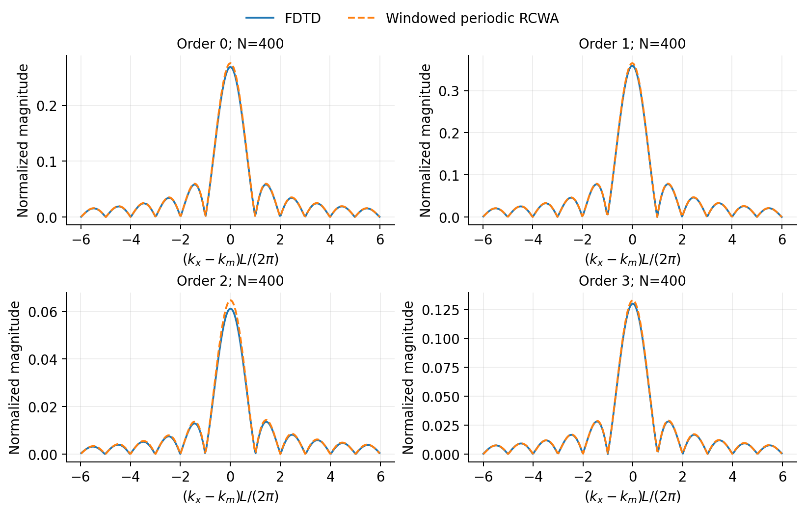
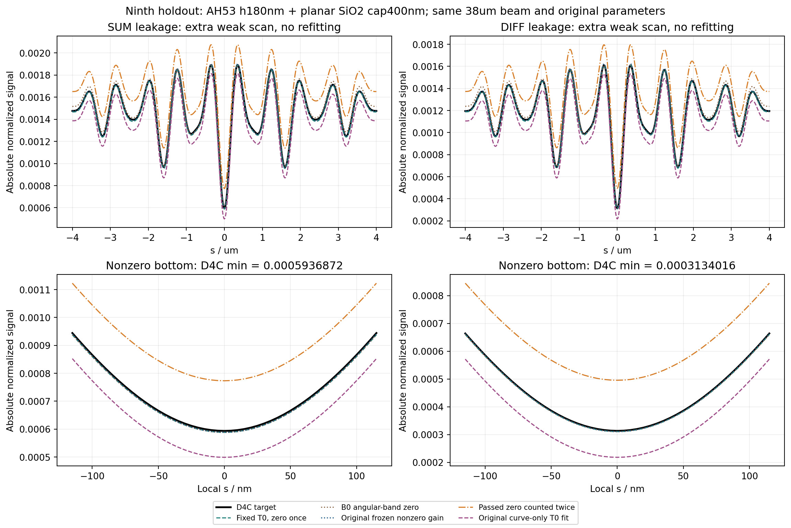

# 本聊天全部原文与程序包索引

归档日期：2026-11-06，Asia/Hong_Kong。

本目录保留从 2026-10-31 最初“532 nm、2 μm 周期 Si Mark”任务，到 2026-11-06 本次上传请求的本聊天原文。原文从本地完整会话记录直接提取，包含原先不在近期上下文中的早期回答；没有用摘要、回忆或新写的解释替代。

## Markdown 原文

- [全部原文：含进度消息，139 条](20261106_all_messages_verbatim.md)：28 条用户输入、17 条助手正式回答、88 条进度消息、6 条交互提问。
- [问答阅读版：不含进度消息，51 条](20261106_questions_and_answers_verbatim.md)：同样完整保留 28 条用户输入、17 条正式回答及 6 条交互提问，仅移除另有完整存档的进度消息。
- [逐条校验清单](20261106_conversation_provenance.json)：记录原文顺序、时间、消息 SHA-256、字节数及两份 Markdown 的校验值。
- [程序包核对记录](20261106_package_verification.md)：说明原程序及科学数据的上传状态。

数学公式、代码块、原有措辞、空格、换行、链接和后续更正均保留。用户交互回复的原始封装以代码块显示；助手交互提问按原文字与原选项顺序显示。编号、角色、时间、导航和此说明为归档新增排版。应用自动附带的环境及页面状态不属于用户对话，不收录；本地会话内部记录不随程序包发布。

**原回答若曾有不完整或被后续修正的解释，仍按当时原文保留。** 阅读结论时请结合后续问答，尤其区分：Mark 平面 38 μm 直径与挡板平面等效半径；真实挡板与零级模态相减；给定 K 权重与功率角度因子；拟合增益与独立确认的物理参数。

## 原程序、报告与数据

整个 D4C 程序包位于 [研究目录](../../README.md)，此前已随提交 `af07c4f30f889537616d3f6fd38235582350caf8` 发布。本次核对源目录原有 32 个 Python 脚本均已上传，与源文件逐字节一致；此次另增加原文导出脚本和本目录的归档文件。

- [零级分离、B 方法积分与标量零级读出函数](../../analysis/zero_order_models.py)：使用完整 `A_zero_ref_V`，分支 `scalar_zero_once`。
- [原始复场到角谱及零级源模板估计](../../analysis/prepare_spectra.py)。
- [多结构比较入口](../../analysis/run_analysis.py)：推荐固定参数分支 `weighted_nostop_mode2_scalar`。
- [非零级共享增益及独立读出对照](../../analysis/physical_component_scan.py)。
- [额外厚膜弱信号对照](../../analysis/analyze_extra_weak.py)。
- [报告 Markdown](../../report/REPORT_zh.md)、[报告 PDF](../../report/REPORT_zh.pdf)、[离线 HTML](../../report/REPORT_zh.html)。
- [真实 FDTD 原生工程、复场与完成记录](../../fdtd/cases/)、[RCWA 参考](../../rcwa/cases/)、[后处理角谱](../../outputs/spectra/)。
- [原始 2 μm 周期、长阵列角谱研究](../../../README.md)。
- [本次原文导出脚本](../export_conversation_verbatim.py)。

本次只归档原文并核对上传完整性，没有重新运行电磁仿真，没有改写或替换既有报告、脚本、仿真数据和讨论中的旧结论。

## 原文两张图片的可访问副本

原文中的本地绝对路径保持原样，以满足逐字归档。下面提供同一图片在仓库中的路径，便于直接查看；没有重新生成或修改图片。

### 400 周期 FDTD 与有限窗口 RCWA 角谱

对应 2026-10-31 关于“RCWA 一个离散级与 FDTD 一个角谱范围”的正式回答。

### 厚膜弱信号 Mark 的扫描曲线

对应 2026-11-05 完成额外厚膜弱信号工况后的正式回答。

