# 实验概览

532 nm；AH53 与 50% 占空比 Mark；9 周期；38 μm 光斑；SiO₂ 填平覆盖层 0/100/150/200 nm。

另加用户指定弱信号压力测试：AH53 台阶 180 nm、SiO₂ 覆盖 400 nm，使扫描纵坐标处于 0.00x 量级；它不参与原八组标定。

本报告按“先生成目标 → 独立求场 → 统一公式 → 控制误差 → 跨结构验证 → 回答应修改哪些参数”的顺序组织。所有扫描曲线保留绝对纵坐标；没有对每条曲线分别平移、归一化峰值或拟合独立增益。报告中的真实 FDTD、RCWA 和人为构造的公式控制分别注明来源。

# 先明确这次实际要完成的问题

用户的目标是：先使用已经给定的 D4C 算法，从多个 Mark 的 RCWA 复振幅得到目标扫描曲线；再使用有限 Mark、Gaussian 入射的真实 FDTD 角谱，代入 FDTD 的 B 方法公式；检查是否存在一套共用参数，使所有 Mark 的绝对扫描曲线都一致。特别要检查零级挡板与 $T_0P_0$ 是否被重复计算。

这里有三个不同的核验层次。第一，代码是否忠实计算指定公式；第二，两套电磁求解在相同连续物理条件下是否收敛；第三，给定的有限角谱算符是否等价于 D4C 的离散级次算符。第一层通过不等于后三者自动一致。本实验分别构造对照，不把一个拟合增益解释为所有差异的物理原因。

全流程只使用角谱积分。假设像面无限大，光在像面上的传播积分由 Parseval 关系直接消去；没有再算有限像面窗口，也没有给图像另选接收面积。

整体路线为：(1)匹配材料的 RCWA 生成 8 条 D4C 目标；(2)全 PML 的有限 9 周期 FDTD 保存复 E/H；(3)空域 FFT 与共同参考面；(4)比较级次权重、零级定义、挡板与标量尾项；(5)只用 0/100 nm 训练；(6)锁定参数预测 150/200 nm。

# 目前最重要的实际结果

完整数据集包含 8 组真实有限 Mark FDTD 对比和 8 组独立 RCWA 目标。补上正确 K/γ、零级按用户给定 T₀ 只计一次之后，固定参数结果见下表。随后只用两种 Mark 的无膜与 100 nm 膜厚拟合一个共用非零级 gain；不修改原 T₀，也不缩放零级项；150/200 nm 为留出数据。

| Mark | 膜厚 / nm | 固定参数 L2 / % | 共用非零 gain 后 L2 / % | s=0 基线差 / % | 用途 |
| --- | --- | --- | --- | --- | --- |
| ah53 | 000 | 0.6193779 | 0.3290776 | -0.4971699 | 训练 |
| ah53 | 100 | 1.143594 | 0.2020096 | -0.6587101 | 训练 |
| ah53 | 150 | 1.156871 | 0.2154359 | -1.47702 | 留出 |
| ah53 | 200 | 1.072375 | 0.1325591 | -0.4683984 | 留出 |
| binary50 | 000 | 0.7985368 | 0.168916 | -0.7127749 | 训练 |
| binary50 | 100 | 1.203828 | 0.2597468 | -0.1061875 | 训练 |
| binary50 | 150 | 1.229911 | 0.2861431 | 0.5680399 | 留出 |
| binary50 | 200 | 1.11335 | 0.1722154 | -0.477547 | 留出 |

这套更简洁、保护零级的参数是 g_ac=1.009561，T₀ 保持 0.000629728295091705，两种 leakage 保持原值。它只校正当前网格下约 1% 的非零级信号尺度，不给每个 Mark 独立常数。是否需要这约 1% 的修正，要结合后文更细网格控制判断，不能直接视为硬件标定。

**必须同时核查 s=0 的零级基线。** 整条曲线 L2 主要由较强的非零级调制决定；降低这个误差可能牺牲弱零级基线。所以上表不是“零级已经匹配”的充分证据。图 13 和专门的基线表保留固定 T₀、全曲线拟合 T₀ 的绝对基线，另外检查优先保护零级的拟合。

# 第一阶段：先用 RCWA 建立 D4C 目标

这一部分先建立要复现的目标，再讨论 FDTD 应怎样接入。目标曲线只使用各自结构的 RCWA 复振幅、用户给定的新 D4C 公式和同一组光学系数计算；不使用 FDTD 曲线倒推每个结构的零点、增益或衍射级权重。因此，后面可以把这些目标当作固定参考，检验同一套 FDTD 参数能否跨结构复现绝对基线与调制。

计算路线是：确定两个几何族及四种膜厚 → 从 FDTD 实际材料拟合中读取 532 nm 的复折射率 → 求解周期结构的各级复振幅并做截断控制 → 代入完整 D4C 公式 → 分别保存整条扫描曲线、非零级贡献和零级常数。额外的小角度 RCWA 用来估计高斯入射的角宽是否足以改变零级；它不代替有限九周期 FDTD。

## 相同结构与相同材料，是比较的起点

两个几何族的母周期都为 $p=16\,\mu\mathrm m$，Si 台阶高度均为 $h=300\,\mathrm{nm}$，台阶下方是相同的半无限 Si 衬底。

| 几何族 | 一个母周期内的 Si 凸台 | 母周期 Si 横向填充比例 | FDTD 有限结构 |
|---|---|---:|---|
| AH53 | 三条宽 $1.6\,\mu\mathrm m$ 的凸台，中心为 $-3.2,0,+3.2\,\mu\mathrm m$ | 30% | 沿横向排列九个母周期，总长 $144\,\mu\mathrm m$ |
| binary50 | 一条宽 $8\,\mu\mathrm m$ 的凸台，中心为 0 | 50% | 同样九个母周期 |

每个几何族有 cap = 0、100、150、200 nm 四种状态，共八个 Mark。**cap = 0 表示完全没有 SiO2，包括沟槽内也没有 SiO2；cap > 0 时是平坦化填充：SiO2 填满沟槽，并在 Si 凸台顶部再覆盖指定的 cap 厚度。** 因而 cap > 0 的最上表面高度为 $300+\mathrm{cap}$ nm。这里没有把“平坦化填充”替换成等厚包覆侧壁的共形膜。

图 1 上排给出两个几何族在 cap = 150 nm 时的一个母周期；蓝色是平坦化 SiO2，灰色是 Si。下排左图把 AH53 的九个母周期与高斯强度画在同一横坐标中，右表列出四种膜状态。RCWA 仍然计算无限周期母单元，有限九周期只由 FDTD 实现。

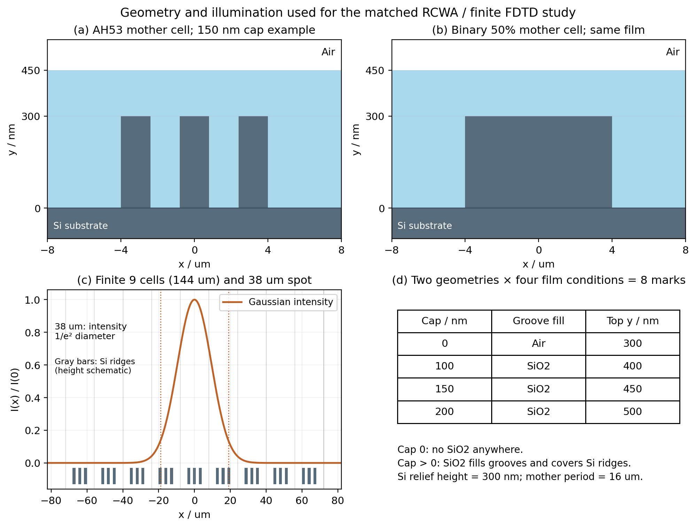

**图 1 的目的：** 让读者明确八组模型改变了什么、没有改变什么，并核对 38 µm 指的是高斯强度 $1/e^2$ 直径。上排横轴是 µm、纵轴是 nm，因此剖面显示不按相同纵横尺度。

**图 1 的结论：** 八组模型只改变几何族与平坦化膜厚。高斯场包络为 $\exp[-(x/w_0)^2]$，$w_0=19\,\mu\mathrm m$；强度是 $\exp[-2(x/w_0)^2]$。九周期边界 $x=\pm72\,\mu\mathrm m$ 处的理想入射强度仅为峰值的 $3.36\times10^{-13}$，说明直接照明在最外端已很弱。这个入射包络数值本身不能排除结构内横向传播或其他有限边缘作用，仍须由实际 FDTD 检验。

材料不能只按名称认为相同。Lumerical 的时域模型用色散拟合，在单一波长处也可能与数据库插值值略有差别。本次直接读取同一 FDTD 500–600 nm 拟合带在 532 nm 的值，并用于 RCWA：

| 材料 | RCWA 与 FDTD 统一使用的 $n+ik$ | 对应复介电常数 |
|---|---:|---:|
| Si (Silicon) - Palik | $4.1499719156+0.0480646349i$ | $17.2199566915+0.3989337698i$ |
| SiO2 (Glass) - Palik | $1.4601075923+0i$ | $2.1319141812+0i$ |

原始探测结果见 [fdtd/materials.json](../fdtd/materials.json)。没有用数据库 Si 的另一组 $k$ 值来制造两种求解器间的材料差异。

## RCWA 实际计算的量与参考面

采用二维 TE，电场为 $E_z$，沿条纹方向不变；时间相量为 $\exp(-i\omega t)$。$y$ 向上，入射沿 $-y$，反射沿 $+y$。横向原点是母单元的镜像中心。令

\[
G=\frac{2\pi}{p},\qquad k_{x,m}=q+mG,
\]

其中 $q$ 是入射横向波数。D4C 主参考取 $q=0$；532 nm 空气中可传播的离散反射级为 $m=-30,\ldots,+30$，而给定 D4C 公式明确使用正级 $m=1,\ldots,18$。

反射系数 $r_m$ 是电场复振幅比，分母为入射平面波外推到 $y=0$ 时的复振幅。输出 `r_total_y0` 也把反射传播场外推到 $y=0$。这个统一的相位平面即使穿过结构，也可以作为入射、出射平面波的数学参考；不表示在结构内部把总场当作空气传播场。另存的 `r_common_y085` 将反射传播场传到后处理使用的 $y=0.85\,\mu\mathrm m$，分母仍保留同一 $y=0$ 入射基准。

正常入射时，RCWA 的电场平方 $|r_m|^2$ 和第 $m$ 级反射功率效率的关系是

\[
\eta_m=\gamma_m|r_m|^2,\qquad
\gamma_m=\sqrt{1-(mG/k_0)^2}.
\]

用户随后明确确认 D4C 中 $T_m=|r_m|^2$。因此本部分把 $|r_m|^2$ 代入 $T_m$，并不先换成 $\eta_m$ 再乘一遍 $K_m$。对零级，$\gamma_0=1$，所以正常入射的 $I_0=|r_0|^2$ 数值也等于该级的功率比例。

### 从矩形介电函数到耦合场，而非局部二值反射近似

在台阶层，沟槽介质的介电常数记为 $\varepsilon_b$：裸 Si 取空气，带平坦化膜时取 SiO2。若 Si 凸台宽度为 $w$，各条中心为 $x_j$，介电函数的卷积矩阵可直接由解析傅里叶系数建立：

\[
[\boldsymbol\varepsilon]_{nm}
=\varepsilon_b\delta_{nm}
+(\varepsilon_{\mathrm{Si}}-\varepsilon_b)
\frac wp\operatorname{sinc}\left[(n-m)\frac wp\right]
\sum_j e^{-i(n-m)Gx_j}.
\]

这里 $\operatorname{sinc}(u)=\sin(\pi u)/(\pi u)$。对 TE 场，台阶层的耦合方程为

\[
\frac{d^2\mathbf E}{dy^2}
+k_0^2\left[\boldsymbol\varepsilon-
\operatorname{diag}\left(\frac{k_{x,m}^2}{k_0^2}\right)\right]\mathbf E=0.
\]

程序实际对这一矩阵求本征模，在空气、图形层、均匀 SiO2 cap 层和半无限 Si 衬底间匹配切向场。复平方根选择无源出射分支；倏逝模参与层内匹配，传播远场数组只对空气光锥内的级次给出功率。均匀 cap 与图形层通过输入导纳相接，cap 的相位厚度被保留。因此，膜厚导致的零级变化来自同一电磁边值问题中的相干干涉，没有逐个 Mark 调整反射率来拟合 FDTD。

完整求解器见 [te_planarized_rcwa.py](../rcwa/te_planarized_rcwa.py)。它扩展了保存在 `rcwa/provenance/original_si_rcwa.py` 的既有单图形层实现，新增均匀 cap；旧文件为原样副本。

### 检查了什么，检查不能替代什么

`solver_validation.json` 记录的 32 项检查全部通过，包括：均匀薄膜在三种 cap 和三种入射角的复 Fresnel 反射系数、无损薄膜界面通量、均匀膜不产生额外衍射级、与旧单层代码的逐复数回归，以及带 cap 结构的镜像关系和无源性。

Si 衬底吸收不能被误写成“所有未反射的光都在 300 nm 台阶内吸收”。程序保存的 $T_{\mathrm{interface}}$ 是进入 $y=0$ 以下半无限 Si 的功率；它最终在该衬底中吸收。有限层吸收是 $A_{\mathrm{finite}}=1-R-T_{\mathrm{interface}}$。这三项的代数和本身不是独立的收敛证明，所以还必须检查空间谐波截断的变化。

## 先固定新 D4C 公式，再计算整条目标曲线

本次采用用户 2026-11-05 提供并进一步澄清的公式：

\[
\boxed{
S_\chi(s)=2\sum_{m=1}^{18}K_m|r_m|^2
\left[1-\cos\left(2mGs+\phi_m\right)\right]
+\underbrace{\left[T_0+L_\chi(1-T_0)\right]|r_0|^2}_{Z_\chi}.
}
\]

它的求和前系数是 **2**，零级部分包含残余透过与被阻挡部分产生的 leakage。本次没有沿用旧项目的 $K_{0,\chi}I_0\ell$、求和前 $1/2$ 等历史写法。原输入公式保存在 [用户公式原文](../inputs/D4C_FDTD_user_formula_20261105.md)，后续确认见项目 `experiment.json`。

两种几何都镜像对称，因此使用实际求得的

\[
\phi_m=\arg(r_{+m}r_{-m}^*)\simeq0.
\]

八组最终结果中正负级的最大复数差不超过 $2.03\times10^{-14}$，$m=1\ldots18$ 的最大成对相位不超过 $2.22\times10^{-12}$ rad。因此本例的 $s=0$ 非零级干涉项消失，$S_\chi(0)=Z_\chi$；这给零级核算提供了一个无需通过整条曲线拟合的直接检查。

输入给出 $L_{\mathrm{SUM}}=0.00138$、$L_{\mathrm{DIFF}}=0.000431$。**DIFF 的实际干涉符号仍未由输入说明确定。** 本部分的 `S_DIFF_same_kernel` 仅把同一 $1-\cos$ 核中的 leakage 参数换成 $L_{\mathrm{DIFF}}$，不把这个控制支路宣称为已确定的互补光学端口。图 2 的主曲线统一显示 SUM leakage 约定。

### $T_0$ 是整个零级的有效残余比例，不能与其他泄漏符号混用

用户给定的近似式在程序中按原表达式求值：

\[
T_0=\operatorname{erfc}\left(
\frac{5\times10^{-4}\sqrt2}{0.778\times3.76\times10^{-4}}
\right)=0.000629728295091705.
\]

因此，对任意结构都固定使用

\[
\begin{aligned}
Z_{\mathrm{SUM}}&=0.002008859270044478\,I_0,\\
Z_{\mathrm{DIFF}}&=0.001060456882196521\,I_0.
\end{aligned}
\]

第一项 $T_0 I_0$ 是残余透过，第二项 $L_\chi(1-T_0)I_0$ 对应被挡部分的附加通道。两项各计一次。若 FDTD 通过实际角域挡板已经保留了零级尾部，又把整个 $T_0P_0$ 额外相加，就可能对同一残余透过重复计数；这应由后续分账对照判断，而不是靠改变每个 Mark 的常数项掩盖。

### $K_m$ 与插值的来源

用户已确认允许用相邻值线性插值补齐：$K_2=(K_1+K_3)/2=0.4947$，$K_4=(K_3+K_5)/2=0.49135$。主曲线因此是完整的 $m=1\ldots18$ 结果。其余系数按本次提供的新表保留，包括 $K_{13}=0.4478$、$K_{14}=0.4380$ 和原表中的非单调值；不平滑为一条拟合余弦曲线。

`K_table.csv` 区分用户校正、此前暂读和用户授权插值的来源。这些来源状态用于追溯，不阻止按用户已认可的表进行本次比较。为便于以后改变 $K_2$ 或 $K_4$，还保留

\[
S_\chi(s)=S_{\chi,\mathrm{known}}(s)+K_2C_2(s)+K_4C_4(s),
\quad C_m(s)=2|r_m|^2[1-\cos(2mGs+\phi_m)]
\]

的敏感度系数。它是附加的可追溯分解，主曲线并不缺这两个级次。更关键的是，$Z_\chi$ 与 $K_2,K_4$ 无关，零级记账的结论可以独立检查。

## 八条实际 D4C 目标曲线

图 2 不是只显示某个拟合系数。上排直接显示由八组实际 RCWA 结果生成的扫描曲线；下排放大 $s=0$ 附近，并把纵轴改为对数，使主峰图中几乎看不见的绝对基线能够分辨。四个颜色在上下排代表同一膜厚。

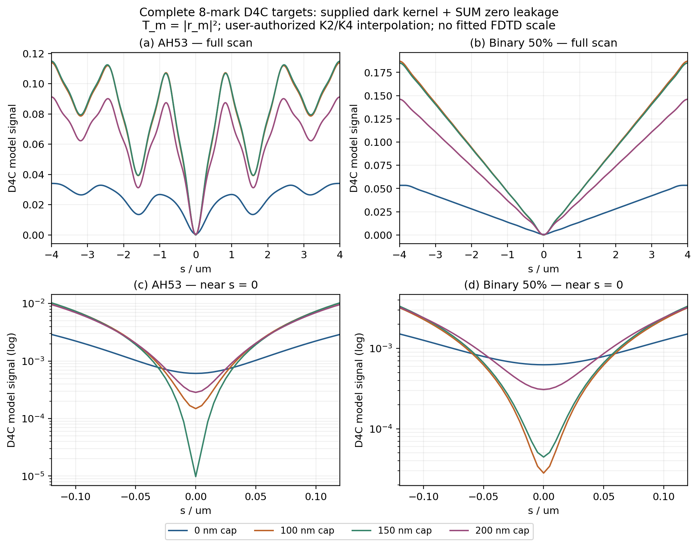

**图 2 的目的：** 同时展示“应复现的整条曲线”和“零级决定的绝对底值”，防止只把调制幅值或去均值形状对齐就认为已经复现 D4C。

**图 2 的结论：** 膜厚同时改变非零级响应和零级反射，但二者变化并不成同一比例。AH53 cap100 与 cap150 的峰值分别为 0.1138834 与 0.1148675，仅相差约 0.864%；零位移基线却从 $1.49044\times10^{-4}$ 降到 $9.78432\times10^{-6}$，降低 15.23 倍。这一对结构非常适合检验是否正确处理了零级：一个只匹配非零级调制的统一规则，不应自动获得两个正确底值。图中还没有加入或拟合 FDTD 输出，所以它证明的是目标本身的差异，不能单独证明任何 FDTD 零级方案已经通过验证。

下表是同一主目标的可核对数值。扫描点为 $[-4,4]\,\mu\mathrm m$、步长 0.005 µm，共 1601 点。周期均值与 DOM 使用前 1600 点，排除重复右端点；DOM 是该网格下的 $(S_{\max}-S_{\min})/(S_{\max}+S_{\min})$。

| Mark | $I_0=|r_0|^2$ | $S_{\mathrm{SUM}}(0)$ | 扫描最大值 | 周期均值 | SUM DOM |
|---|---:|---:|---:|---:|---:|
| AH53 cap0 | 0.30401214 | $6.1071761\times10^{-4}$ | 0.03407919 | 0.02407347 | 0.96478990 |
| AH53 cap100 | 0.07419345 | $1.4904420\times10^{-4}$ | 0.11388341 | 0.07929404 | 0.99738593 |
| AH53 cap150 | 0.00487058 | $9.7843193\times10^{-6}$ | 0.11486747 | 0.07995863 | 0.99982966 |
| AH53 cap200 | 0.14199373 | $2.8524542\times10^{-4}$ | 0.09122277 | 0.06414753 | 0.99376567 |
| binary50 cap0 | 0.31220684 | $6.2717960\times10^{-4}$ | 0.05345337 | 0.02798968 | 0.97680572 |
| binary50 cap100 | 0.01395860 | $2.8040858\times10^{-5}$ | 0.18700981 | 0.09414502 | 0.99970016 |
| binary50 cap150 | 0.02210836 | $4.4412590\times10^{-5}$ | 0.18509639 | 0.09336316 | 0.99952023 |
| binary50 cap200 | 0.15342628 | $3.0821181\times10^{-4}$ | 0.14606716 | 0.07391775 | 0.99578875 |

与上表相同结构顺序，DIFF leakage 控制的 $S_{\mathrm{DIFF}}(0)$ 分别为

\[
\begin{split}
&3.2239177\times10^{-4},\quad7.8678957\times10^{-5},\quad
5.1650451\times10^{-6},\quad1.5057823\times10^{-4},\\
&3.3108189\times10^{-4},\quad1.4802491\times10^{-5},\quad
2.3444966\times10^{-5},\quad1.6270196\times10^{-4}.
\end{split}
\]

每个 Mark 的零级常数只由自己的 RCWA $I_0$ 乘同一通道系数得到，没有逐结构加任意偏置。完整 Re/Im 系数保存在 `all_orders.csv`；整条曲线与分解保存在各 `cases/<variant>/d4c_targets.csv/.npz` 和聚合的 `d4c_all_targets.npz`。图 2 的独立宽表源数据为 `figures/02_d4c_targets.csv`。

## 这些参考值的截断精度到哪里

八个结构都实际计算了最大空间谐波序号 $N=160,240,320$，对应 321、481、641 个保留谐波，共 24 次正常入射求解。比较在相同的 $m=-18,\ldots,18$ 传播级上进行，而不是把不同长度数组直接相减。最终各结构都满足预先采用的工作停止条件：该复向量的相对 L2 变化小于 0.05%，去掉零级后的子向量变化小于 0.1%。

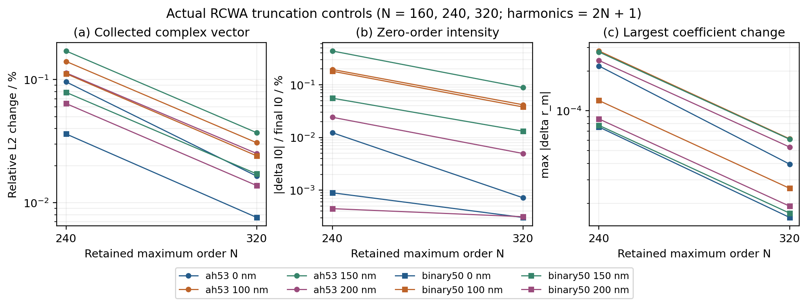

**图 3 的目的：** 区分参考解本身的数值变化与后续 FDTD 零级模型差异。面板 a 看完整收集复向量，b 专门看本任务最敏感的 $I_0$，c 看最大逐级绝对复数变化。横轴 N240 表示 N160→N240，N320 表示 N240→N320；圆点为 AH53，方点为 binary50，颜色对应膜厚。

**图 3 的结论：** 所有结构加密后的变化都下降。最后一级加密中，复向量相对 L2 最大为 0.037052%，最大逐级绝对复振幅变化为 $6.1367\times10^{-5}$。弱零级要单独看：AH53 cap150 的 $I_0$ 最后变化仍为 0.088317%，高于完整复向量的百分比。因而不能把“整体向量变化小”写成“每一个弱级都同等精确”，也不能据此宣称后面会达到任意多位数的完美匹配。

| Mark | N240→N320 完整复向量 L2 变化 | 非零级复向量 L2 变化 | $I_0$ 相对变化 |
|---|---:|---:|---:|
| AH53 cap0 | 0.016435% | 0.040684% | 0.000718% |
| AH53 cap100 | 0.030713% | 0.034109% | 0.041765% |
| AH53 cap150 | 0.037052% | 0.034876% | 0.088317% |
| AH53 cap200 | 0.025108% | 0.033718% | 0.004970% |
| binary50 cap0 | 0.007596% | 0.019300% | 0.000304% |
| binary50 cap100 | 0.024030% | 0.024313% | 0.037912% |
| binary50 cap150 | 0.017147% | 0.017716% | 0.013162% |
| binary50 cap200 | 0.013792% | 0.019303% | 0.000314% |

这是连续介电模型 RCWA 的截断控制；FDTD 的网格、色散、PML、有限结构和有限记录窗口误差要另外估计。即使两边后处理公式完全一致，独立电磁模型仍可能保留这几类数值差异。

## 38 µm 光斑的入射角宽，会不会本身造成明显零级偏差

正常入射的单次 RCWA 给出 $r_m(q=0)$。高斯光由一段入射角谱组成，更一般地应使用 $r_m(q)$。为量化忽略其角依赖的影响，本次在 $N=160$ 下计算了每结构 $q=0,25,\ldots,200\times10^3\,\mathrm{rad/m}$ 九个非负角点；负角通过镜像关系 $r_m(-q)=r_{-m}(q)$ 重建为 17 点。

对同一个几何和槽内介质，一个 q 下的图形层本征解可在三个 cap 厚度间复用，再分别接入均匀 cap。因此这里没有为获得相同图形层重复求本征值。这个控制的目的只是比较同一截断下 $r_m(q)$ 与冻结的 $r_m(0)$；不能把 N160 角控制和 N320 主解的差混称为单纯入射角效应。

高斯角谱功率权重使用

\[
W(q)\propto\gamma_{\mathrm{in}}(q)
\exp[-(qw_0)^2/2].
\]

下表的复向量误差是按此入射功率权重，对 $m=-18\ldots18$ 的 $r_m(q)-r_m(0)$ 做 L2 积分并归一化；零级平均使用 $\int W(q)|r_0(q)|^2dq/\int W(q)dq$。

| Mark | 冻结 q0 的加权复向量误差 | 加权零级强度相对 q0 的变化 |
|---|---:|---:|
| AH53 cap0 | 0.234597% | −0.015027% |
| AH53 cap100 | 0.598237% | +0.010981% |
| AH53 cap150 | 0.498921% | −0.145718% |
| AH53 cap200 | 0.251062% | −0.027771% |
| binary50 cap0 | 0.077428% | +0.003989% |
| binary50 cap100 | 0.419829% | +0.021106% |
| binary50 cap150 | 0.213377% | +0.022541% |
| binary50 cap200 | 0.175182% | −0.034714% |

在这个已计算范围内，整体复场的角依赖约为 0.08%–0.60%，零级角平均的相对变化最多约 0.146%。因此，对本次零级分账的初步控制，冻结 q0 是可量化的近似。它并不能自动证明所有弱衍射级或微小挡板尾部同样准确。

还有一个与本任务直接相关的范围限制：上述角控制只到 $|q|=200000\,\mathrm{rad/m}$。其外的理想高斯入射功率仅占总量的 $0.000144696$，但这已经是目标 $T_0=0.000629728$ 的约 23%。所以这些角点足以作为主体光束的敏感度诊断，**不应截断后直接用于精确计算零级挡板残余**。需要精确尾部时，应保留解析高斯全尾，或者扩展并收敛角域范围；本次输出没有把一份短角库冒充完整零级泄漏库。

## 与后续零级挡板实验直接相连的控制值

若只考虑一个孤立的理想 Gaussian 零级，场包络为 $\exp[-x^2/w_0^2]$，在角域用完全不透光的对称挡板阻挡 $|k|<a$，零级残余功率比例为

\[
F_0(a)=\operatorname{erfc}\left(\frac{aw_0}{\sqrt2}\right).
\]

由用户 $T_0$ 反推得到

\[
\boxed{a_{T_0}=179919.7989504\,\mathrm{rad/m}
=0.1799197989504\,\mathrm{rad}/\mu\mathrm m.}
\]

此前常用的 $a=0.2\,\mathrm{rad}/\mu\mathrm m$ 对应

\[
F_0(0.2\times10^6)=0.000144696087850240,
\]

约为用户 $T_0$ 的 23%，二者本来就不是同一个理想零级截断比例。另外，B 方法把零级最近邻角带划到 $G/2=0.19634954\,\mathrm{rad}/\mu\mathrm m$；旧 0.2 挡板略跨过这一边界，会同时接触一级角带的边缘。

这个控制值只来自孤立 Gaussian 零级。实际 FDTD 的中心谱可能包含有限结构散射、其他级的角谱尾部、实际照明偏差和数值背景。角域挡板会作用于占据该角域的全部场；“删除一整个零级模态”则是另一种操作。因此，后续必须分别保存挡前零级功率、挡后零级残余、被阻挡功率和附加 leakage，才能判断哪些项重复计数。单看最终扫描曲线的底值可以发现差异，却不能唯一识别差异来自哪一步。

## 本部分交付给 FDTD 对照的固定参考

本部分已经得到八条完整主目标及其可追溯的复系数，下一步不需要再为每个 Mark 拟合一条“想要的参考”。同一组 $K_m,T_0,L_\chi$ 已锁定；各 Mark 的差异只由自己的 RCWA 复振幅产生。AH53 cap100/cap150 是峰高接近而零级相差 15.23 倍的一对有力控制，裸 Si 与其他膜厚则进一步扩大零级和非零级组合的范围。

| 文件 | 作用 |
|---|---|
| `rcwa/cases/<variant>/reference.npz` | 最终复衍射系数、功率和参考面定义 |
| `rcwa/cases/<variant>/d4c_targets.npz` | 主数组 `S_SUM`、`S_DIFF_same_kernel`、`AC`、`zero_SUM`、`zero_DIFF`；另含 K2/K4 敏感度 |
| `rcwa/d4c_all_targets.npz` | 统一结构顺序的八条 1601 点主曲线 |
| `rcwa/d4c_target_metrics.csv` | 峰谷、周期均值、DOM 和零级底值 |
| `rcwa/all_orders.csv` | 各级 Re/Im、模、相位、$|r|^2$ 与效率 |
| `rcwa/convergence.csv` | 每次空间谐波加密的实际变化和耗时 |
| `rcwa/solver_validation.json` | 32 项解析/回归/物理检查 |
| `rcwa/gaussian_angle_controls.csv` | 同截断下高斯角依赖诊断 |
| `rcwa/gaussian_zero_stop_control.json` | $T_0$、等效挡板半宽、旧半宽的实际理想截断比例 |
| `figures/01_geometry.*`、`02_d4c_targets.*`、`03_rcwa_convergence.*` | 图片、SVG、对应 CSV/JSON 来源 |

这些目标的量纲是用户算法归一化后的模型信号。它们不是已标定探测器瓦数，也不是不加说明就等同于真实 D4C 硬件导出的读数。后续若统一参数能同时对齐主曲线、非零级调制和八个零级底值，应同时报告保留结构的误差与电磁数值误差；不能把目标反推的逐级或逐结构系数当作独立预测成功。

## 关于“图中最小值为什么看起来是 0”的核对

用户指出：无论 SUM 还是 DIFF，都有漏光项，曲线最小值不应为零。这个判断适用于本组结构。逐个核查原始绘图数组后，16 条目标的最小值全部严格大于零，且分别等于保存的零级残余加 leakage。原全量程线性图中，最小值比峰值小几个数量级，视觉上贴近 0；不能将这种显示效果解释为算法把漏光漏掉或把底值归零。

本次对称结构在 $s=0$ 有 $1-\cos=0$，因此只消掉非零级干涉项，零级尾项仍为

$$S_{\min,\chi}=S_\chi(0)=[T_0+L_\chi(1-T_0)]|r_0|^2>0.$$

为消除误读，下面专门给出谷底局部线性放大图：每个纵轴仍从 0 开始，蓝、橙点与 0 有明确间隔，并标出实际最小值。局部更密位移网格只是对同一 D4C 公式重新求值，没有增加或冒充新的 FDTD 求解。

**图的目的：** 直接核查漏光项是否保留，并让读者能从图上看见曲线没有到零。

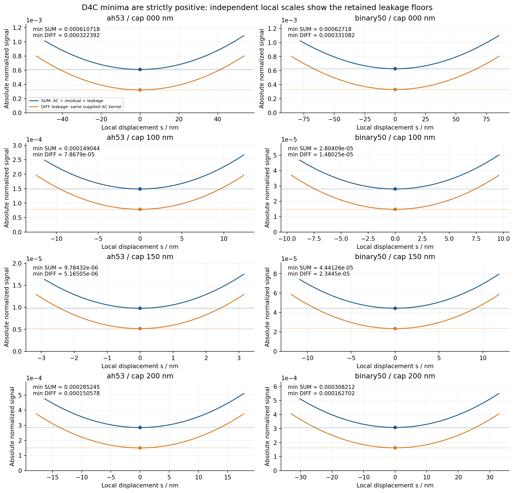

**读图与结论：** 蓝色为 SUM，橙色为文档同一干涉核下采用 DIFF leakage 的版本。每个面板使用适合该结构的局部位移与纵轴范围，横轴为 nm；两种最小值在点旁明确给出。最弱的 AH53 cap150 仍有 SUM=9.78432×10⁻⁶、DIFF=5.16505×10⁻⁶，均不是 0。不能把不同面板的自动纵轴范围当作相同信号尺度，完整绝对量级仍以目标总览和下表为准。

| 结构 | D4C SUM 最小值 | D4C DIFF leakage 最小值 |
| --- | --- | --- |
| ah53_cap000 | 0.0006107176 | 0.0003223918 |
| ah53_cap100 | 0.0001490442 | 7.867896e-05 |
| ah53_cap150 | 9.784319e-06 | 5.165045e-06 |
| ah53_cap200 | 0.0002852454 | 0.0001505782 |
| binary50_cap000 | 0.0006271796 | 0.0003310819 |
| binary50_cap100 | 2.804086e-05 | 1.480249e-05 |
| binary50_cap150 | 4.441259e-05 | 2.344497e-05 |
| binary50_cap200 | 0.0003082118 | 0.000162702 |

# 第二阶段：真正的有限 Mark FDTD 如何取得角谱

## 几何、入射、边界与材料的一致性

每个有限 Mark 沿 x 只有 9 个周期，周期 16 μm，总长度 144 μm；z 方向不变，计算二维 TE，电场分量为 $E_z$。Si 台阶高度 300 nm，下面是 Si 衬底。AH53 的一个周期内有三条宽 1.6 μm 的 Si 线，中心在 $-3.2,0,+3.2$ μm；二元 Mark 的 Si 线宽为 8 μm，即 50% 占空比。

无膜组是裸 Si/空气结构，不能把它误解为已经填平但 cap 厚度为零。其余三组使用 SiO₂ 填满沟槽，并在 Si 台阶最高点上方分别保留 100、150、200 nm；覆盖层顶面平坦。有限 Mark 外围也保留同一平坦覆盖层，从而不引入位于受照区域的额外膜边缘。

532 nm 入射 Gaussian 束的**强度 $1/e^2$ 直径为 38 μm**，因此场为 $E_i(x,0)\propto\exp(-x^2/w_0^2)$，$w_0=19$ μm，腰面 y=0。源在 y=1.35 μm，Mark 不移动；本次复现的是用户指定 B 方法的相位扫描，而非每个位移都移动几何重新求解。

x 计算宽度 192 μm，复场监视器宽 184 μm。y 范围为 −0.8 到 +2.5 μm，四个方向全部是 PML；没有横向周期边界。反射监视器位于 y=1.8、2.0 μm，位于源上方；空域入射参考在 y=0.8 μm。原始 six-component E/H、原生 LSF、模型 FSP、实际 mesh 与结束记录都保留。

生产网格为全域 dx=10 nm、dy=5 nm；对照网格为 dx=20 nm、dy=10 nm。统一网格延伸穿过空气、Si 与边界，避免旧算例中源区粗细网格交界带来的额外回波。材料使用本次 FDTD 的实际拟合复折射率，RCWA 使用完全相同数值；没有分别取材料数据库近似值。

Si 的实际拟合折射率为 4.149971915645845+0.048064634885764825i，SiO₂ 为 1.4601075923261915。裸 Si 平面解析反射率为 0.37416823853。网格及有限时间误差都保留在结果中，未乘以 Fresnel 修正因子。

## 从总复场到同一参考面的反射角谱

采用时间约定 $e^{-i\omega t}$ 与傅里叶变换

$$A(k;y)=\int E_z(x,y)e^{-ikx}\,dx.$$

电场单位 V/m，积分后 $A$ 的单位为 V。反射监视器在源上方，因此主提取使用同一源、同一网格的空结构计算，先作**复电场相减**，再传播到 yᵣ=0.85 μm：

$$A_r(k;y_r)=[A_{\mathrm{mark},R}(k)-A_{\mathrm{air},R}(k)]\exp[i\beta(k)(y_r-y_R)],\quad\beta(k)=\sqrt{k_0^2-k^2}.$$

该相减不是减平坦 Si 背景，也不是对强度相减。减掉平坦 Si 会改变总零级，直接破坏这里要比较的 $I_0$。独立 E/H 方向分离作为交叉核验；连续介质 E/H 导纳与离散 Yee 格的细小差异也单独报告。

空域参考的向下入射角谱使用

$$A_i^{\downarrow}(k)=\tfrac12\left[A_E(k)-\frac{Z_0}{\gamma(k)}A_H(k)\right],\qquad\gamma(k)=\sqrt{1-(k/k_0)^2}.$$

实际入射功率由它计算：

$$P_{\mathrm{in}}=\int\frac{\gamma(k)}{4\pi Z_0}|A_i^{\downarrow}(k)|^2\,dk.$$

同一 $P_{\mathrm{in}}$ 同时归一化非零级、零级残余与 leakage；没有把峰高当入射功率，也没有重复除以入射量。FFT 零填充只细化 dk，物理接收窗口仍为 184 μm。

## 数值误差先独立检查，避免用零级参数补偿

**图的目的：** 确定电磁离散误差是否已经足够小，并检查读出参数是否被用来掩盖网格误差。

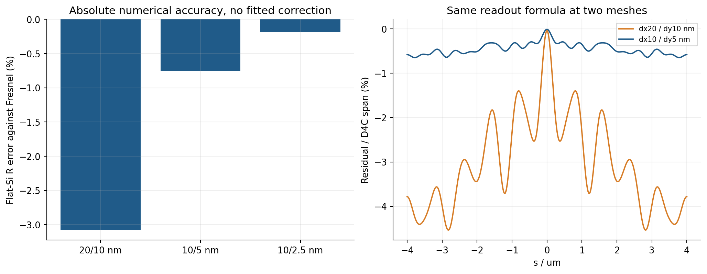

**读图与结论：** 左图统一扣除空域复场后，平坦 Si 反射率误差从 dx20/dy10 nm 的约 −3.072% 降至 dx10/dy5 nm 的约 −0.750%，再到 dx10/dy2.5 nm 的约 −0.187%。右图使用完全相同的读出公式，展示无膜 AH53 扫描残差随网格改变；因此这部分变化确实来自电磁求解，而非修改 T₀。该控制不能给所有复杂膜层结构提供同一个误差修正量。

生产仿真时间使用真实短时/长时对照决定。无膜 AH53 长时基准实际计算到约 428.93 fs，达到 9.04×10⁻¹⁰ auto-shutoff；100 fs 对照虽然全域剩余能量未达到该阈值，但 NA=0.6 的扫描曲线最大差仅约目标 span 的 0.0225%。总复场相对 L2 差约 0.0874%，非零角带复场相对差约 0.2338%。因此 100 fs 对这条扫描曲线已足够，但不能把它描述为所有弱衍射级复振幅都达到 0.1%。膜层结构另外做时间控制，具体真实记录见 solver manifest 与 comparison JSON。

## 150 nm 膜层的时间与更细垂直网格控制

**图的目的：** 判别约 1% 的曲线差是否应该由修改零级参数来解决。

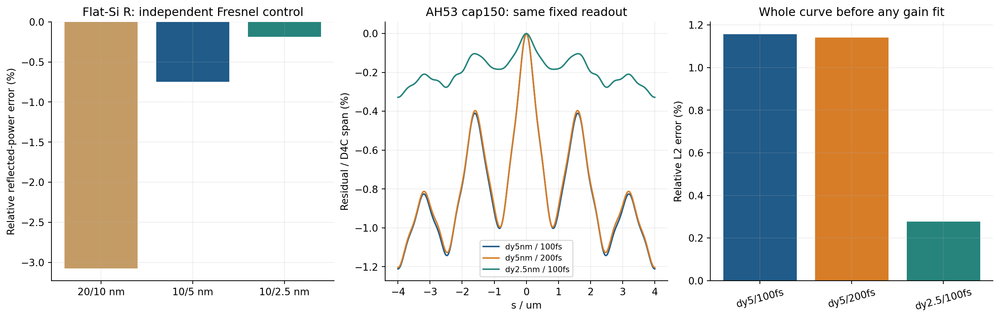

**读图与结论：** 三个计算使用同一 K/γ、同一原 T₀ 与 leakage、同一零级分解，没有增益拟合。把时间从 100 fs 延长到 200 fs，仅使最大曲线变化达到 D4C span 的约 0.0270%；把 dy 从 5 nm 降到 2.5 nm，整曲线相对 L2 则从 1.15687% 降到 0.276862%，s=0 基线偏差从 −1.47702% 降到 −0.309295%。这显著支持剩余误差主要来自数值离散，而不是需要把 T₀ 改成另一个很不同的数。

| 设置 | 实际时间 / fs | 整曲线相对 L2 / % | s0 基线相对差 / % |
| --- | --- | --- | --- |
| _fine | 99.99593 | 1.156871 | -1.47702 |
| _fine_t200 | 200.0066 | 1.140972 | -1.579782 |
| _finerY | 100.0031 | 0.2768623 | -0.3092946 |

更细控制使用实际 Custom PML128，标准控制为 Standard PML64；已读回的 kappa/sigma/alpha 及多项式参数相同，y 方向实际 PML 厚度保持 320 nm，x 方向变厚。因此这个控制不应冒称只有一个参数发生改变。空域与双反射监视器核验均保留；平坦 Si 的同步收敛和时间对照共同支持数值解释。初始未扣空场的通量审计给出 fine 约 −0.726%、finerY 约 −0.163%；本报告图 4/15 与扫描主流程统一使用空场复场相减，因小背景的相干项，数值略变为 −0.750%/−0.187%，两种定义都没有通过拟合修正。

# 第三阶段：将 FDTD 角谱写成与 D4C 可比较的扫描公式

## B 方法完整积分的对象

令 $G=2\pi/p$。最近级次映射记为 $M(k)$，边界是相邻 $mG$ 的中点。用户指定的 B 方法把同一角带的所有 k 点赋予相同扫描相位 $e^{-iM(k)Gs}$。它不同于真实刚性平移的连续相位 $e^{-iks}$。本次保持用户指定 B 方法，没有偷偷改成另一条扫描定义。

对 $k>0$ 的第 m 个角带 $B_m$，两支的相干积分应写为

$$S_{m}^{\mathrm{EM}}(s)=\int_{B_m,k>0}\frac{\gamma(k)}{4\pi Z_0P_{\mathrm{in}}}
\left|U(k)e^{-imGs}-U(-k)e^{+imGs}\right|^2dk.$$

可以压缩成两个特征：

$$D_m=\int_{B_m,k>0}w(k)[|U(k)|^2+|U(-k)|^2]dk,$$

$$C_m=\int_{B_m,k>0}w(k)U(k)U(-k)^*dk,\qquad w(k)=\frac{\gamma(k)}{4\pi Z_0P_{\mathrm{in}}},$$

$$S_m^{\mathrm{EM}}(s)=D_m-2\operatorname{Re}[C_m e^{-2imGs}].$$

这里 $D_m$ 与 $C_m$ 已归一化，单位都是相对于入射功率的无量纲数；$C_m$ 保留相位。只有 $+m/-m$ 等幅同相时，才可把它写成单一 $1-\cos$。本次八组结构镜面对称，RCWA 的配对相位基本为零，故相位正负约定不会影响这些目标曲线。不能由此推断任意非对称 Mark 都可省略相位。

## 为什么必须区分 Kₘ 和 γ(k)

对于非常窄的、彼此分离的第 m 级波包，电磁积分趋向

$$S_m^{\mathrm{EM}}\simeq2\gamma_m|r_m|^2[1-\cos(2mGs)],\qquad\gamma_m=\sqrt{1-(m\lambda/p)^2}.$$

用户已确认 D4C 用 $T_m=|r_m|^2$，其目标则是 $2K_m|r_m|^2[1-\cos(2mGs)]$。因此两套强度约定之间的固定转换为

$$\boxed{W_m=K_m/\gamma_m.}$$

最终非零级读出为 $\sum_{m=1}^{18}W_m[D_m-2\operatorname{Re}(C_m e^{-2imGs})]$。这不是逐级自由拟合，而是从两套既定公式的归一化推导的固定权重。连续通量中的 γ(k) 仍保留，不能删掉后又将它等同于 K。若用户选择的是功率效率而非 $|r|^2$，转换式会不同；本次这个歧义已经由用户明确消除。

低级 K 约为 0.49，而 γ 约为 1，因此若直接把纯电磁 B 曲线当 D4C 曲线，会出现近两倍的调制增益。仅拟合一个整体 0.5 可以暂时缓解，却不能严格代替随级次变化的已知 Kₘ，也可能把零级一并错误缩放。

# 第四阶段：零级究竟应如何处理

## 三种零级公式的含义

先定义同一个零级场在挡板之前与之后的功率：

$$P_{0,\mathrm{raw}}=\int_{\mathrm{pupil}}w(k)|A_0(k)|^2dk,\quad
P_{0,\mathrm{pass}}=\int_{\mathrm{pupil}}w(k)|T_{\mathrm{stop}}(k)A_0(k)|^2dk,$$

$$P_{0,\mathrm{block}}=P_{0,\mathrm{raw}}-P_{0,\mathrm{pass}},\qquad T_{0,\mathrm{eff}}=P_{0,\mathrm{pass}}/P_{0,\mathrm{raw}}.$$

此处 w 已含 $1/P_{\mathrm{in}}$，所以三个 P 在程序中是归一化功率。标量模型应只加一次

$$\boxed{Z_{\mathrm{scalar},\chi}=[T_0+L_\chi(1-T_0)]P_{0,\mathrm{raw}}.}$$

若真实角谱挡板已经负责计算残余，则应使用

$$\boxed{Z_{\mathrm{physical},\chi}=P_{0,\mathrm{pass}}+L_\chi P_{0,\mathrm{block}}.}$$

两者在 $T_{0,\mathrm{eff}}=T_0$ 时完全等价。相反，以下做法一般重复计入已经通过的那部分：

$$Z_{\mathrm{repeated},\chi}=P_{0,\mathrm{pass}}+[T_0+L_\chi(1-T_0)]P_{0,\mathrm{raw}}.$$

其与标量分支之差恰好为 $P_{0,\mathrm{pass}}$。若固定同一非零级曲线，它只会改变上下位置，不改变扫描 span 或形状。因此某一组的 RMSE 变小，并不能证明重复计数有物理依据：它可能抵消了另一项错误。

原始 D4C 主式明确把干涉求和限定为 $m>0$，再加标量零级。不能先把零级放进理想相干奇偶端口，再机械加一次同一个标量项。SUM/DIFF 在本报告中沿用用户文档给定同一干涉核，仅替换 leakage；这里没有虚构真实 DIFF 端口的光路正负号。

**仅仅在 U 中使用了挡板 mask，并不自动构成重复计数。** 如果干涉求和本来只含 $m>0$，或者对称零级在理想暗口相消，那么已经通过挡板的零级仍可能没有作为 DC 读出，此时标量尾项仍有其算法作用。重复与否必须沿实际读出逐项核对：同一份 $P_{0,\mathrm{pass}}$ 是否已经以功率加到结果中。不能仅因公式同时出现 $T_{\mathrm{stop}}$ 与 $T_0P_0$ 就断言错误。

## 原挡板半宽并不对应给定 T₀

理想 $w_0=19$ μm Gaussian 的零级角谱功率密度正比于 $\exp[-w_0^2k^2/2]$。不透光、中心对称挡板的半宽为 h 时，忽略极小的 γ 变化有

$$T_{0,\mathrm{eff}}\simeq\operatorname{erfc}(w_0h/\sqrt2).$$

用户公式给出 $T_0=0.000629728295091705$，对应 $h=0.1799197989504$ rad/μm；旧半宽 0.2 rad/μm 对应 $T_{0,\mathrm{eff}}=0.000144696087850240$，两者相差约 4.35 倍。挡板内部材料的局部功率透射率 τ 也不是整束光的 T₀：即使内部全不透光，外侧 Gaussian 尾部仍通过。

本次直接测量实际 FDTD 源分布的挡板残余，并保留 TE 通量因子。离散硬边界采用边界 cell 与挡板的交叠比例积分，避免 h 在相邻 dk 样点之间跳动所产生的一阶假变化；这是积分处理，不是把物理挡板改成软边。

**图的目的：** 看清物理零级波包、最近级次中央角带及挡板边界的关系。

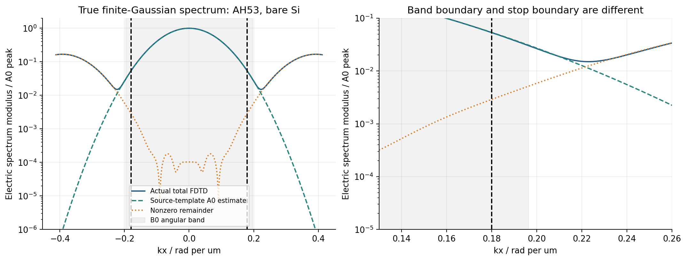

**读图与结论：** 左图来自无膜 AH53 的真实细网格复场。绿色是仅使用空域入射模板估计的零级，橙色为总场减去该估计的余场。右图放大 B0 边界与挡板边界：它们不在同一位置。零级的尾部跨出 B0，邻级的尾部也可进入 B0。因此把中央角带功率直接命名为完整 P₀，是一项近似。模板场是独立场分解估计，并不从 D4C 目标扫描曲线反推。

## 两种 P₀ 提取都要实际比较

第一种沿用旧 B0 定义，即 $|k|<G/2$ 中的总场功率。这种方法简单，但角带不是独立物理模式。

第二种使用空场实测 $A_i(q)$ 生成移位源模板 $A_i(k-mG)\exp[i\beta(k)y_r]$，联合拟合总复场。每级允许 q 的二阶响应项，从而估计完整 $A_0(k)$；再将 $A_0$ 从总场中减去后构造非零级干涉。这个分解没有输入 RCWA 的 $r_m$，也没有输入目标扫描曲线。保留常数响应与二阶响应的比较，以检查结果是否过分依赖模板自由度。

需要明确：总场 $A=A_0+A_n$ 是相干和，其总功率还含 $2\operatorname{Re}\int w A_0A_n^*dk$。程序记录这项交叉功率，不把分量功率可加当作恒等式。D4C 的标量零级读出本身定义了一个离散级次分离算符；源模板版本是在有限谱上尝试实现这个算符。它不是所有有限结构都存在唯一严格“物理零级”的证明。

对于只输入零级 Gaussian 的控制，最近角带 B 方法仍会把跨越 $G/2$ 的零级尾部赋予 m=1 的扫描相位，产生伪调制。无膜 AH53 对应量级约 $5.802\times10^{-5}$；显式提取并移除完整 $A_0$ 后，纯零级的扫描 range 为零。该反证说明不能仅因中央 B0 不随位移变化，就认为零级所有尾部都不随位移变化。

**图的目的：** 用完全相同的 RCWA 复振幅与有限源波包，单独检查 P₀ 定义，不夹带 FDTD 求解误差。

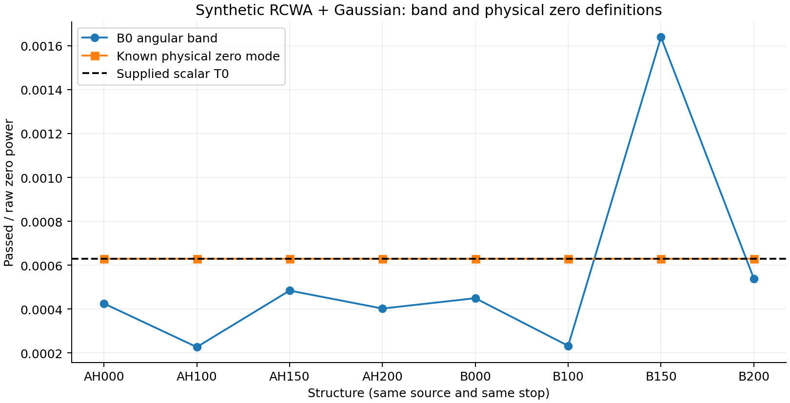

**读图与结论：** 这是 RCWA frozen-q0+Gaussian 合成控制，不能称作有限 Mark FDTD。实测空域源相同、挡板半宽也相同；已知完整 A₀ 时，各结构有效透过率一致。使用 B0 角带后，有效透过率约在 0.0002269 到 0.0016390 之间变化。改变 Mark 就需要不同 T₀ 的表象，可能源于角带混合，而不是仪器真的改变了挡板。

**图的目的：** 判断有限谱与离散级次的差异在不经过 FDTD 时是否已经存在。

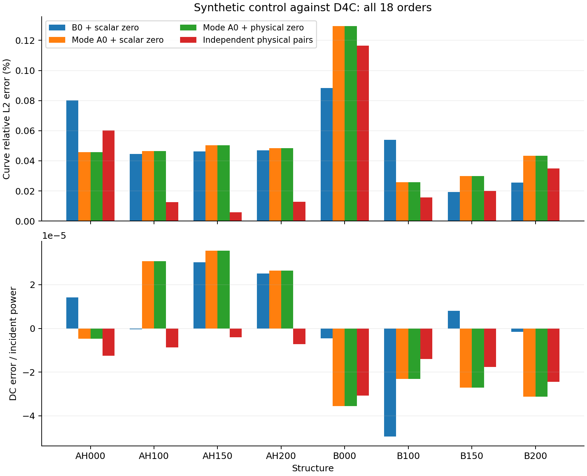

**读图与结论：** 每个柱都对照相同 D4C 目标，保留绝对纵坐标。逐物理级积分在 NA=0.6 下的曲线相对差约 0.00585%–0.11641%；第 18 级中心 sinθ=0.5985 靠近 NA=0.6，有限谱被额外截断。固定同一个 K₁₈、将接收扩大至能完整覆盖选中 18 级的 NA=0.65 后，逐级控制误差降至约 0.000153%–0.000237%。这证明边缘截断产生额外作用，但没有证明 K₁₈ 已经包含了哪种真实仪器损失。

# 第五阶段：八条真实 FDTD 曲线是否都能匹配

**图的目的：** 直接查看真实有限 Gaussian FDTD 和 D4C 的全扫描范围、峰值、基线及波形。

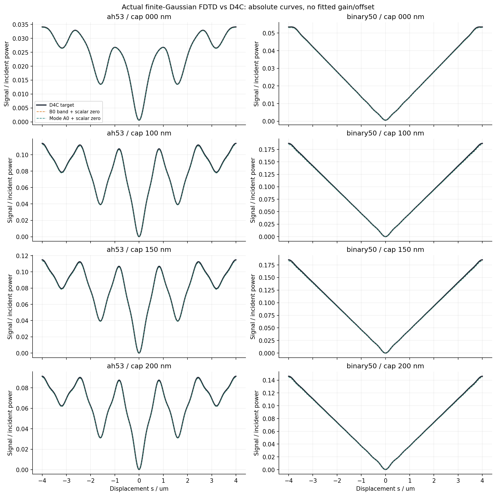

**读图与结论：** 黑线是先计算好的 D4C 目标；橙线保留 B0 零级定义，绿色采用独立源模板零级估计。所有固定参数相同，gain=1，没有逐曲线对齐。AH53 展现多级干涉细节，二元结构更接近低级主导；这两类不同频谱是检验普适参数的必要条件。线条看似重合时，需要图 8 的残差检查绝对误差。

**图的目的：** 把肉眼难分辨的差异展开，并检验重复零级项是否只改变曲线的整体上下位置。

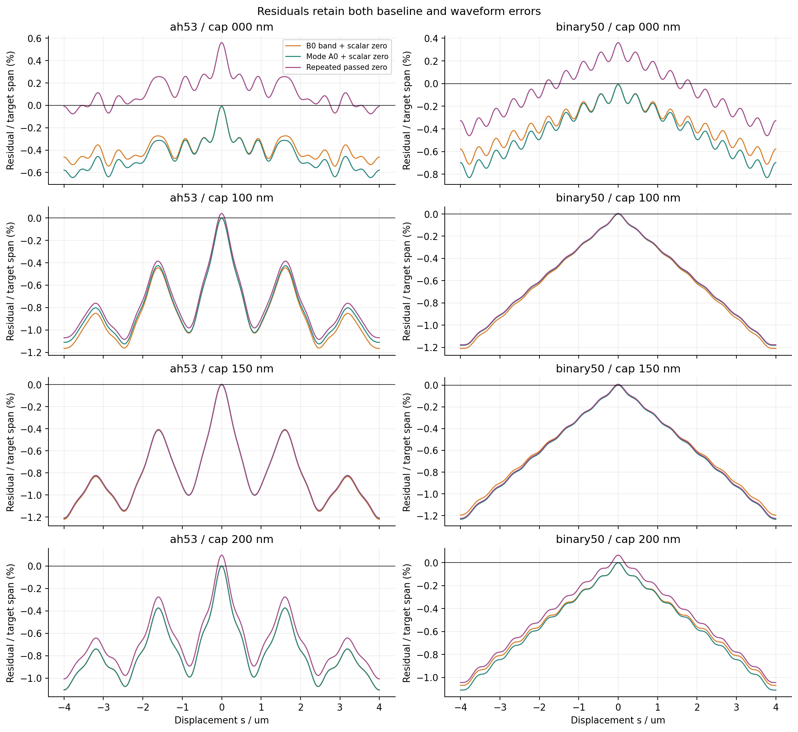

**读图与结论：** 纵轴除以每条目标的 span，横轴仍是相同位移。紫线比绿色多加一次已通过的零级功率，因此两者差是一条常量；这不会修复局部峰形或各扫描谐波。如果某一结构因此更接近，也应同时检查其他膜厚是否偏离。表中相对 L2 使用目标整曲线范数，图中 span 归一仅用于显示，不用于重新缩放预测。

**图的目的：** 把“补 K 权重”“改变 P₀ 定义”“实际挡板”“重复残余项”的效果逐项比较。

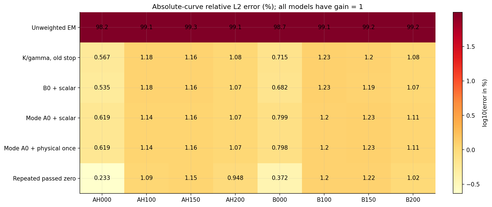

**读图与结论：** 每个格给出 gain=1 的绝对曲线相对 L2 百分数，颜色使用对数尺度。原纯电磁公式与 D4C 的权重不同，通常出现近倍数偏差；补上固定 K/γ 后，才有意义继续研究较小的零级基线差。不能在这些步骤之间随意加入独立每条曲线的纵向平移。

| 结构 | B0+标量 / % | 模式+标量 / % | 模式+实际挡板一次 / % | 模式+重复项 / % |
| --- | --- | --- | --- | --- |
| ah53_cap000 | 0.5345109 | 0.6193779 | 0.6188599 | 0.2327591 |
| ah53_cap100 | 1.183734 | 1.143594 | 1.143413 | 1.09102 |
| ah53_cap150 | 1.163489 | 1.156871 | 1.156914 | 1.153537 |
| ah53_cap200 | 1.073948 | 1.072375 | 1.072572 | 0.9482325 |
| binary50_cap000 | 0.6819438 | 0.7985368 | 0.7978886 | 0.371898 |
| binary50_cap100 | 1.233062 | 1.203828 | 1.203806 | 1.196841 |
| binary50_cap150 | 1.189827 | 1.229911 | 1.229886 | 1.218697 |
| binary50_cap200 | 1.070893 | 1.11335 | 1.113699 | 1.017133 |

**图的目的：** 检查剩余基线差究竟来自 P₀ 本身，还是挡板透过率。

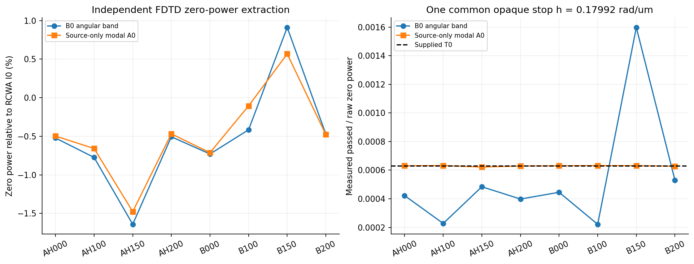

**读图与结论：** 左图直接比较 FDTD 提取 P₀ 与 RCWA 的 I₀；即使将 T₀ 设为同一个数，输入零级功率的差也会传递到基线。右图使用同一 h=0.17992 rad/μm，比较通过比例；B0 与源模板的差体现定义影响。膜层改变零级时，不能用固定一个绝对加法常数补偿所有结构，因为正确零级项应随 P₀ 缩放。

# 第六阶段：只改哪几个共用参数，能达到什么程度

## 标定与留出设计

训练集固定为 AH53 与 binary50 的无膜、100 nm 组；留出集固定为两种几何的 150、200 nm 组。拟合目标同时包含文档同干涉核下的 SUM/DIFF leakage 版本。每条曲线按其目标均方根做记录平衡，避免强信号曲线独占目标函数，但**预测曲线没有按记录独立缩放**。周期重复端点仅计算一次。

候选共同参数为一个总功率 gain、一个零级 $T_0$；$L_{\mathrm{SUM}}$、$L_{\mathrm{DIFF}}$ 固定。另一个物理挡板分支只搜索一个共同半宽 h，并只拟合一个共同 gain；其零级项使用实测 passed/blocked，不再拥有独立的标量 T₀。

为什么不同时拟合 T₀ 和两个 leakage？两通道只给出 $c_\chi=T_0+L_\chi(1-T_0)$ 两个组合。若把 T₀、两个 L 与 gain 全部放开，Jacobian 的秩不足；有界最小二乘返回一组数字也不代表这些参数已被辨识。实现会拒绝这种退化拟合。

| 零级定义 | 共同 gain | 共同 T₀ | 固定 LSUM | 固定 LDIFF |
| --- | --- | --- | --- | --- |
| B0 角带 | 1.011277 | 0.0002192807 | .00138 | .000431 |
| 源模板 A₀ | 1.011175 | 0.0003054133 | .00138 | .000431 |

**图的目的：** 直接检验只改 T₀ 是否足够，及允许共同 gain 后是否能跨结构改进。

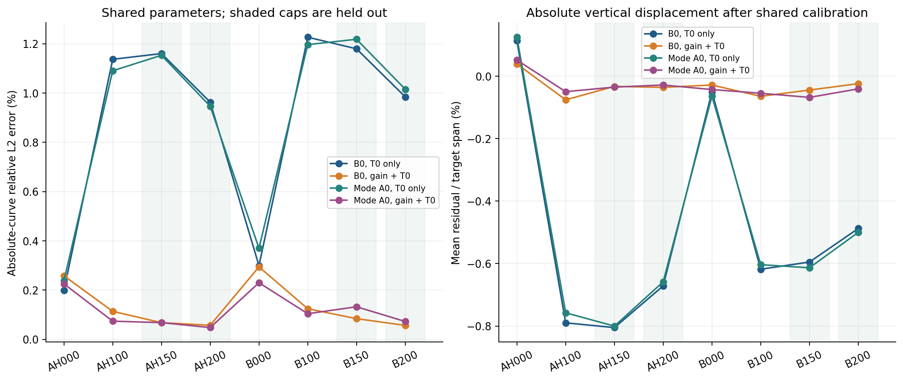

**读图与结论：** 背景有阴影的 150/200 nm 结构没有参与拟合。左图比较绝对曲线相对 L2，右图比较平均上下偏差；二者应一起看。T₀ 只提供与各自 P₀ 成比例的常数，无法改变扫描 span、各谐波比例及局部形状。gain 能改变全曲线尺度，但也无法任意修复各级响应的结构依赖。此图是检验“所有 Mark 共用参数”的主证据。

**图的目的：** 防止把整曲线 RMSE 降低误判成用户最关心的零级基线已正确。

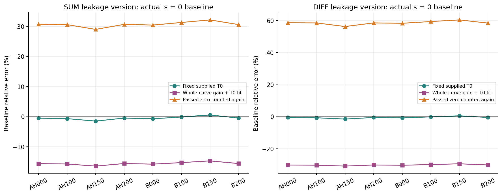

**读图与结论：** 绿色保持用户给定 T₀，紫色来自只按全曲线误差优化的共同 gain+T₀，橙色多加了一次已通过的零级。如果紫色基线误差变大，即使其全曲线 L2 更小，也不能把它推荐成正确的零级修正。SUM/DIFF 的泄漏底不同，相同 T₀ 调整造成的相对基线误差也不同；这正是需要保留两种 leakage 控制的原因。

| 结构 | 固定 T₀ 基线差 / % | 全曲线拟合基线差 SUM / % | 全曲线拟合基线差 DIFF / % |
| --- | --- | --- | --- |
| ah53_cap000 | -0.4971699 | -15.6063 | -30.14256 |
| ah53_cap100 | -0.6587101 | -15.74331 | -30.25597 |
| ah53_cap150 | -1.47702 | -16.43737 | -30.83047 |
| ah53_cap200 | -0.4683984 | -15.5819 | -30.12236 |
| binary50_cap000 | -0.7127749 | -15.78917 | -30.29392 |
| binary50_cap100 | -0.1061875 | -15.27469 | -29.86806 |
| binary50_cap150 | 0.5680399 | -14.70284 | -29.39471 |
| binary50_cap200 | -0.477547 | -15.58966 | -30.12878 |

这里的基线误差以该结构、该 leakage 版本的 D4C 零位移值为分母。它与周期平均误差不是同一个量：非零级本身也贡献周期平均值。因此用 T₀ 修补周期平均误差时，可能把真正的 s=0 零级底调错。

## 同时保护整曲线与零级基线的拟合，以及更简单的固定 T₀ 方案

为避免让强调制淹没零级底，另定义固定的拟合目标：每条训练曲线既提供一个按 RMS 归一化的整曲线残差块，也提供一个按目标零位移基线归一化的 s=0 残差块。两个块的权重均固定为 1，不为各 Mark 单独调权。拟合 $S=g_{\mathrm{ac}}N(s)+[T_0+L_\chi(1-T_0)]P_0$，leakage 不变，gain 只作用于整个非零级贡献，包含其自身的周期平均值。

该基线约束版本得到 g_ac=1.009528、T₀=0.0006359928。同时保留更简单的一参数版本：固定用户 T₀，只拟合 g_ac=1.009561。下表比较两者，不因增加一个参数就预设它更好。

| 结构 | 固定 T₀+g_ac L2 / % | 同式 s0 差 / % | 保护基线 joint L2 / % | 同式 s0 差 SUM / % | 同式 s0 差 DIFF / % |
| --- | --- | --- | --- | --- | --- |
| ah53_cap000 | 0.3290776 | -0.4971699 | 0.3324568 | -0.1873068 | 0.09037204 |
| ah53_cap100 | 0.2020096 | -0.6587101 | 0.2046611 | -0.3493501 | -0.07212208 |
| ah53_cap150 | 0.2154359 | -1.47702 | 0.2185557 | -1.170209 | -0.8952642 |
| ah53_cap200 | 0.1325591 | -0.4683984 | 0.1344677 | -0.1584457 | 0.1193134 |
| binary50_cap000 | 0.168916 | -0.7127749 | 0.1694052 | -0.4035832 | -0.126506 |
| binary50_cap100 | 0.2597468 | -0.1061875 | 0.2628858 | 0.2048931 | 0.4836631 |
| binary50_cap150 | 0.2861431 | 0.5680399 | 0.2892405 | 0.8812202 | 1.161872 |
| binary50_cap200 | 0.1722154 | -0.477547 | 0.1744007 | -0.1676228 | 0.1101108 |

固定 T₀ 版本的零位移偏差直接反映 FDTD 零级功率与 RCWA I₀ 的差，最大约 1.48%，不需要把 T₀ 大幅改到约 0.0003。基线约束拟合只对 T₀ 做小幅调整；其额外自由度并没有自动消除电磁与有限角谱模型的残差。

**图的目的：** 直接回答是否存在一套可跨八结构使用的少量参数，并避免以零级正确性换取较小的整曲线误差。

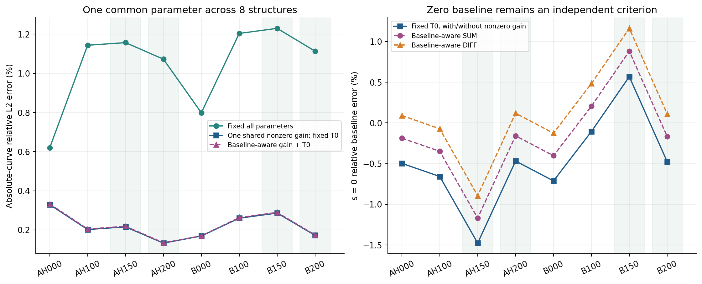

**读图与结论：** 蓝色采用同一个非零级功率 gain=1.009561，原 T₀ 与两种 leakage 全部保留。左图显示各结构相对曲线误差；阴影为未参与拟合的膜厚。右图单独显示 s=0 底值，固定 T₀ 时非零级 gain 不会改变这个底值。紫色/橙色是额外保护基线的联合拟合；它未全面优于更简单的固定 T₀ 方案，因此没有必要仅为增加参数而增加参数。

下面把“假如每个 Mark 只允许改 T₀，需取多少”作为诊断列出。这些数没有用于画预测曲线，也不是逐 Mark 标定方案。若它们不一致，说明只调一个共用 T₀ 不足以修复全部基线；若数值为负或很大，还说明其在补偿零级以外的误差。

| 结构 | B0 所需 T₀（gain=1） | 源模板所需 T₀（gain=1） |
| --- | --- | --- |
| ah53_cap000 | 0.001065555 | 0.001129878 |
| ah53_cap100 | 0.01340661 | 0.01297224 |
| ah53_cap150 | 0.1944186 | 0.1930326 |
| ah53_cap200 | 0.005518403 | 0.005509473 |
| binary50_cap000 | 0.001275775 | 0.001377259 |
| binary50_cap100 | 0.08445201 | 0.08230846 |
| binary50_cap150 | 0.05060928 | 0.0523848 |
| binary50_cap200 | 0.00585272 | 0.006048545 |

**图的目的：** 检验实际零级挡板能否由一个共用 h 对应到 D4C 的标量 T₀。

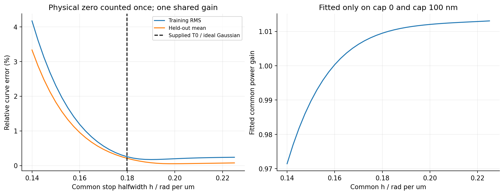

**读图与结论：** 该分支只计一次 passed 零级与 blocked leakage，gain 只在训练结构拟合。虚线为理想 Gaussian 对应给定 T₀ 的 h，而不是预先强行指定的最优点。曲线显示实际 FDTD 与 D4C 目标之间的总模型残差会影响最优 h；不能将通过最小化总曲线误差得到的 h 直接当作真实硬件尺寸。

搜索范围 h=0.14–0.225 rad/μm，步长 0.0025；以训练集为准的共同最优 h=0.19 rad/μm，gain=1.01117，训练相对曲线误差 RMS=0.1739569%。该结果与标量共用参数版本一起保留，未针对留出结构重新搜索。

# 用户新增的第九组：较厚膜层与 0.00x 弱扫描曲线

用户明确这里指扫描曲线的纵坐标，不是零级反射率或总反射率。为保持原八组结论可检验，第九组只作额外留出，所有既有参数冻结；它不参与选择新的 gain、T₀ 或 leakage。

先对原 AH53 的 300 nm 台阶只扫描 SiO₂ cap 厚度：300–1000 nm、间隔 10 nm，共 71 点；这组实际筛选的最小 SUM 扫描峰值约为 0.0881549（cap400），仍没有达到 0.00x。最小零级 I₀ 出现在另一膜厚，不能把它偷换成扫描曲线的峰值。

因此新增的结构同时采用 180 nm Si 台阶与 400 nm 平坦 SiO₂ cap，顶面位于 y=0.58 μm。周期、线宽、三线位置、9 周期范围、38 μm Gaussian、边界和监视器均与原 AH53 相同。这里明确改变了台阶高度，不能把低扫描幅值单独归因于膜层变厚；其完整输入保存在 inputs/extra_weak_mark.json。

**图的目的：** 展示为何需要新增一个不同台阶高度的测试结构，以及低扫描信号与低总反射率的差别。

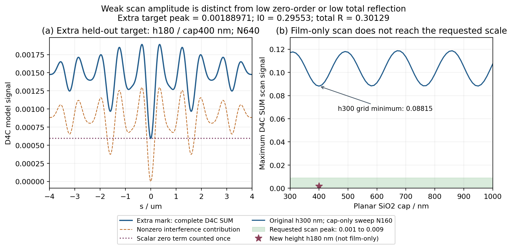

**读图与结论：** 左图把 D4C 总扫描、非零级贡献与零级常数分开；右图的厚膜扫描始终保持原 300 nm 台阶，星号才是新增 180 nm 台阶。厚膜网格最低峰仍约 0.0882，新结构峰约 0.0018897；新结构总反射率却约 0.3013。因此不能用低扫描峰值冒充低总反射率，也不能把新高度的星号当作同一条单参数厚度曲线的一点。

| 目标量 | SUM | DIFF leakage 版本 |
| --- | --- | --- |
| 实际扫描最小值 | 0.0005936872 | 0.0003134016 |
| 实际扫描最大值 | 0.001889706 | 0.001609421 |
| 扫描 span | 0.001296019 | 0.001296019 |

**图的目的：** 在扫描本身只有 0.00x、零级底占比更高时，检验共同参数及零级会计是否仍成立。

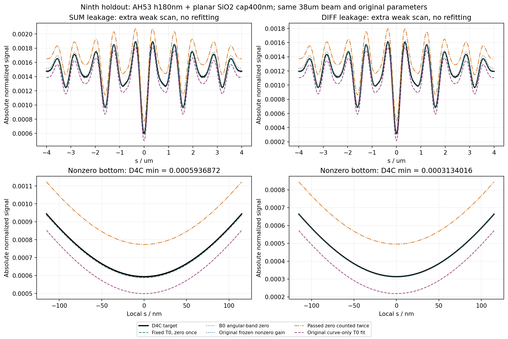

**读图与结论：** 黑线是新结构独立 RCWA 的 D4C 目标，不是从 FDTD 拟合所得。绿色保留原 T₀ 并只计一次零级，蓝色使用在原四个训练结构得到的非零级 gain；橙色故意重复已通过零级，紫色使用原全曲线最优化但错误牺牲零级底的有效 T₀。下排单独放大非零谷底。这个弱信号例能把在强曲线上被相对范数淹没的绝对 DC 错误明显显示出来。

| 模型（参数全部来自原训练） | SUM L2 / % | SUM 基线差 / % | DIFF L2 / % | DIFF 基线差 / % |
| --- | --- | --- | --- | --- |
| 固定原 T₀、零级一次 | 0.5851052 | -0.8831192 | 0.5387178 | -0.8831191 |
| 原 B0 角带定义、标量一次 | 1.641875 | -0.9050736 | 2.167348 | -0.9050736 |
| 实际挡板、零级一次 | 0.5598179 | -0.8132814 | 0.5104381 | -0.7506974 |
| 原共同非零 gain、原 T₀ | 0.3397453 | -0.8831192 | 0.47873 | -0.8831191 |
| 原保护基线 joint 参数 | 0.3693058 | -0.574458 | 0.5672336 | -0.2978562 |
| 故意重复 passed 零级 | 11.90222 | 30.25754 | 14.81571 | 58.10767 |
| 原全曲线最小化 gain+T₀ | 5.898485 | -15.93365 | 7.300464 | -30.41352 |

这些误差独立列出，没有把新增第九组重新混入原训练集，使其看起来又被“统一调准”。弱信号主结果采用经过额外时间核验的 200 fs；100 fs 的未收敛结果只作为失败时间控制保留，不能用它来宣称共享参数失效或计算已收敛模型误差。

可以用 span 直接判断“一个 gain 加零级常数能否精确拟合当前所有曲线”。T₀ 与 leakage 只改常数，不改 span；若只允许一个共同非零级 gain，那么每条曲线要求的 gain 都必须等于目标 span/FDTD span。下面只是代数诊断，不拿各自 gain 来生成预测：

| 结构 | 固定原参数 FDTD span / 目标 span | 单独匹配 span 所需 gain |
| --- | --- | --- |
| ah53_cap000 | 0.9943013 | 1.005731 |
| ah53_cap100 | 0.9889006 | 1.011224 |
| ah53_cap150 | 0.9878888 | 1.01226 |
| ah53_cap200 | 0.9889662 | 1.011157 |
| binary50_cap000 | 0.9925809 | 1.007475 |
| binary50_cap100 | 0.9881872 | 1.011954 |
| binary50_cap150 | 0.9876576 | 1.012497 |
| binary50_cap200 | 0.9889063 | 1.011218 |
| ah53_h180_cap400 | 1.003097 | 0.9969124 |

如果旧结构需要大于 1 的 gain，而新弱结构需要小于 1，就不存在一个共同常数 gain 能把这批当前网格曲线的 span 同时精确对齐；再调零级常数也改变不了这个矛盾。这个判断只针对已声明的读出参数族与当前数据，不将有限的参数测试夸大为所有可能光学模型的不可能性结论。

**图的目的：** 用弱曲线自己的小 span 评价时间误差，避免沿用强信号的宽松绝对容差。

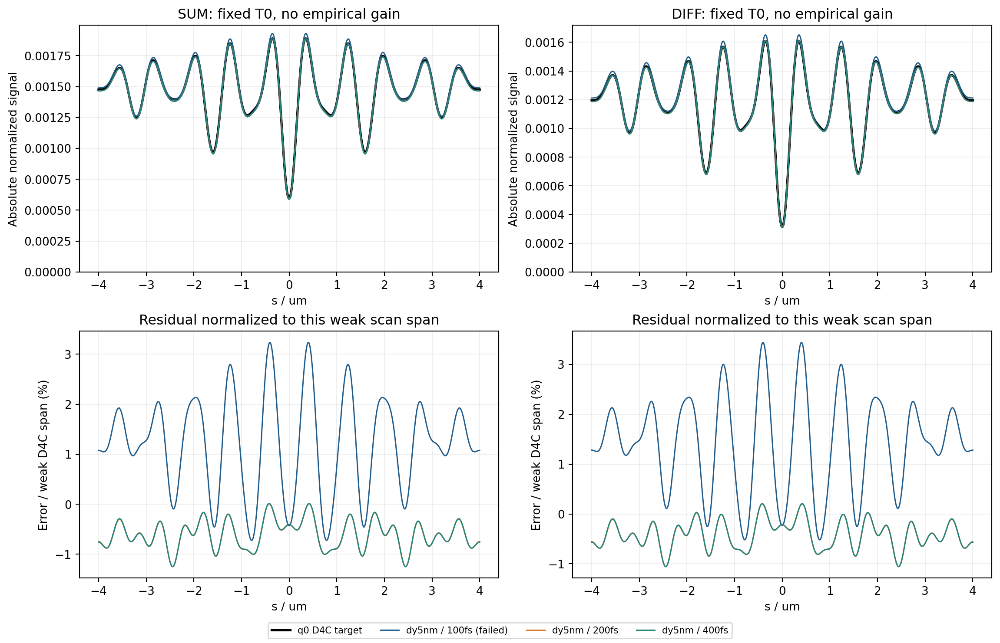

**读图与结论：** 所有曲线保持原 T₀、leakage 和固定 K/γ，不使用经验 gain。左上、右上分别为两种 leakage 的绝对曲线；下排使用第九组自己的 D4C span 归一化残差。100 fs 对此例未收敛，不能将其偏差解释为共享参数失效；主弱信号对比采用 200 fs，并与独立 400 fs 计算核验。

| 网格 / 时间设置 | SUM L2 / % | SUM s0 差 / % | DIFF L2 / % | DIFF s0 差 / % |
| --- | --- | --- | --- | --- |
| _fine | 1.342122 | -0.9418744 | 1.824341 | -0.9418744 |
| _fine_t200 | 0.5851052 | -0.8831192 | 0.5387178 | -0.8831191 |
| _fine_t400 | 0.5820495 | -0.8840723 | 0.5352938 | -0.8840723 |

100 fs/200 fs 的最大差以这条弱曲线自身 span 为分母：SUM=3.233281%, DIFF=3.245988%。所有完成记录和复场保留，不能将强信号时间控制的百分数直接套用到这里。

用于验证主 200 fs 结果的 200 fs/400 fs 最大差为：SUM=0.01063297%, DIFF=0.01083911%。这项比较与100fs失败记录分开报告。

## 弱衍射参考须单独控制截断

| 最大级次 N | SUM 扫描峰 | $I_0$ | 总 R | 最后完整复向量变化 | 最后非零级复向量变化 |
|---:|---:|---:|---:|---:|---:|
| 160 | 0.0018759178 | 0.295659874 | 0.301340650 | — | — |
| 240 | 0.0018869627 | 0.295559794 | 0.301299134 | 0.063743% | 0.770510% |
| 320 | 0.0018887373 | 0.295543231 | 0.301291995 | 0.011480% | 0.139425% |
| 480 | 0.0018895276 | 0.295536046 | 0.301288890 | 0.005297% | 0.064558% |
| 640 | 0.0018897063 | 0.295534480 | 0.301288215 | 0.001210% | 0.014789% |

弱衍射时，总反射复向量可被较强零级主导，因此同时报告非零级子向量的变化，不能只看包含零级的整体百分比。各档真实 RCWA 数据、完整目标数组及与原八组相同的字段位于 `rcwa/cases/ah53_h180_cap400/`。`inputs/extra_weak_mark.json` 独立记录第九结构，原 `experiment.json` 的八个 variants 与原训练/留出划分保持不变。


## 弱衍射是否使有限入射角宽产生数个百分点差异

这一项使用**同一 N160 截断**，把 $q=0$ 系数与 $q=-250,\ldots,250\times10^3\,\mathrm{rad/m}$、间隔 $25\times10^3\,\mathrm{rad/m}$ 的 21 点 Gaussian 入射角平均比较。主参考的 N640 正入射目标保持不变；这里没有把 N640 与 N160 的差混称角宽效应，也没有在 $K_m$ 外重新施加一个 NA 截断。

各级强度平均为 $\langle T_m\rangle=\int W(q)|r_m(q)|^2dq/\int W(q)dq$，$W=\gamma_{\mathrm{in}}(q)\exp[-(qw_0)^2/2]$。镜像对称结构满足 $r_{-m}(-q)=r_m(q)$；对于对称 Gaussian 包络，正负出射包的 parity 配对交叉项因而可用这个强度矩作诊断。该控制没有用角平均后的结果重新拟合或替换 D4C 主目标。

| m | 同 N160 的 $T_m(q=0)$ | Gaussian 平均 $\langle T_m\rangle$ | 相对变化 |
|---:|---:|---:|---:|
| 1 | 5.313076e-05 | 5.337273e-05 | +0.4554% |
| 2 | 1.127447e-05 | 1.093552e-05 | -3.0064% |
| 3 | 6.393982e-06 | 6.338821e-06 | -0.8627% |
| 4 | 2.914601e-05 | 2.890451e-05 | -0.8286% |
| 5 | 7.953572e-05 | 7.968225e-05 | +0.1842% |
| 6 | 2.245916e-05 | 2.26161e-05 | +0.6988% |
| 7 | 1.358188e-05 | 1.370176e-05 | +0.8827% |
| 8 | 1.000321e-05 | 9.894016e-06 | -1.0916% |
| 9 | 0.000100696 | 0.0001014418 | +0.7407% |
| 10 | 0.0002954593 | 0.0002965551 | +0.3709% |
| 11 | 7.105941e-05 | 7.152875e-05 | +0.6605% |
| 12 | 9.610656e-06 | 9.281717e-06 | -3.4226% |
| 13 | 6.805637e-06 | 6.746613e-06 | -0.8673% |
| 14 | 3.343093e-05 | 3.31041e-05 | -0.9776% |
| 15 | 0.0001184514 | 0.0001185403 | +0.0750% |
| 16 | 3.988166e-05 | 4.003849e-05 | +0.3932% |
| 17 | 1.99723e-05 | 2.016104e-05 | +0.9450% |
| 18 | 1.738704e-05 | 1.712972e-05 | -1.4800% |

弱级 m2、m12 分别有约 −3.01%、−3.42% 的相对变化，不能概括为“所有级变化都小于 1%”。但按固定 $K_m$ 和扫描核相加后，整条非零级 AC 的 L2 变化只有 **0.222654%**，去均值形状变化为 **0.447202%**，peak/span 增加 **0.260662%**；零级平均相对 q0 增加 **0.016357%**。角域外遗漏的理想入射功率约 $2.03\times10^{-6}$。

因此，这份已完成的角敏感度控制支持“小角度依赖对弱级有可见相对影响”，但不能单独支持把数个百分点的曲线形状差异全部归因于角宽。尤其应先按弱信号自己的扫描范围核对时间收敛；100 fs 的初步差异包含已发现的时间未收敛，不能直接当作参数泛化失效。FDTD 网格、实际角域光路和本例近似 B 重建仍需分别核对；不能为了让曲线对齐而事后换一个角平均目标。全部逐级系数、两条同 N160 曲线和限定条件见 `rcwa/extra_gaussian_angle_diagnostic.json` 及新结构目录的 `Gaussian_angle_diagnostic_*`。

# 附加对照：对完整物理波包逐级积分

本附录补充一个独立对照：在零级的完整角谱已经单独估计之后，还要检查其他衍射级的波包是否被最近邻角带分界混合。它的目的不是预先证明某种处理一定更接近 D4C，而是把“零级定义”“非零级分带”和“源投影残差”三个因素分开。所有更好或更差的结果均保留；一种方法在单个结构上误差更小，不足以证明它在其他结构上也成立。

整个后处理直接在角谱上积分，对应无穷大像面接收，不需要另外计算像面上的二维或一维积分。需要特别说明：无穷大像面并不会自动使有限波包的不同级次严格正交。有限波包在同一角坐标上有重叠时，相干交叉项仍然可能存在。

## 这项对照使用什么输入

输入来自已经独立完成的真实 FDTD 仿真，包括反射复角谱、空域仿真得到的实际入射角谱、实际入射功率和源模板联合投影系数。场分解不读取 RCWA 的逐级复振幅。保存的 D4C 扫描目标只在完成重构以后，用于计算误差和估计少量跨结构共享的读出参数。

电场角谱采用

$$
A(k)=\int E(x)e^{-ikx}\,dx.
$$

若原始电场单位为 V/m，沿横向坐标积分后的角谱单位为 V。实际入射功率 $P_{\mathrm{in}}$ 的单位为 W/m；本模型在不变方向按单位长度计功率。空气中的 TE 功率内积为

$$
\langle a,b\rangle_D
=\int_D a(k)b^*(k)
\frac{\gamma(k)}{4\pi Z_0P_{\mathrm{in}}}\,dk,
\qquad
\gamma(k)=\sqrt{1-(k/k_0)^2}.
$$

离散计算中的梯形权重已经包含 $\Delta k$。不能再额外乘一次 $\Delta k$，也不能把已经除以 $P_{\mathrm{in}}$ 的量再次归一化。$\gamma(k)$ 是电磁通量因子；$K_m$ 是用户给定的仪器级次权重，两者分别保留。

## 如何从入射源模板重构各个波包

设空域 FDTD 得到并传播到 $y=0$ 的入射角谱为 $B(q)$，母周期倒格矢为 $G=2\pi/p$。在第 $m$ 级附近，入射横向波数与出射横向波数的关系写为

$$
q=k-mG.
$$

本次联合源投影以二次多项式表示有限角度内的复响应：

$$
\widehat A_m(k)
=B(k-mG)\,\mathbf 1_{|k-mG|<G}
\exp[i\beta(k)y_{\mathrm{ref}}]
\sum_{d=0}^{2}c_{m,d}
\left(\frac{k-mG}{q_{\mathrm{scale}}}\right)^d,
$$

其中

$$
\beta(k)=\sqrt{k_0^2-k^2},\qquad
q_{\mathrm{scale}}=1/(19\,\mu{\mathrm{m}}),\qquad
y_{\mathrm{ref}}=0.85\,\mu{\mathrm{m}}.
$$

系数 $c_{m,d}$ 来自对真实 FDTD 复场的联合最小二乘投影。拟合的输入是复场和实测源模板，而不是 D4C 扫描曲线。每个结构的电磁场当然不同，因此它们的场投影系数也不同；这些系数是场分解的输出，不是允许逐个结构自由调节扫描曲线基线的参数。

重构总场为 $\widehat A=\sum_m\widehat A_m$，重构残差为

$$
R(k)=A_{\mathrm{FDTD}}(k)-\widehat A(k).
$$

完整波包扫描分支使用重构场，因而没有包含 $R$。为防止将丢弃残差造成的变化误认为“物理分级改善”，后面同时计算真实总场和重构总场的最近邻角带扫描。投影审计分别给出总场和非零场的相对残差；强零级可能掩盖弱非零级误差，不能只报一个总场残差。

这里的“物理波包”是便于区分最近邻角带的名称。二次源投影仍然是近似场表示，并不声称已经唯一、精确地识别出有限 Maxwell 散射问题中的每个衍射模式。投影阶数、入射角范围和残差必须同时检查。

## 对每个完整波包施加 B 方法的位移相位

对第 $m$ 个重构波包，按本次 B 方法规定，整束波包统一乘

$$
\widehat A_m(k;s)=\widehat A_m(k)e^{-imGs}.
$$

该相位对波包内每个 $k$ 相同。它与把整个场刚性平移所产生的 $e^{-iks}$ 不同，本附录没有改用整体平移。

对一对正负级，把负级通过 $k\mapsto-k$ 映射到相同检测角坐标。定义

$$
P_m^+=\int_{k>0}w(k)|\widehat A_{+m}(k)|^2\,dk,
\qquad
P_m^-=\int_{k>0}w(k)|\widehat A_{-m}(-k)|^2\,dk,
$$

$$
C_m=\int_{k>0}w(k)
\widehat A_{+m}(k)\widehat A_{-m}^*(-k)\,dk,
$$

其中 $w(k)=\gamma(k)/(4\pi Z_0P_{\mathrm{in}})$，并包含所选接收 NA。于是该级对的扫描贡献为

$$
N_m(s)
=\frac{K_m}{\gamma_m}
\left[P_m^++P_m^-
-2\operatorname{Re}\{C_me^{-2imGs}\}\right],
\qquad
\gamma_m=\sqrt{1-(m\lambda/p)^2}.
$$

用户已确认 $T_m=|r_m|^2$。对窄波包，单边电磁功率近似为 $\gamma_m|r_m|^2$，因此需要在电磁通量积分之外再使用 $K_m/\gamma_m$，才能与 D4C 的 $K_m|r_m|^2$ 约定对应。这不是逐级拟合：全部结构采用相同的用户给定 $K_m$，其中 $K_2$、$K_4$ 使用用户授权的插值。

在等幅、镜面对称和窄波包极限下，$P_m^+=P_m^-\simeq\gamma_m|r_m|^2$，$C_m\simeq\gamma_m|r_m|^2$，上式化为

$$
N_m(s)\simeq2K_m|r_m|^2[1-\cos(2mGs)],
$$

与本次 D4C 的非零级公式一致。一般复场中保留 $C_m$ 的实部和虚部，因此相位信息不会提前丢失。非对称结构还须统一 $\arg C_m$ 与原公式 $\phi_m$ 的符号约定；本次八个结构具有镜面对称性，不能利用这批数据判断一般非对称情况的相位约定。

正 $k$ 域积分使每一对输出模式只计一次。本次保存的源模板显式采用 $|q|<G$ 截断，因此模型内的正 $m\ge1$ 波包不跨过 $k=0$，$m=1$ 的支持边界恰在零点。这个性质属于被截断的源模板；真实高斯和 Maxwell 场的远尾并没有被证明严格为零。程序记录了模型内非正 $k$ 的正级波包功率，便于核查这一近似。

## 零级只计一次

重构零级的完整角谱功率为

$$
P_0=\int_{\mathrm{pupil}}
\frac{\gamma(k)}{4\pi Z_0P_{\mathrm{in}}}
|\widehat A_0(k)|^2\,dk.
$$

它使用整个接收瞳孔中的重构零级，而不是只取 $|k|<G/2$ 的中心角带。扫描信号按照用户公式加入一次

$$
Z_\chi=[T_0+L_\chi(1-T_0)]P_0,
\qquad
S_\chi(s)=N(s)+Z_\chi,
\qquad
N(s)=\sum_{m=1}^{18}N_m(s).
$$

物理波包分支中不会先保留同一零级的相干双臂贡献、再把同一功率作为标量背景加一遍。SUM、DIFF 在这里分别使用已给定的 leakage 系数；当前资料没有确定其实际硬件干涉符号，不能把这两条泄漏参数曲线自行解释成已验证的互补硬件端口。

还需说明独立级次求和的含义：$\sum_mN_m$ 保留同一级对内的相干交叉项，但没有包含不同级次对之间的交叉项，也没有包含零级与非零级的交叉项。这与本次 D4C 的独立级次求和结构一致，是一种读出模型。它不是将整个有限 FDTD 场直接取模平方后积分的恒等变换。即使像面无限大，有限波包的交叉内积也不保证为零。

## 三路对照分别回答什么

三路使用同一个入射功率、同一个 $\widehat A_0$、同一套 $K_m$ 和零级标量项：

| 分支 | 用于非零扫描的输入 | 回答的问题 |
|---|---|---|
| 真实场最近邻角带 | $A_{\mathrm{FDTD}}-\widehat A_0$ | 与主 B 方法基准保持一致 |
| 重构场最近邻角带 | $\widehat A-\widehat A_0$ | 丢弃投影残差本身改变多少 |
| 重构物理波包对 | 每个 $\widehat A_{\pm m}$ 的完整角谱 | 模式分解和跨角带尾巴改变多少 |

如果前两路接近，而第三路明显不同，说明主要变化来自“如何将重叠角谱归属给不同级次，以及是否保留级次间交叉项”，不应将其称为投影残差被消除后的精度提高。第三路也可能更差，必须保留该结果。

主分析保留“真实场最近邻角带”分支，即真实总角谱减去独立源模板估计的完整零级，再按原 B 方法分带。物理波包独立求和在本报告中属于附加比较，不因其名称中有“物理”就自动替代主分支。

每一路均给出 NA=.6 和 NA=.65 两个控制。第 18 级中心满足 $18\lambda/p=0.5985$，紧邻 NA=.6 的边缘；有限谱峰可能被额外截去一部分。NA=.65 只是完整收集选中的 18 级波包的表示控制，不代表真实系统 NA 已被改定。两种控制均保持 $K_{18}=0.248$ 不变；该系数是否已经包含 NA 边缘损失尚未证实。

## 两种不同的共享 gain 候选

为检验统一读出参数能否跨结构成立，分别比较两种低维模型。

整体 gain 模型为

$$
S_\chi^{\mathrm{whole}}(s)
=g\{N(s)+[\tau+L_\chi(1-\tau)]P_0\}.
$$

它将非零级贡献与零级项一同缩放。

新增的非零级 gain 模型为

$$
S_\chi^{\mathrm{nonzero}}(s)
=g_{\mathrm{ac}}N(s)+[\tau+L_\chi(1-\tau)]P_0.
$$

这里的 $g_{\mathrm{ac}}$ 缩放整个非零衍射贡献 $N(s)$，包括它自身的平均值；不是仅缩放减去均值后的振荡部分。零级标量项不受 $g_{\mathrm{ac}}$ 缩放。两种 gain 的作用不同，不能把其最优值或误差混写成同一模型的结果。

两种模型都固定 $L_{\mathrm{SUM}}$、$L_{\mathrm{DIFF}}$，分别比较只拟合 gain、只拟合 $\tau$、联合拟合 gain 与 $\tau$。所有训练结构和两个 leakage 参数通道共享同一组参数。不存在每个结构自己的 offset，也没有每级自己的拟合增益。

仅靠整条曲线的相对 L2 误差，不能保证零级绝对基线对齐。非零级贡献本身也有平均值；当它的平均值存在误差时，整曲线优化可能利用 $\tau$ 补偿这部分 DC 误差，造成曲线整体接近、$s=0$ 的零级基线却明显偏离。为此，所有候选都单独输出 $s=0$ 的目标值、预测值和有符号相对误差，而不是用整曲线均值代替零级基线。

另增加一项优先保护 $s=0$ 的共享 $g_{\mathrm{ac}}+\tau$ 候选，保留原整曲线优化作为失败诊断。对每个训练记录 $j$（一个结构及一个 leakage 通道），残差块定义为

$$
\mathbf r_j=
\begin{bmatrix}
\displaystyle
\frac{S_j^{\mathrm{pred}}(s_i)-S_j^{\mathrm{target}}(s_i)}
{\operatorname{RMS}(S_j^{\mathrm{target}})\sqrt{N}}\quad (i=1,\ldots,N)\\[6pt]
\displaystyle
\frac{S_j^{\mathrm{pred}}(0)-S_j^{\mathrm{target}}(0)}{S_j^{\mathrm{target}}(0)}
\end{bmatrix}.
$$

全局最小化 $\sum_j\|\mathbf r_j\|^2$。整曲线块与单个 $s=0$ 块的权重固定为 1，对所有训练记录完全相同；不依据某个结构调整权重，也不新增逐结构参数。重复周期端点不额外计入曲线块。这里“优先保护”表示在目标函数中明确加入相对零级基线约束，并不意味着强制所有结构的基线误差精确为零。

该候选仍使用 $g_{\mathrm{ac}}N(s)+c_\chi(\tau)P_0$，并固定 leakage。拟合 $\tau$ 得到的是跨这些数值与读出模型的共享有效参数，不能悄悄替换成独立验证过的物理挡板透过率。评价时应把整曲线误差与 $s=0$ 基线误差一起列出，并同时显示原始给定 $T_0$、整曲线优化和基线保护优化的结果。

另一个更简洁的候选是固定原始给定的 $T_0$，只拟合一个跨结构共享的 $g_{\mathrm{ac}}$。它能调整非零衍射贡献，同时保留零级只计一次、原始 $T_0$ 与两种已给定 leakage 的关系。对于本次对称结构，非零级暗核在 $s=0$ 接近零，因此这一候选基本不改变原有零级基线。如果原始 $T_0$ 已经给出良好的绝对基线，就没有必要仅为降低整曲线 L2 而重新标定 $T_0$。基线保护拟合的价值在于暴露并约束这种取舍，并不意味着多一个可调参数就一定应被推荐。

训练集合预先规定为两种几何的 cap0/cap100，留出集合为两种几何的 cap150/cap200。先在训练集合得到参数，冻结参数，再在留出集合评分。只有八个真实场都已准备好，才能称为完整的 4 train + 4 holdout 结果；程序在部分数据可用时会清楚记录 `all_eight_complete=false`。

结果必须同时列出绝对曲线误差、平均值误差、去均值后的形状误差和幅度比例。共享 gain 或 $\tau$ 可能补偿数值模型误差，拟合成功不等于相应参数已经得到独立的仪器标定。某一会计方式在一个结构上误差更小，也可能只是常量补偿碰巧抵消了其他 DC 误差。

## 数据与重跑

独立驱动为 `analysis/physical_component_scan.py`。它不改动真实求解、RCWA 或主扫描驱动。完整结果位于 `outputs/physical_component_fine/`：

| 文件 | 内容 |
|---|---|
| `candidate_errors.csv` | 三路、两种 NA 的未拟合绝对与形状误差，保留更差结果 |
| `component_powers.csv` | 逐物理级正负功率、复交叉项与支持范围核验 |
| `projection_audit.csv` | 总场和非零场投影残差、零级重构一致性 |
| `shared_fits.json` | 整体 gain 与非零 gain 两类参数及冻结留出评估 |
| `shared_fit_errors.csv` | 各共享参数候选的逐结构误差及训练/留出标记 |
| `scan_curves.npz` | D4C 目标、未拟合和共享参数扫描曲线 |
| `summary.json` | 输入文件哈希、结构覆盖范围、方法定义和限制 |

全部八个 fine 真实 FDTD 角谱生成后，使用与主后处理相同的 Python 环境运行：

```powershell
& 'D:\Ansys Inc\v252\Lumerical\python\python.exe' `
  'D:\工作\AH53_D4C_ZeroOrder_20261105\analysis\physical_component_scan.py' `
  --suffix _fine --require-all-eight
```

最终表格应直接读取这次重跑的 CSV 和 JSON，核对 `all_eight_complete=true`，再给出跨全部测试结构的结论。本文的方法说明没有将尚未完成的部分结果写成全八结构验证。

以下为完整八结构实际运行的未拟合结果，说明逐物理波包积分并不会自动全面改善。保留这些更好或更差的结果，避免只选择有利分支。

| 结构 | 实际场 band L2 / % | 重构场 band L2 / % | 完整物理 pairs L2 / % |
| --- | --- | --- | --- |
| ah53_cap000 | 0.6193779 | 0.6194216 | 0.6488439 |
| ah53_cap100 | 1.143594 | 1.143611 | 1.192426 |
| ah53_cap150 | 1.156871 | 1.15688 | 1.205323 |
| ah53_cap200 | 1.072375 | 1.072385 | 1.123758 |
| binary50_cap000 | 0.7985368 | 0.7985243 | 0.7805938 |
| binary50_cap100 | 1.203828 | 1.203833 | 1.191483 |
| binary50_cap150 | 1.229911 | 1.229922 | 1.21709 |
| binary50_cap200 | 1.11335 | 1.113351 | 1.10179 |

# 为什么仍不应该承诺“任意 Mark 完全一样”

首先，连续 Maxwell 解的两种照明并不完全相同。目标输入是正入射单一 q=0 的无限周期 RCWA；38 μm Gaussian 具有一段入射角谱，真实场取决于 $r_m(q)$。9 周期已足以把受照边缘推到很远，却不会把 Gaussian 变成平面波。$x=\pm72$ μm 的理想场幅约 $5.8\times10^{-7}$，Mark 外入射功率约 $3.5\times10^{-14}$，说明此例主要差异不是照到端部；固定光斑所产生的角响应平均仍然存在。

其次，FDTD 的空间离散误差仍有限。即使平坦 Si 的反射率误差已小于 1%，它不能保证所有深度、膜厚、相位响应都有同一个乘法误差。将读出 gain 调到某个值，只是一个模型标定，不是把 FDTD 变成精确连续 Maxwell 解。

第三，有限谱与离散级次的读出算符有可量化的差异：B0 并非完整零级；最近级次相位会给零级尾部分配非零扫描频率；NA 边缘会剪切有限第 18 级谱。它们不可能都由一个常量 T₀ 改变形状。前述合成对照已在没有任何 Mark FDTD 求解误差的情况下显示这些作用。

因此，本报告结论限定为：实际测试了给定参数族是否能在本组结构上统一拟合，并给出未被拟合抹掉的残差；没有通过试验有限参数点就宣称所有可能模型都不可能匹配。要将精度继续推进，应先使输入照明与接收算符相同，再做 Maxwell 收敛，之后才辨识硬件的剩余参数。

# 最后结论：直接回答用户的问题

**需要先修改的不是每个 Mark 的独立纵向偏移，而是两套公式的共同定义。** 用户确认 $T_m=|r_m|^2$ 后，非零级 FDTD 通量积分要配合固定的 $K_m/\gamma_m$ 权重；单纯 γ 加权的电磁功率不是 D4C 的经验加权信号。成对复场公式中的两支与因子 2 也必须一致。

**零级只能按一种会计规则计入一次。** 若用标量 D4C 尾项，就用挡板前的完整零级功率并加 $[T_0+L_\chi(1-T_0)]P_0$；若用实际挡板，直接加 $P_{0,\mathrm{pass}}+L_\chi(P_{0,\mathrm{raw}}-P_{0,\mathrm{pass}})$，不再额外加同一个 $T_0P_0$。两者等价条件是实际 passed/raw 等于给定 T₀。38 μm 光斑下，理想硬挡板半宽约 0.17992 rad/μm 对应该 T₀，旧 0.2 rad/μm 本来就不是同一个参数。

**P₀ 的定义也需要统一。** 中央角带并不严格等于完整零级；若目标是复现 D4C 的独立级次处理，应提取完整零级分量并审计其尾部，而不能要求一个重新拟合的 T₀ 吸收所有 Mark 的角带混合。源模板分解是本报告测试的可实施办法，其拟合残差与交叉功率均保留。

**只调零级参数不能修复非零级波形误差。** T₀ 与 leakage 仅增加与 P₀ 成比例的常数，不能改变 span 或扫描谐波。最终是否匹配所有 Mark，必须看锁定参数后的留出曲线与残差表；不能因为某一个 Mark 多加一次零级项后 RMSE 更小，就认定这种做法正确。

本次建议保留原 T₀ 和 leakage，使用正确 K/γ 与零级一次规则；若在当前生产网格上需要共同读出校正，只拟合一个非零级 g_ac=1.009561 即可。它在全部八结构、两种 leakage 版本上的整曲线相对 L2 最大差为 0.3375654%，零级基线最大相对差约 1.48%。只按整曲线误差把 T₀ 拟到 0.0003054133 虽可让总 L2 更小，却会把零级基线调错，因此不推荐。若要求严格为零的残差，当前数据不支持“再调一个零级挡板参数就能做到”；应继续使网格、入射角平均和接收算符一致。

**第九个弱信号例使用完全冻结的原参数，也得到改善。** 在原生产网格、经过时间核验的弱信号记录上，保留原 T₀、零级一次时 SUM 曲线相对 L2 为 0.5851052%，套用原八组 gain 后为 0.3397453%；其零级基线差为 -0.8831192%。这支持该共同读出校正在本批数据上的实用性，但不等于各条曲线、各扫描谐波已严格相同；零级常数仍不能消除 span 与形状差。报告保留未收敛100fs、收敛时间核验及入射角控制，不通过重新拟合第九组来改变验证结果。

# 文件、数据和复现

| 文件 / 目录 | 含义 |
| --- | --- |
| report/REPORT_zh.md / .pdf / .html | 教材全文；HTML 为含公式与内嵌图片的单文件 |
| inputs/D4C_FDTD_user_formula_20261105.md | 用户提供的原始算法，完整保持原文件 |
| docs/user_clarifications.md | Tm 确认、K₂/K₄ 授权插值及膜层选择 |
| rcwa/cases/*/reference.npz | 独立 RCWA 各级复系数及参考面 |
| rcwa/cases/*/d4c_targets.csv | 每组结构完整目标曲线 |
| fdtd/cases/*/nearfield_*.npz | 真实有限结构 six E/H 原始复场 |
| fdtd/cases/*/DONE.json | 实际网格、时间、终止与求解记录 |
| outputs/spectra/*.npz | 角谱、实测 Pin、源模板零级分量 |
| outputs/comparison_fine/scan_curves.npz | 所有固定参数和共同拟合预测曲线 |
| outputs/comparison_fine/shared_fits.json | 共同参数与训练/留出误差 |
| analysis/synthetic_control/ | 明确标记为合成的有限谱公式控制 |
| analysis/prepare_spectra.py / run_analysis.py | 从原始场提谱、比较与全局拟合 |
| analysis/plot_results.py / report/build_report.py | 重建实际图表及本报告 |
| qa/ | 独立科学与交付核验 |

复现顺序：先按 `experiment.json` 和 `fdtd/run_fdtd.py` 生成实际模型；保存原始场后，逐组运行 `analysis/prepare_spectra.py <variant> --suffix _fine`；再运行 `analysis/run_analysis.py`、`analysis/plot_results.py` 和 `report/build_report.py`。FDTD 重算需要 Lumerical 许可；从保存的 NPZ 重新分析不需要启动电磁求解器。RCWA 求解器、材料与级数收敛保存在 rcwa 目录。

本文的功率公式和会计等式由所列 Fourier 约定直接推导，并以原始场验证。软件含义查阅了 Ansys 的 [FDTD convergence testing](https://optics.ansys.com/hc/en-us/articles/360034915833-Convergence-testing-process-for-FDTD-simulations)、[finite array / assume periodic distinction](https://optics.ansys.com/hc/en-us/articles/360034914793-Understanding-the-Assume-Periodic-option-in-far-field-projections)、[grating projections](https://optics.ansys.com/hc/en-us/articles/360034394354-Grating-projections-in-FDTD-overview) 与 [numerical dispersion and mesh](https://optics.ansys.com/hc/en-us/articles/360034382634-Understanding-the-non-uniform-mesh-in-FDTD)。这些官方资料支持方法边界；本报告的数值结论来自本次真实文件，不能用文献替代。

# 补充讨论与用户原文确认

本文件补充用户原始算法文件；不改动原文件内容。

用户明确任务：

> 我是要你D4C的算法算出几个扫描曲线 然后用FDTD的公式去对 看看哪个参数需要修改就能符合所有测试mark的扫描曲线

关于膜层：用户确认采用 SiO₂ 平坦填平层，填充沟槽，在 Si 台阶顶面上方保留 100、150、200 nm 平坦覆盖厚度。

关于强度和缺失权重，助手提问：

> 为把对比对应到你的实际 D4C 算法，请补充文件中尚未定义的两点：Tₘ 是否就是 |rₘ|²（复振幅模平方），以及 K₂、K₄ 的值。我会先按 Tₘ=|rₘ|² 计算；缺失的 K₂、K₄ 会保留为符号，并另做明确标注的插值敏感性对照。

用户原文回答：

> 是  k2 k4你插值一下就行

据此主计算使用 Tₘ=|rₘ|²，K₂=(K₁+K₃)/2=0.4947，K₄=(K₃+K₅)/2=0.49135。此后不将这两个事项列为未获确认的算法歧义。其余暂读权重保留原表来源状态。

## 关于谷底是否被画成零的原文讨论

用户：

> 为什么你的D4C扫描曲线图里最小值能是0 不管是Isum还是diff 最小值都不是0啊 哪里来的 有漏光项呢

助手核查实际数组后答复：

> 核对了实际绘图数组：最小值没有算成 0，漏光项也没有漏加；全量程线性图把这些小底值压得看起来贴近了 0。这个显示不清楚，我会改。

本次对称结构在 s=0 时，非零级的 1−cos 项消失，但仍保留

$$S_{\min,\chi}=[T_0+L_\chi(1-T_0)]|r_0|^2.$$

> 例如，无膜 AH53 的 SUM、DIFF 最小值分别为 6.10718×10⁻⁴、3.22392×10⁻⁴；150 nm 膜层 AH53 分别为 9.78432×10⁻⁶、5.16505×10⁻⁶。这些值都与程序里的零级残余加漏光项逐项一致。我会给两种通道都补上谷底放大图和最小值标注。

## 新增弱信号厚膜工况的用户要求

用户：

> 再补充一个膜层比较厚反射率降低到0.00几的情况

助手询问是零级反射率还是总反射率，用户澄清：

> 扫描曲线的纵坐标

因此新增工况的筛选目标是整条扫描曲线的实际纵坐标处于 0.00x 量级，而不是将 I₀ 或总反射率 R 误当该筛选指标。新增工况不参与原八组训练，继续冻结原共同参数作额外验证。

原始完整算法文件随交付保存为 [D4C_FDTD_user_formula_20261105.md](../inputs/D4C_FDTD_user_formula_20261105.md)。这里不把原文尚未确认的事项静默改写；Tm 与 K₂/K₄ 的新确认在上一节独立追加。
