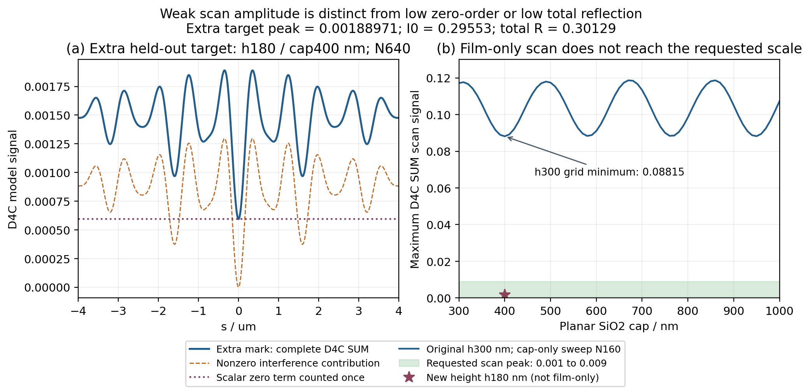

# 额外留出：扫描纵坐标为 0.00x 的弱信号 Mark

本次新增要求指的是**扫描曲线纵坐标的量级**，而不是零级 $|r_0|^2$ 或所有反射级相加的总反射率 $R$。因此候选筛选直接使用完整 D4C $S_{\rm SUM}(s)$ 的扫描最大值，要求其处于 0.001–0.009。$I_0$ 与 $R$ 仍同时保存，用于防止把三个量混为一谈。

## 1. 先检查只增厚原结构的膜是否足够

保持原 AH53 的 300 nm Si 台阶、16 µm 母周期、1.6 µm 凸台宽和三个局部中心不变，令平坦化 SiO2 cap 从 300 扫到 1000 nm，间隔 10 nm，共 71 点。每点都计算完整各级复振幅并代入同一 D4C 公式。N160 的图形层输入导纳在厚度间复用，均匀 cap 用散射递推接入，不重新计算相同本征层。递推与原完整模态求解在已有 cap100/150/200 三点的最大逐复数差均小于 $10^{-10}$。

这份厚度网格上最低扫描峰是 **0.088154906**，位于 cap = 400 nm。未得到 0.001–0.009。与此同时，最低零级 $I_0$ 是 **0.003712996**（cap510 nm），但其扫描峰为 **0.115351870**；最低总反射率为 **0.170708287**（cap330 nm）。因此，挑一个低 $I_0$ 的厚膜点不能回答“扫描幅值 0.00x”的要求。

这些结论针对已计算的 10 nm 厚度网格；不是对连续厚度或所有可能材料层的全局最小值证明。原始厚度网格、复数递推校验和实际扫描指标在 `rcwa/thick_film_sweep.csv/.json` 中。

## 2. 额外改变台阶高度，并将它作为第九个留出结构

为获得所需弱扫描信号，额外结构采用：

| 参数 | 新结构 ah53_h180_cap400 |
|---|---|
| 几何 | AH53，九个 16 µm 母周期，凸台宽 1.6 µm，局部中心 −3.2/0/+3.2 µm |
| Si 台阶高度 | **180 nm**，与原八组的 300 nm 不同 |
| SiO2 | 平坦化填槽，并在凸台上覆盖 **400 nm cap** |
| 最上表面 | $y=0.58\,\mu\mathrm m$，兼容已有 $y_{\rm ref}=0.85\,\mu\mathrm m$ 与源面 1.35 µm |
| 材料 | 与原八组完全相同的 FDTD 532 nm 实际拟合值 |
| 数据用途 | 第九个额外留出；不进入原训练集，不重新拟合 gain、$T_0$ 或结构专用偏置 |

这里既改变了台阶高度，也改变了 cap，不能把获得弱扫描信号归因于单纯膜层增厚。180 nm 接近 SiO2 中 532 nm 光的半波厚度（约 182 nm），提供了可降低局部凸台/沟槽反射相位差的候选思路；实际结果以完整电磁求解为准，侧壁散射与多次耦合没有被局部相位模型代替。

**本图目的：** 直接显示新增结构的原始 D4C 目标幅值，同时展示为什么原台阶只改 cap 的已扫网格没有达到目标。左图分开完整扫描、非零级干涉贡献和零级常数；右图蓝线始终是 h300 nm，星号明确属于改变到 h180 nm 的新结构。

**本图结论：** 最终 N640 的新增扫描峰为 **0.0018897063**、零位移底值为 **0.0005936872**，符合所需 0.00x 扫描量级。其 $I_0=\mathbf{0.295534480}$、总 $R=\mathbf{0.301288215}$，均不在 0.00x 量级。左图来自 RCWA 与固定 D4C 系数，没有用 FDTD 输出或第九结构拟合参数；是否被 FDTD 预测正确仍要看冻结参数的独立留出对比。

## 3. 弱衍射参考须单独控制截断

| 最大级次 N | SUM 扫描峰 | $I_0$ | 总 R | 最后完整复向量变化 | 最后非零级复向量变化 |
|---:|---:|---:|---:|---:|---:|
| 160 | 0.0018759178 | 0.295659874 | 0.301340650 | — | — |
| 240 | 0.0018869627 | 0.295559794 | 0.301299134 | 0.063743% | 0.770510% |
| 320 | 0.0018887373 | 0.295543231 | 0.301291995 | 0.011480% | 0.139425% |
| 480 | 0.0018895276 | 0.295536046 | 0.301288890 | 0.005297% | 0.064558% |
| 640 | 0.0018897063 | 0.295534480 | 0.301288215 | 0.001210% | 0.014789% |

弱衍射时，总反射复向量可被较强零级主导，因此同时报告非零级子向量的变化，不能只看包含零级的整体百分比。各档真实 RCWA 数据、完整目标数组及与原八组相同的字段位于 `rcwa/cases/ah53_h180_cap400/`。`inputs/extra_weak_mark.json` 独立记录第九结构，原 `experiment.json` 的八个 variants 与原训练/留出划分保持不变。

## 4. 弱衍射是否使有限入射角宽产生数个百分点差异

这一项使用**同一 N160 截断**，把 $q=0$ 系数与 $q=-250,\ldots,250\times10^3\,\mathrm{rad/m}$、间隔 $25\times10^3\,\mathrm{rad/m}$ 的 21 点 Gaussian 入射角平均比较。主参考的 N640 正入射目标保持不变；这里没有把 N640 与 N160 的差混称角宽效应，也没有在 $K_m$ 外重新施加一个 NA 截断。

各级强度平均为 $\langle T_m\rangle=\int W(q)|r_m(q)|^2dq/\int W(q)dq$，$W=\gamma_{\rm in}(q)\exp[-(qw_0)^2/2]$。镜像对称结构满足 $r_{-m}(-q)=r_m(q)$；对于对称 Gaussian 包络，正负出射包的 parity 配对交叉项因而可用这个强度矩作诊断。该控制没有用角平均后的结果重新拟合或替换 D4C 主目标。

| m | 同 N160 的 $T_m(q=0)$ | Gaussian 平均 $\langle T_m\rangle$ | 相对变化 |
|---:|---:|---:|---:|
| 1 | 5.313076e-05 | 5.337273e-05 | +0.4554% |
| 2 | 1.127447e-05 | 1.093552e-05 | -3.0064% |
| 3 | 6.393982e-06 | 6.338821e-06 | -0.8627% |
| 4 | 2.914601e-05 | 2.890451e-05 | -0.8286% |
| 5 | 7.953572e-05 | 7.968225e-05 | +0.1842% |
| 6 | 2.245916e-05 | 2.26161e-05 | +0.6988% |
| 7 | 1.358188e-05 | 1.370176e-05 | +0.8827% |
| 8 | 1.000321e-05 | 9.894016e-06 | -1.0916% |
| 9 | 0.000100696 | 0.0001014418 | +0.7407% |
| 10 | 0.0002954593 | 0.0002965551 | +0.3709% |
| 11 | 7.105941e-05 | 7.152875e-05 | +0.6605% |
| 12 | 9.610656e-06 | 9.281717e-06 | -3.4226% |
| 13 | 6.805637e-06 | 6.746613e-06 | -0.8673% |
| 14 | 3.343093e-05 | 3.31041e-05 | -0.9776% |
| 15 | 0.0001184514 | 0.0001185403 | +0.0750% |
| 16 | 3.988166e-05 | 4.003849e-05 | +0.3932% |
| 17 | 1.99723e-05 | 2.016104e-05 | +0.9450% |
| 18 | 1.738704e-05 | 1.712972e-05 | -1.4800% |

弱级 m2、m12 分别有约 −3.01%、−3.42% 的相对变化，不能概括为“所有级变化都小于 1%”。但按固定 $K_m$ 和扫描核相加后，整条非零级 AC 的 L2 变化只有 **0.222654%**，去均值形状变化为 **0.447202%**，peak/span 增加 **0.260662%**；零级平均相对 q0 增加 **0.016357%**。角域外遗漏的理想入射功率约 $2.03\times10^{-6}$。

因此，这份已完成的角敏感度控制支持“小角度依赖对弱级有可见相对影响”，但不能单独支持把数个百分点的曲线形状差异全部归因于角宽。尤其应先按弱信号自己的扫描范围核对时间收敛；100 fs 的初步差异包含已发现的时间未收敛，不能直接当作参数泛化失效。FDTD 网格、实际角域光路和本例近似 B 重建仍需分别核对；不能为了让曲线对齐而事后换一个角平均目标。全部逐级系数、两条同 N160 曲线和限定条件见 `rcwa/extra_gaussian_angle_diagnostic.json` 及新结构目录的 `Gaussian_angle_diagnostic_*`。
