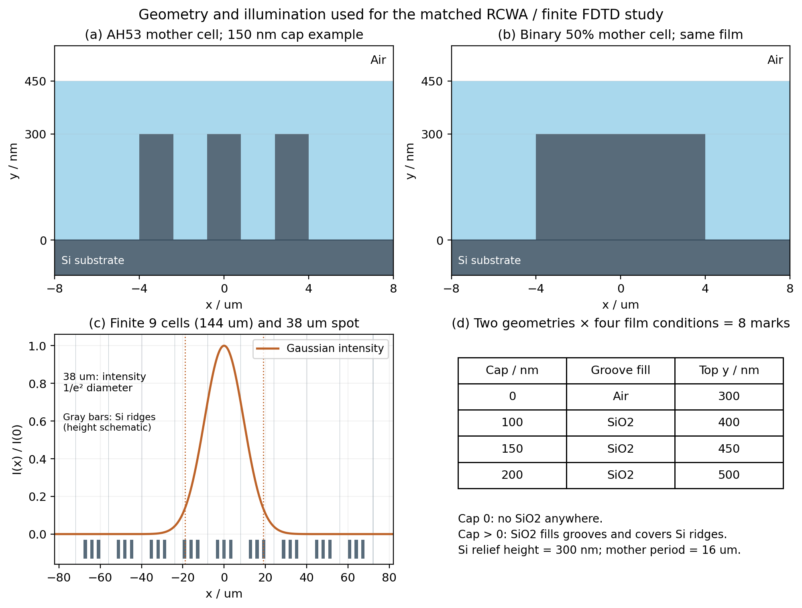
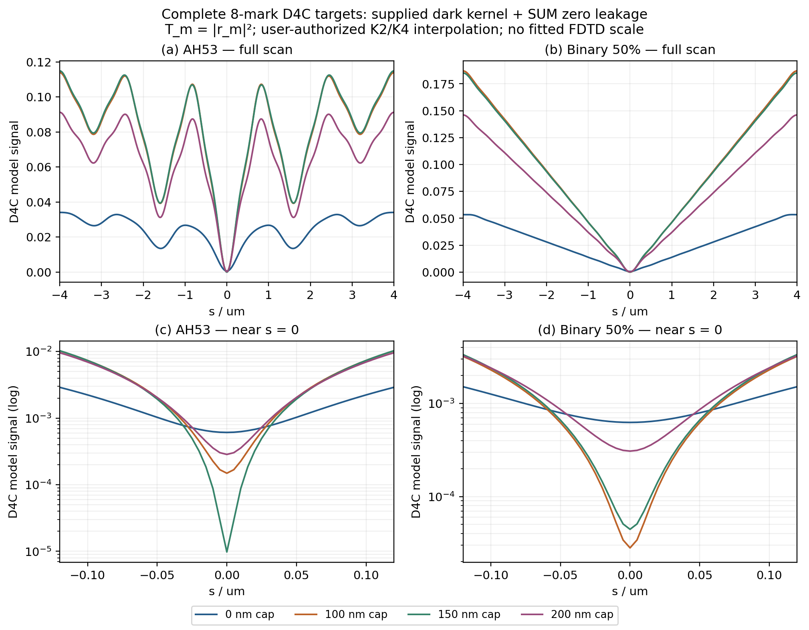
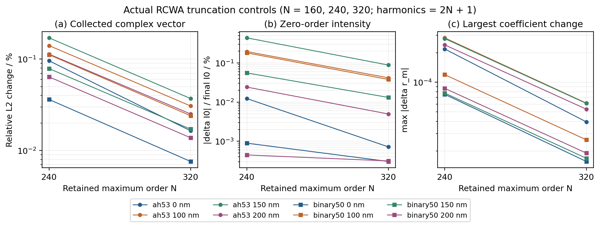

# RCWA 参考与八种 Mark 的 D4C 目标曲线

这一部分先建立要复现的目标，再讨论 FDTD 应怎样接入。目标曲线只使用各自结构的 RCWA 复振幅、用户给定的新 D4C 公式和同一组光学系数计算；不使用 FDTD 曲线倒推每个结构的零点、增益或衍射级权重。因此，后面可以把这些目标当作固定参考，检验同一套 FDTD 参数能否跨结构复现绝对基线与调制。

计算路线是：确定两个几何族及四种膜厚 → 从 FDTD 实际材料拟合中读取 532 nm 的复折射率 → 求解周期结构的各级复振幅并做截断控制 → 代入完整 D4C 公式 → 分别保存整条扫描曲线、非零级贡献和零级常数。额外的小角度 RCWA 用来估计高斯入射的角宽是否足以改变零级；它不代替有限九周期 FDTD。

## 1. 相同结构与相同材料，是比较的起点

两个几何族的母周期都为 $p=16\,\mu\mathrm m$，Si 台阶高度均为 $h=300\,\mathrm{nm}$，台阶下方是相同的半无限 Si 衬底。

| 几何族 | 一个母周期内的 Si 凸台 | 母周期 Si 横向填充比例 | FDTD 有限结构 |
|---|---|---:|---|
| AH53 | 三条宽 $1.6\,\mu\mathrm m$ 的凸台，中心为 $-3.2,0,+3.2\,\mu\mathrm m$ | 30% | 沿横向排列九个母周期，总长 $144\,\mu\mathrm m$ |
| binary50 | 一条宽 $8\,\mu\mathrm m$ 的凸台，中心为 0 | 50% | 同样九个母周期 |

每个几何族有 cap = 0、100、150、200 nm 四种状态，共八个 Mark。**cap = 0 表示完全没有 SiO2，包括沟槽内也没有 SiO2；cap > 0 时是平坦化填充：SiO2 填满沟槽，并在 Si 凸台顶部再覆盖指定的 cap 厚度。** 因而 cap > 0 的最上表面高度为 $300+\mathrm{cap}$ nm。这里没有把“平坦化填充”替换成等厚包覆侧壁的共形膜。

图 1 上排给出两个几何族在 cap = 150 nm 时的一个母周期；蓝色是平坦化 SiO2，灰色是 Si。下排左图把 AH53 的九个母周期与高斯强度画在同一横坐标中，右表列出四种膜状态。RCWA 仍然计算无限周期母单元，有限九周期只由 FDTD 实现。

**图 1 的目的：** 让读者明确八组模型改变了什么、没有改变什么，并核对 38 µm 指的是高斯强度 $1/e^2$ 直径。上排横轴是 µm、纵轴是 nm，因此剖面显示不按相同纵横尺度。

**图 1 的结论：** 八组模型只改变几何族与平坦化膜厚。高斯场包络为 $\exp[-(x/w_0)^2]$，$w_0=19\,\mu\mathrm m$；强度是 $\exp[-2(x/w_0)^2]$。九周期边界 $x=\pm72\,\mu\mathrm m$ 处的理想入射强度仅为峰值的 $3.36\times10^{-13}$，说明直接照明在最外端已很弱。这个入射包络数值本身不能排除结构内横向传播或其他有限边缘作用，仍须由实际 FDTD 检验。

材料不能只按名称认为相同。Lumerical 的时域模型用色散拟合，在单一波长处也可能与数据库插值值略有差别。本次直接读取同一 FDTD 500–600 nm 拟合带在 532 nm 的值，并用于 RCWA：

| 材料 | RCWA 与 FDTD 统一使用的 $n+ik$ | 对应复介电常数 |
|---|---:|---:|
| Si (Silicon) - Palik | $4.1499719156+0.0480646349i$ | $17.2199566915+0.3989337698i$ |
| SiO2 (Glass) - Palik | $1.4601075923+0i$ | $2.1319141812+0i$ |

原始探测结果见 [fdtd/materials.json](../fdtd/materials.json)。没有用数据库 Si 的另一组 $k$ 值来制造两种求解器间的材料差异。

## 2. RCWA 实际计算的量与参考面

采用二维 TE，电场为 $E_z$，沿条纹方向不变；时间相量为 $\exp(-i\omega t)$。$y$ 向上，入射沿 $-y$，反射沿 $+y$。横向原点是母单元的镜像中心。令

\[
G=\frac{2\pi}{p},\qquad k_{x,m}=q+mG,
\]

其中 $q$ 是入射横向波数。D4C 主参考取 $q=0$；532 nm 空气中可传播的离散反射级为 $m=-30,\ldots,+30$，而给定 D4C 公式明确使用正级 $m=1,\ldots,18$。

反射系数 $r_m$ 是电场复振幅比，分母为入射平面波外推到 $y=0$ 时的复振幅。输出 `r_total_y0` 也把反射传播场外推到 $y=0$。这个统一的相位平面即使穿过结构，也可以作为入射、出射平面波的数学参考；不表示在结构内部把总场当作空气传播场。另存的 `r_common_y085` 将反射传播场传到后处理使用的 $y=0.85\,\mu\mathrm m$，分母仍保留同一 $y=0$ 入射基准。

正常入射时，RCWA 的电场平方 $|r_m|^2$ 和第 $m$ 级反射功率效率的关系是

\[
\eta_m=\gamma_m|r_m|^2,\qquad
\gamma_m=\sqrt{1-(mG/k_0)^2}.
\]

用户随后明确确认 D4C 中 $T_m=|r_m|^2$。因此本部分把 $|r_m|^2$ 代入 $T_m$，并不先换成 $\eta_m$ 再乘一遍 $K_m$。对零级，$\gamma_0=1$，所以正常入射的 $I_0=|r_0|^2$ 数值也等于该级的功率比例。

### 2.1 从矩形介电函数到耦合场，而非局部二值反射近似

在台阶层，沟槽介质的介电常数记为 $\varepsilon_b$：裸 Si 取空气，带平坦化膜时取 SiO2。若 Si 凸台宽度为 $w$，各条中心为 $x_j$，介电函数的卷积矩阵可直接由解析傅里叶系数建立：

\[
[\boldsymbol\varepsilon]_{nm}
=\varepsilon_b\delta_{nm}
+(\varepsilon_{\rm Si}-\varepsilon_b)
\frac wp\operatorname{sinc}\left[(n-m)\frac wp\right]
\sum_j e^{-i(n-m)Gx_j}.
\]

这里 $\operatorname{sinc}(u)=\sin(\pi u)/(\pi u)$。对 TE 场，台阶层的耦合方程为

\[
\frac{d^2\mathbf E}{dy^2}
+k_0^2\left[\boldsymbol\varepsilon-
\operatorname{diag}\left(\frac{k_{x,m}^2}{k_0^2}\right)\right]\mathbf E=0.
\]

程序实际对这一矩阵求本征模，在空气、图形层、均匀 SiO2 cap 层和半无限 Si 衬底间匹配切向场。复平方根选择无源出射分支；倏逝模参与层内匹配，传播远场数组只对空气光锥内的级次给出功率。均匀 cap 与图形层通过输入导纳相接，cap 的相位厚度被保留。因此，膜厚导致的零级变化来自同一电磁边值问题中的相干干涉，没有逐个 Mark 调整反射率来拟合 FDTD。

完整求解器见 [te_planarized_rcwa.py](../rcwa/te_planarized_rcwa.py)。它扩展了保存在 `rcwa/provenance/original_si_rcwa.py` 的既有单图形层实现，新增均匀 cap；旧文件为原样副本。

### 2.2 检查了什么，检查不能替代什么

`solver_validation.json` 记录的 32 项检查全部通过，包括：均匀薄膜在三种 cap 和三种入射角的复 Fresnel 反射系数、无损薄膜界面通量、均匀膜不产生额外衍射级、与旧单层代码的逐复数回归，以及带 cap 结构的镜像关系和无源性。

Si 衬底吸收不能被误写成“所有未反射的光都在 300 nm 台阶内吸收”。程序保存的 $T_{\rm interface}$ 是进入 $y=0$ 以下半无限 Si 的功率；它最终在该衬底中吸收。有限层吸收是 $A_{\rm finite}=1-R-T_{\rm interface}$。这三项的代数和本身不是独立的收敛证明，所以还必须检查空间谐波截断的变化。

## 3. 先固定新 D4C 公式，再计算整条目标曲线

本次采用用户 2026-11-05 提供并进一步澄清的公式：

\[
\boxed{
S_\chi(s)=2\sum_{m=1}^{18}K_m|r_m|^2
\left[1-\cos\left(2mGs+\phi_m\right)\right]
+\underbrace{\left[T_0+L_\chi(1-T_0)\right]|r_0|^2}_{Z_\chi}.
}
\]

它的求和前系数是 **2**，零级部分包含残余透过与被阻挡部分产生的 leakage。本次没有沿用旧项目的 $K_{0,\chi}I_0\ell$、求和前 $1/2$ 等历史写法。原输入公式保存在 [用户公式原文](../inputs/D4C_FDTD_user_formula_20261105.md)，后续确认见项目 `experiment.json`。

两种几何都镜像对称，因此使用实际求得的

\[
\phi_m=\arg(r_{+m}r_{-m}^*)\simeq0.
\]

八组最终结果中正负级的最大复数差不超过 $2.03\times10^{-14}$，$m=1\ldots18$ 的最大成对相位不超过 $2.22\times10^{-12}$ rad。因此本例的 $s=0$ 非零级干涉项消失，$S_\chi(0)=Z_\chi$；这给零级核算提供了一个无需通过整条曲线拟合的直接检查。

输入给出 $L_{\rm SUM}=0.00138$、$L_{\rm DIFF}=0.000431$。**DIFF 的实际干涉符号仍未由输入说明确定。** 本部分的 `S_DIFF_same_kernel` 仅把同一 $1-\cos$ 核中的 leakage 参数换成 $L_{\rm DIFF}$，不把这个控制支路宣称为已确定的互补光学端口。图 2 的主曲线统一显示 SUM leakage 约定。

### 3.1 $T_0$ 是整个零级的有效残余比例，不能与其他泄漏符号混用

用户给定的近似式在程序中按原表达式求值：

\[
T_0=\operatorname{erfc}\left(
\frac{5\times10^{-4}\sqrt2}{0.778\times3.76\times10^{-4}}
\right)=0.000629728295091705.
\]

因此，对任意结构都固定使用

\[
\begin{aligned}
Z_{\rm SUM}&=0.002008859270044478\,I_0,\\
Z_{\rm DIFF}&=0.001060456882196521\,I_0.
\end{aligned}
\]

第一项 $T_0 I_0$ 是残余透过，第二项 $L_\chi(1-T_0)I_0$ 对应被挡部分的附加通道。两项各计一次。若 FDTD 通过实际角域挡板已经保留了零级尾部，又把整个 $T_0P_0$ 额外相加，就可能对同一残余透过重复计数；这应由后续分账对照判断，而不是靠改变每个 Mark 的常数项掩盖。

### 3.2 $K_m$ 与插值的来源

用户已确认允许用相邻值线性插值补齐：$K_2=(K_1+K_3)/2=0.4947$，$K_4=(K_3+K_5)/2=0.49135$。主曲线因此是完整的 $m=1\ldots18$ 结果。其余系数按本次提供的新表保留，包括 $K_{13}=0.4478$、$K_{14}=0.4380$ 和原表中的非单调值；不平滑为一条拟合余弦曲线。

`K_table.csv` 区分用户校正、此前暂读和用户授权插值的来源。这些来源状态用于追溯，不阻止按用户已认可的表进行本次比较。为便于以后改变 $K_2$ 或 $K_4$，还保留

\[
S_\chi(s)=S_{\chi,\rm known}(s)+K_2C_2(s)+K_4C_4(s),
\quad C_m(s)=2|r_m|^2[1-\cos(2mGs+\phi_m)]
\]

的敏感度系数。它是附加的可追溯分解，主曲线并不缺这两个级次。更关键的是，$Z_\chi$ 与 $K_2,K_4$ 无关，零级记账的结论可以独立检查。

## 4. 八条实际 D4C 目标曲线

图 2 不是只显示某个拟合系数。上排直接显示由八组实际 RCWA 结果生成的扫描曲线；下排放大 $s=0$ 附近，并把纵轴改为对数，使主峰图中几乎看不见的绝对基线能够分辨。四个颜色在上下排代表同一膜厚。

**图 2 的目的：** 同时展示“应复现的整条曲线”和“零级决定的绝对底值”，防止只把调制幅值或去均值形状对齐就认为已经复现 D4C。

**图 2 的结论：** 膜厚同时改变非零级响应和零级反射，但二者变化并不成同一比例。AH53 cap100 与 cap150 的峰值分别为 0.1138834 与 0.1148675，仅相差约 0.864%；零位移基线却从 $1.49044\times10^{-4}$ 降到 $9.78432\times10^{-6}$，降低 15.23 倍。这一对结构非常适合检验是否正确处理了零级：一个只匹配非零级调制的统一规则，不应自动获得两个正确底值。图中还没有加入或拟合 FDTD 输出，所以它证明的是目标本身的差异，不能单独证明任何 FDTD 零级方案已经通过验证。

下表是同一主目标的可核对数值。扫描点为 $[-4,4]\,\mu\mathrm m$、步长 0.005 µm，共 1601 点。周期均值与 DOM 使用前 1600 点，排除重复右端点；DOM 是该网格下的 $(S_{\max}-S_{\min})/(S_{\max}+S_{\min})$。

| Mark | $I_0=|r_0|^2$ | $S_{\rm SUM}(0)$ | 扫描最大值 | 周期均值 | SUM DOM |
|---|---:|---:|---:|---:|---:|
| AH53 cap0 | 0.30401214 | $6.1071761\times10^{-4}$ | 0.03407919 | 0.02407347 | 0.96478990 |
| AH53 cap100 | 0.07419345 | $1.4904420\times10^{-4}$ | 0.11388341 | 0.07929404 | 0.99738593 |
| AH53 cap150 | 0.00487058 | $9.7843193\times10^{-6}$ | 0.11486747 | 0.07995863 | 0.99982966 |
| AH53 cap200 | 0.14199373 | $2.8524542\times10^{-4}$ | 0.09122277 | 0.06414753 | 0.99376567 |
| binary50 cap0 | 0.31220684 | $6.2717960\times10^{-4}$ | 0.05345337 | 0.02798968 | 0.97680572 |
| binary50 cap100 | 0.01395860 | $2.8040858\times10^{-5}$ | 0.18700981 | 0.09414502 | 0.99970016 |
| binary50 cap150 | 0.02210836 | $4.4412590\times10^{-5}$ | 0.18509639 | 0.09336316 | 0.99952023 |
| binary50 cap200 | 0.15342628 | $3.0821181\times10^{-4}$ | 0.14606716 | 0.07391775 | 0.99578875 |

与上表相同结构顺序，DIFF leakage 控制的 $S_{\rm DIFF}(0)$ 分别为

\[
\begin{split}
&3.2239177\times10^{-4},\quad7.8678957\times10^{-5},\quad
5.1650451\times10^{-6},\quad1.5057823\times10^{-4},\\
&3.3108189\times10^{-4},\quad1.4802491\times10^{-5},\quad
2.3444966\times10^{-5},\quad1.6270196\times10^{-4}.
\end{split}
\]

每个 Mark 的零级常数只由自己的 RCWA $I_0$ 乘同一通道系数得到，没有逐结构加任意偏置。完整 Re/Im 系数保存在 `all_orders.csv`；整条曲线与分解保存在各 `cases/<variant>/d4c_targets.csv/.npz` 和聚合的 `d4c_all_targets.npz`。图 2 的独立宽表源数据为 `figures/02_d4c_targets.csv`。

## 5. 这些参考值的截断精度到哪里

八个结构都实际计算了最大空间谐波序号 $N=160,240,320$，对应 321、481、641 个保留谐波，共 24 次正常入射求解。比较在相同的 $m=-18,\ldots,18$ 传播级上进行，而不是把不同长度数组直接相减。最终各结构都满足预先采用的工作停止条件：该复向量的相对 L2 变化小于 0.05%，去掉零级后的子向量变化小于 0.1%。

**图 3 的目的：** 区分参考解本身的数值变化与后续 FDTD 零级模型差异。面板 a 看完整收集复向量，b 专门看本任务最敏感的 $I_0$，c 看最大逐级绝对复数变化。横轴 N240 表示 N160→N240，N320 表示 N240→N320；圆点为 AH53，方点为 binary50，颜色对应膜厚。

**图 3 的结论：** 所有结构加密后的变化都下降。最后一级加密中，复向量相对 L2 最大为 0.037052%，最大逐级绝对复振幅变化为 $6.1367\times10^{-5}$。弱零级要单独看：AH53 cap150 的 $I_0$ 最后变化仍为 0.088317%，高于完整复向量的百分比。因而不能把“整体向量变化小”写成“每一个弱级都同等精确”，也不能据此宣称后面会达到任意多位数的完美匹配。

| Mark | N240→N320 完整复向量 L2 变化 | 非零级复向量 L2 变化 | $I_0$ 相对变化 |
|---|---:|---:|---:|
| AH53 cap0 | 0.016435% | 0.040684% | 0.000718% |
| AH53 cap100 | 0.030713% | 0.034109% | 0.041765% |
| AH53 cap150 | 0.037052% | 0.034876% | 0.088317% |
| AH53 cap200 | 0.025108% | 0.033718% | 0.004970% |
| binary50 cap0 | 0.007596% | 0.019300% | 0.000304% |
| binary50 cap100 | 0.024030% | 0.024313% | 0.037912% |
| binary50 cap150 | 0.017147% | 0.017716% | 0.013162% |
| binary50 cap200 | 0.013792% | 0.019303% | 0.000314% |

这是连续介电模型 RCWA 的截断控制；FDTD 的网格、色散、PML、有限结构和有限记录窗口误差要另外估计。即使两边后处理公式完全一致，独立电磁模型仍可能保留这几类数值差异。

## 6. 38 µm 光斑的入射角宽，会不会本身造成明显零级偏差

正常入射的单次 RCWA 给出 $r_m(q=0)$。高斯光由一段入射角谱组成，更一般地应使用 $r_m(q)$。为量化忽略其角依赖的影响，本次在 $N=160$ 下计算了每结构 $q=0,25,\ldots,200\times10^3\,\mathrm{rad/m}$ 九个非负角点；负角通过镜像关系 $r_m(-q)=r_{-m}(q)$ 重建为 17 点。

对同一个几何和槽内介质，一个 q 下的图形层本征解可在三个 cap 厚度间复用，再分别接入均匀 cap。因此这里没有为获得相同图形层重复求本征值。这个控制的目的只是比较同一截断下 $r_m(q)$ 与冻结的 $r_m(0)$；不能把 N160 角控制和 N320 主解的差混称为单纯入射角效应。

高斯角谱功率权重使用

\[
W(q)\propto\gamma_{\rm in}(q)
\exp[-(qw_0)^2/2].
\]

下表的复向量误差是按此入射功率权重，对 $m=-18\ldots18$ 的 $r_m(q)-r_m(0)$ 做 L2 积分并归一化；零级平均使用 $\int W(q)|r_0(q)|^2dq/\int W(q)dq$。

| Mark | 冻结 q0 的加权复向量误差 | 加权零级强度相对 q0 的变化 |
|---|---:|---:|
| AH53 cap0 | 0.234597% | −0.015027% |
| AH53 cap100 | 0.598237% | +0.010981% |
| AH53 cap150 | 0.498921% | −0.145718% |
| AH53 cap200 | 0.251062% | −0.027771% |
| binary50 cap0 | 0.077428% | +0.003989% |
| binary50 cap100 | 0.419829% | +0.021106% |
| binary50 cap150 | 0.213377% | +0.022541% |
| binary50 cap200 | 0.175182% | −0.034714% |

在这个已计算范围内，整体复场的角依赖约为 0.08%–0.60%，零级角平均的相对变化最多约 0.146%。因此，对本次零级分账的初步控制，冻结 q0 是可量化的近似。它并不能自动证明所有弱衍射级或微小挡板尾部同样准确。

还有一个与本任务直接相关的范围限制：上述角控制只到 $|q|=200000\,\mathrm{rad/m}$。其外的理想高斯入射功率仅占总量的 $0.000144696$，但这已经是目标 $T_0=0.000629728$ 的约 23%。所以这些角点足以作为主体光束的敏感度诊断，**不应截断后直接用于精确计算零级挡板残余**。需要精确尾部时，应保留解析高斯全尾，或者扩展并收敛角域范围；本次输出没有把一份短角库冒充完整零级泄漏库。

## 7. 与后续零级挡板实验直接相连的控制值

若只考虑一个孤立的理想 Gaussian 零级，场包络为 $\exp[-x^2/w_0^2]$，在角域用完全不透光的对称挡板阻挡 $|k|<a$，零级残余功率比例为

\[
F_0(a)=\operatorname{erfc}\left(\frac{aw_0}{\sqrt2}\right).
\]

由用户 $T_0$ 反推得到

\[
\boxed{a_{T_0}=179919.7989504\,\mathrm{rad/m}
=0.1799197989504\,\mathrm{rad}/\mu\mathrm m.}
\]

此前常用的 $a=0.2\,\mathrm{rad}/\mu\mathrm m$ 对应

\[
F_0(0.2\times10^6)=0.000144696087850240,
\]

约为用户 $T_0$ 的 23%，二者本来就不是同一个理想零级截断比例。另外，B 方法把零级最近邻角带划到 $G/2=0.19634954\,\mathrm{rad}/\mu\mathrm m$；旧 0.2 挡板略跨过这一边界，会同时接触一级角带的边缘。

这个控制值只来自孤立 Gaussian 零级。实际 FDTD 的中心谱可能包含有限结构散射、其他级的角谱尾部、实际照明偏差和数值背景。角域挡板会作用于占据该角域的全部场；“删除一整个零级模态”则是另一种操作。因此，后续必须分别保存挡前零级功率、挡后零级残余、被阻挡功率和附加 leakage，才能判断哪些项重复计数。单看最终扫描曲线的底值可以发现差异，却不能唯一识别差异来自哪一步。

## 8. 本部分交付给 FDTD 对照的固定参考

本部分已经得到八条完整主目标及其可追溯的复系数，下一步不需要再为每个 Mark 拟合一条“想要的参考”。同一组 $K_m,T_0,L_\chi$ 已锁定；各 Mark 的差异只由自己的 RCWA 复振幅产生。AH53 cap100/cap150 是峰高接近而零级相差 15.23 倍的一对有力控制，裸 Si 与其他膜厚则进一步扩大零级和非零级组合的范围。

| 文件 | 作用 |
|---|---|
| `rcwa/cases/<variant>/reference.npz` | 最终复衍射系数、功率和参考面定义 |
| `rcwa/cases/<variant>/d4c_targets.npz` | 主数组 `S_SUM`、`S_DIFF_same_kernel`、`AC`、`zero_SUM`、`zero_DIFF`；另含 K2/K4 敏感度 |
| `rcwa/d4c_all_targets.npz` | 统一结构顺序的八条 1601 点主曲线 |
| `rcwa/d4c_target_metrics.csv` | 峰谷、周期均值、DOM 和零级底值 |
| `rcwa/all_orders.csv` | 各级 Re/Im、模、相位、$|r|^2$ 与效率 |
| `rcwa/convergence.csv` | 每次空间谐波加密的实际变化和耗时 |
| `rcwa/solver_validation.json` | 32 项解析/回归/物理检查 |
| `rcwa/gaussian_angle_controls.csv` | 同截断下高斯角依赖诊断 |
| `rcwa/gaussian_zero_stop_control.json` | $T_0$、等效挡板半宽、旧半宽的实际理想截断比例 |
| `figures/01_geometry.*`、`02_d4c_targets.*`、`03_rcwa_convergence.*` | 图片、SVG、对应 CSV/JSON 来源 |

这些目标的量纲是用户算法归一化后的模型信号。它们不是已标定探测器瓦数，也不是不加说明就等同于真实 D4C 硬件导出的读数。后续若统一参数能同时对齐主曲线、非零级调制和八个零级底值，应同时报告保留结构的误差与电磁数值误差；不能把目标反推的逐级或逐结构系数当作独立预测成功。
