# 本实验要回答的唯一问题

用户的问题是：**无限周期 RCWA 给出各个衍射级的复振幅，而非周期边界的有限 FDTD 给出连续角谱。究竟应取每一级中心的复数值，还是对该级附近积分？如果中心值已经吻合，旁边的 sinc 分布又代表什么？**

本实验只使用一个最简单的 Si 一维台阶光栅，不加入复杂 Mark、薄膜堆栈、扫描位移、高斯照明、成像系统或信号处理应用。先把数学量定义清楚，再运行真正的 RCWA 和全 PML FDTD，最后逐项比较。

**直接答案预告：** 对整数周期矩形窗口，若窗内场接近无限周期响应，取精确衍射级中心的**复角谱**，除以窗口长度和同一参考面的入射复场，并去掉传播相位，就得到可与 RCWA 比较的复振幅。恢复这个系数不需要对峰附近的复角谱做无权积分。附近的主瓣和旁瓣是这个系数经过有限窗口展宽后的分布；积分其正确加权的模平方得到的是功率。

实际验证采用 10、20、50、100、200、400 个周期，完整保留独立的空气参考和 Si 结构求解。另有网格及时间控制。当前最接近 RCWA 的实际工况是 **N050_dx10_dy5_t600**，七个传播级复系数的整体相对 L2 差为 **1.1500%**；这是一项真实计算的比较值，包含有限边缘、材料离散、PML 和网格误差，不是通过拟合强行校准后的结果。

全文的解析 sinc 图只用于验证窗口数学关系；真实 FDTD 图均来自保存的 Lumerical 复电磁场。每幅图都明确写出目的和从图中得到的结论。

# 结构、坐标与要比较的物理量

## 最小结构

| 项目 | 本实验固定取值 |
|---|---|
| 真空波长 | 532 nm |
| 周期 $\Lambda$ | 2 μm |
| Si 线宽 | 1 μm，50% 占空比 |
| 台阶高度 / 刻蚀深度 | 100 nm |
| 上方介质 | 空气，$n=1$ |
| 下方介质 | Si 半无限衬底；数值上延伸穿过底部 PML |
| 台阶材料 | 与衬底完全相同的 Si |
| 入射 | 正入射，TE；只有一个偏振 |
| 维数 | 二维截面，沿槽方向不变；功率按单位槽长解释 |
| 有限光栅外部 | 槽底高度的平坦 Si，没有另加孤立空气块或额外薄膜 |

100 nm 深度是为了把问题完全指定而作的简单选择，不代表某种设备的已知工艺参数。核心的复幅提取公式不依赖这个特定深度。

## 统一坐标和相位

本报告推导采用向上坐标 $h$：台阶顶面为 $h=0$，空气侧 $h>0$，入射光沿 $-h$ 传播，反射光沿 $+h$ 传播。FDTD 原生坐标就是 $h=y$，TE 电场为 $E_z$。RCWA 使用向下的原生 $z$，因此 $h=-z_{\mathrm{RCWA}}$。所有最终系数统一到台阶顶面 $h=0$。

横向原点取**沟槽中心** $x=0$。偶数个完整周期居中时，Si 脊中心位于 $x=\ldots,-3,-1,+1,+3,\ldots$ μm。RCWA 最初在脊中心建单胞，导出时显式换到同一沟槽中心原点。相差半周期会使第 $m$ 级乘 $(-1)^m$，奇数级会变号。忽略这一点会把完全一致的场误判为相差 $180^\circ$。

所有公式使用时间约定 $\exp(-i\omega t)$，有损材料的 $\operatorname{Im}\epsilon>0$。以下 $E$ 都是 TE 电场的复标量，包含实部和虚部，而非光强图。

## 材料保持一致

使用安装环境中的 `Si (Silicon) - Palik`。其数据库插值在 532 nm 为 +4.1501040 +0.0439352i；实际 FDTD 使用 500–565 nm 带宽的色散拟合，在 532 nm 的值为 **+4.1498733 +0.0483349i**。RCWA 使用后者作为单频复折射率。两种算法因此比较的是相同的单频介电常数，而不是两个略有不同的 Si 数据集。

材料原始值与拟合值均保存于 `rcwa/material.json` 和各 FDTD 工况的 `material.json`。

**图的目的：** 把几何、照明方向、台阶顶面和反射监视面固定下来。

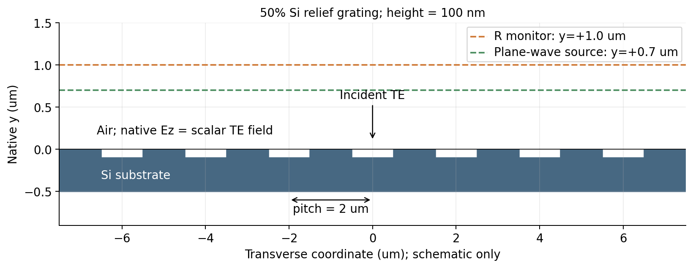

**图的结论：** 只计算同一种 Si 的二元台阶。监视面位于源上方，保存反射场；空气参考在台阶顶面测入射复场。示意图只显示部分周期，全模型还包含横向缓冲区和四边 PML。

# RCWA 的离散复系数与 FDTD 的连续复角谱

## RCWA 到底给了什么

定义倒格矢、各级横向波数与空气中的纵向波数：

$$G=\frac{2\pi}{\Lambda},\qquad q_m=mG,\qquad \beta_m=\sqrt{k_0^2-q_m^2},\qquad k_0=\frac{2\pi}{\lambda_0}.$$

对传播波取 $\beta_m>0$。无限周期结构的反射电场展开为

$$E_r(x,h)=E_{i,0}\sum_m r_m\exp(iq_mx+i\beta_m h).$$

$E_{i,0}$ 是台阶顶面 $h=0$ 的入射复电场。$r_m$ 是无量纲的**电场复系数**。空气中的衍射效率为

$$\eta_m=\frac{\beta_m}{k_0}|r_m|^2=\cos\theta_m|r_m|^2.$$

因此 RCWA 的功率归一化散射矩阵元、电场分量和衍射效率不是同一个量。若软件给出的是通量归一化系数，应先转换为同一定义的电场系数。本实验直接读取原生复场分量，并用平坦界面的 Fresnel 反射验证其入射符号与参考面。

传播条件为 $|m\lambda_0/\Lambda|<1$。本例只有七个空气侧传播级：

| $|m|$ | $|q_m|/k_0$ | $|\theta_m|$ |
|---:|---:|---:|
| 0 | 0 | 0° |
| 1 | 0.266 | 15.426381° |
| 2 | 0.532 | 32.140687° |
| 3 | 0.798 | 52.939539° |

50% 的几何占空比不保证所有偶数电磁衍射级都为零。二元几何函数的傅里叶零点不等于完整 Maxwell 散射问题的所有系数零点；多次散射和电磁边界条件仍参与计算。本例确实存在二级反射。

## FDTD 中定义什么角谱

在空气中的反射监视线 $h=d$，取矩形窗口长度 $L$，定义

$$A_L(q;d)=\int_{-L/2}^{L/2} E_r(x,d)e^{-iqx}\,dx.$$

逆变换约定为

$$E_r(x,d)w_L(x)=\frac{1}{2\pi}\int_{-\infty}^{\infty}A_L(q;d)e^{iqx}\,dq.$$

如果 $x$ 用米、电场用 V/m，则 $A_L$ 的单位是 V，不能直接与无量纲的 $r_m$ 比大小。代码为了便于画图使用 μm，角谱数组单位相应为“电场 × μm”；在比值中 $A_L$ 与 $L$ 使用同一种长度单位。

适合比较的无量纲复角谱是

$$a_L(q;d)=\frac{A_L(q;d)}{L E_{i,0}}.$$

所有复数比较还要包含监视面传播相位。只看 $|A|$ 无法验证相位；只保存远场强度也无法一般性恢复 $r_m$ 的复相位。

# 从有限窗口一步一步推到提取公式

## 矩形窗把每个离散级展宽成 sinc

定义 $\operatorname{sinc}v=\sin v/v$。矩形窗的变换为

注意 NumPy 的 `np.sinc(v)` 采用 $\sin(\pi v)/(\pi v)$；因此本文公式的 $\operatorname{sinc}(s)$ 在代码中应写成 `np.sinc(s/pi)`。两种习惯只有自变量尺度不同，不能把峰宽混用。

$$W_L(s)=L\operatorname{sinc}\left(\frac{sL}{2}\right).$$

把 RCWA 场展开代入 FDTD 角谱定义，逐项积分：

$$A_L(q;d)=E_{i,0}L\sum_m r_m e^{i\beta_md}\operatorname{sinc}\left[\frac{(q-q_m)L}{2}\right].$$

这条等式描述的是**把无限周期场用有限观察窗截取**的理想基准。有限物理光栅还会有边缘散射，因此真实 FDTD 只能在误差允许的范围内接近这个表达式。后文将两者分别作图，不把这个解析式冒充 FDTD。

无限周期角谱本来是

$$A_\infty(q;d)=2\pi E_{i,0}\sum_m r_m e^{i\beta_md}\delta(q-q_m).$$

δ 峰不是具有普通有限峰高的函数。有限窗使峰高随 $L$ 增大、宽度随 $1/L$ 变小。因此所谓“FDTD 峰值等于 RCWA”必须附带 $L E_{i,0}$ 归一化的约定。

## 为什么整数周期窗在级中心精确正交

令 $L=N\Lambda$，其中 $N$ 是正整数。取 $q=q_j=jG$：

$$\operatorname{sinc}\left[\frac{(q_j-q_m)L}{2}\right]=\operatorname{sinc}[\pi N(j-m)].$$

当 $j=m$ 时该值为 1，当 $j\ne m$ 时该值严格为 0。因此

$$A_L(q_j;d)=L E_{i,0}r_j e^{i\beta_jd}.$$

最后得到本报告的核心公式：

$$\boxed{\displaystyle \widehat r_j=\frac{A_L(q_j;d)}{L E_{i,0}}e^{-i\beta_jd}.}$$

等价地，也可以直接在近场上作复投影：

$$\widehat r_j=\frac{e^{-i\beta_jd}}{L E_{i,0}}\int_{-L/2}^{L/2}E_r(x,d)e^{-iq_jx}\,dx.$$

**这里已经有一次空间积分。** 它是把近场投影到平面波基上，也就是角谱的定义；它不是再对某一级附近的角谱作第二次无权积分。

数学正交关系对 1、10、20、200 个整数周期都成立。因此，对精确中心的理想复幅提取，十几个整数周期已经满足正交条件；如果要求附近整段角谱的尾部很小，几百周期仍然有价值。较大的 $N$ 还能降低物理端部在窗口平均中的份额，并改善角带之间的功率分离。

## 哪些情况使中心公式出现偏差

实际有限 FDTD 可写为

$$E_r^{\mathrm{FDTD}}(x,d)=E_{i,0}\sum_mr_m e^{iq_mx+i\beta_md}+\delta E(x,d).$$

那么提取误差恰好为

$$\widehat r_j-r_j=\frac{e^{-i\beta_jd}}{L E_{i,0}}\int_{-L/2}^{L/2}\delta E(x,d)e^{-iq_jx}\,dx.$$

$\delta E$ 包括有限端部、实际入射场不均匀、PML、网格离散和时间截断误差。增加 $L$ 并不消除所有这些来源；尤其不会自动消除固定网格的相位误差。若边缘误差局限在固定宽度内，其平均影响通常随 $1/L$ 下降；这需要数据检验，不能预先强制假设。

若窗口不是整数周期，理想不同级的 sinc 在中心也会互相串扰。若用了 Hann 等窗，分母应采用相干增益 $\int w(x)dx$，且正交关系通常改变。此时可以联合拟合已知的窗口核，解复数线性最小二乘问题；这种拟合是明确带核和归一化的估计，不等于直接积分角谱幅值。

# 需要多少周期：先算旁瓣，再看实际误差

## 级中心与级附近要分开判断

零级窗谱在一级**精确中心** $q=G$ 的理想值为 $\operatorname{sinc}(\pi N)=0$。用户关心的“一级附近能否忽略零级旁瓣”，应另行考察整个一级主瓣区间 $|q-G|\leq2\pi/L$。

用零级自身峰高归一化，在该区间有保守上界

$$\max\left|\frac{A_{0,L}(q)}{L E_{i,0}r_0}\right|\leq\frac{1}{\pi(N-1)}.$$

相对于一级自身的影响还须乘 $|r_0/r_1|$。因此“可忽略”必须说明比较的是场还是功率、相对于哪一级，以及容许误差是多少。下面表格是解析 sinc 计算，不是 FDTD 拟合。

| 周期数 N | 长度 / μm | 一级主瓣全宽 / ° | 一级主瓣内零级最大场比例 | 对应 dB |
| --- | --- | --- | --- | --- |
| 10 | 20 | 3.162548 | 0.0335251 | -29.49 |
| 20 | 40 | 1.581089 | 0.0163258 | -35.74 |
| 50 | 100 | 0.632415 | 0.0064306 | -43.83 |
| 100 | 200 | 0.316206 | 0.0031991 | -49.90 |
| 200 | 400 | 0.158103 | 0.0015955 | -55.94 |
| 400 | 800 | 0.079051 | 0.0007968 | -61.97 |

本光栅由 RCWA 得到 $|r_0/r_1|=0.75435$。因此，若只要求“零级在一级主瓣范围内的尾部场低于一级峰高的 0.1%”，保守条件为

$$N>1+\frac{|r_0/r_1|}{\pi\times0.001}\approx 241.1.$$

200 周期属于约 0.1% 场串扰的量级，400 周期提供更充分余量。这个判据只处理理想窗的零级尾部，并不能代替真实 FDTD 的网格和端部误差检查。

**图的目的：** 量化十几个到几百个周期究竟改变什么。

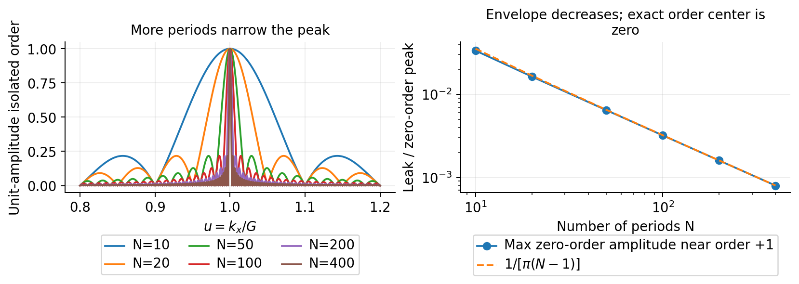

**图的结论：** 增加 N 使峰宽缩小并降低相邻级附近的尾部包络；整数周期的精确级中心始终是其他级窗谱的零点。

# 真实计算按什么顺序完成

## RCWA 基准与独立符号检查

使用 Lumerical v252 RCWA，不用标量振幅掩模代替 Maxwell 解。求解截面与 FDTD 相同。计算谐波上限从 20、40、80 增至 160，并检查更细横向材料采样。这里的上限 160 意味着 $m=-160,\ldots,+160$ 的 321 个计算谐波，并非 160 个空气传播级。

首先计算同材料的平坦空气/Si 界面，与 $r_F=(1-n)/(1+n)$ 的复数 Fresnel 系数比较。该检查用来确定 RCWA 的原生 s 偏振入射方向、场分量符号和参考面传播相位。其复数误差约为 $10^{-14}$。

独立的 RCWA 实空间场监视器积分证实：原生 `field_amplitudes` 的横向相位从单胞左边界 $x_{\min}=-1$ μm 起算，而非几何 $x=0$，验证复数误差为 $6.41\times10^{-15}$。转到物理脊中心需乘 $e^{+im\pi}$，再转到 FDTD 沟槽中心需乘 $e^{-im\pi}$，两个半周期因子相互抵消。此外，实际材料采样中还测得半网格相关的线性傅里叶相位偏置，显式乘 $e^{-iq_m\Delta x_{\mathrm{actual}}/2}$ 去除，换到共同对称轴后 $+m$ 与 $-m$ 的复系数相等。这些因子均独立确定，不是为了贴合 FDTD 而拟合相位；不改变幅度、效率或几何尺寸。原始数据、每个修正因子以及证据分别保存在 `rcwa/reference_for_analysis.npz`、`spatial_origin_projection.json` 和 `phase_origin_audit.csv`。

## 全 PML 的有限 FDTD

每个周期数分别建立真实有限长度模型，四边均为 PML，不使用横向周期边界。Si 结构只包含 N 个完整周期。Mark 两侧各加 4 μm 缓冲，缓冲底部仍是槽底平坦 Si。

源为全横向计算宽度的平面波源，位于原生 $y=0.7$ μm，波长带宽 500–565 nm。主反射监视线 R 位于源上方 $y=1.0$ μm；第二条 R2 位于 $y=1.2$ μm，检查参考面校正。监视器只采集目标 532 nm，并保存六个复电磁场分量和坐标。

角谱由空气中一条近场复监视线计算，不要求把网格延伸到几何远场。400 周期的实际长度为 800 μm，按 $2L^2/\lambda$ 估算的 Fraunhofer 尺度约 2.4 m；直接把 FDTD 域铺到这个距离没有必要。在均匀半空间内，各角谱分量按已知纵向波数传播，即可得到远场方向分布。

必须正视：有限宽度平面波在全 PML 环境中不会在所有横向位置都保持理想平面波。侧边吸收和源截断会产生衍射。本实验保留用户指定的源与边界，通过逐个尺寸的空气参考测量实际入射场，并检查中央照明均匀性。没有把空气参考中的扰动默认为零。

另外把 N=10 的源在横向每侧额外延伸 2 μm，独立测试是否因未覆盖 PML 而出现可避免的源截断。R、R2 和 I 的复场与原空气参考逐点一致；因此本环境中这项额外延伸没有改变实际注入场。诊断输入与比较文件保留在 `fdtd/cases/N010_sourceThroughPML_diagnostic/`，主尺寸序列保持相同源设置。

主序列采用均匀 $\Delta x=20$ nm、$\Delta y=10$ nm，PML 24 层。更细网格、加长时间等控制以实际工况文件为准。源、网格、频率、监视面和时间设置在每组空气与结构模型间保持一致。相同层数在不同网格下的 PML 物理厚度不同，因此本报告把它计入数值误差限制，不宣称单次网格加密已分离所有误差。

10/5 nm 网格采用 48 层 PML，使边界物理厚度与粗网格接近一致。5/2.5 nm 最细网格原先请求 96 层，但保存模型的实际属性表明软件上限将它限制为 **64 层**；本报告和图例采用实际 64 层，并保留请求值。这组最细网格的 PML 物理厚度未完全匹配，不能据此单独证明纯网格收敛。另保留 N=20、10/5 nm 的 24 层与 48 层控制，用于单独检查该网格的边界厚度影响。所有工况仍是四边 PML，没有引入周期边界。

## 从保存的复场做后处理

1. 从结构模型读取 R 的复 $E_z$。R 在源上方，主要记录向上反射波；减去同尺寸空气模型在 R 的残余源反向泄漏。这一步**没有减去平坦 Si 的反射背景**，因此零级仍是完整反射系数。
2. 从空气模型在 $y=0$ 的 I 监视线读取实际入射复场，在同一个 $L=N\Lambda$ 窗内求复平均 $E_{i,0}$。
3. 精确截取 $[-L/2,L/2]$，保留精确边界，对双端点作梯形半权。避免把双端点误算成长度 $L+\Delta x$ 的窗口。
4. 在精确 $q_m=mG$ 处直接复投影，得到七个 $A_L(q_m)$。不使用“找图上最高点”的方式，因为有限端部与邻级叠加可使局部最大值偏离精确级中心。
5. 除以 $L E_{i,0}$ 并乘 $e^{-i\beta_md}$，得到 $\widehat r_m$。
6. 另作带零填充的 FFT，画出连续角谱。零填充仅使曲线采样更密，不改变有限窗口的真实分辨率，也不使有限光栅变成无限周期结构。
7. 用 R2 重复同样提取，检查两监视面去传播后的复系数差；用保存的 $E/H$ 检查向上传播波关系。
8. 将 $\widehat r_m$ 的实部、虚部、模、相位和效率与 RCWA 比较；再独立积分角谱功率，回答积分所代表的物理量。

代码的 `analyze.py` 不运行 Maxwell 求解器，也不根据 RCWA 合成所谓“FDTD 数据”；它只读取已保存的真实场。图中标记 `Windowed periodic RCWA` 的虚线明确属于解析有限窗对照。

# RCWA 的实际结果

| m | 复电场系数 r_m | 模 | 相位 / ° | 反射效率 |
| --- | --- | --- | --- | --- |
| -3 | -0.0920369 +0.0958721i | 0.132899 | 133.83076 | 1.0644% |
| -2 | +0.0632222 +0.0139025i | 0.064733 | 12.40187 | 0.3548% |
| -1 | +0.3334621 -0.1488428i | 0.365173 | -24.05388 | 12.8547% |
| 0 | -0.1411446 -0.2365597i | 0.275467 | -120.82264 | 7.5882% |
| 1 | +0.3334621 -0.1488428i | 0.365173 | -24.05388 | 12.8547% |
| 2 | +0.0632222 +0.0139025i | 0.064733 | 12.40187 | 0.3548% |
| 3 | -0.0920369 +0.0958721i | 0.132899 | 133.83076 | 1.0644% |

七个传播级的总反射效率为 **36.1361%**。Si 有吸收，而且还有能量进入衬底，所以不能要求反射效率之和为 1。各级系数的相位均针对台阶顶面和沟槽中心；若改为脊中心，奇数级的复数符号相反，功率完全相同。

**图的目的：** 先给出被比较的离散复电场系数，说明各级幅度和相位。

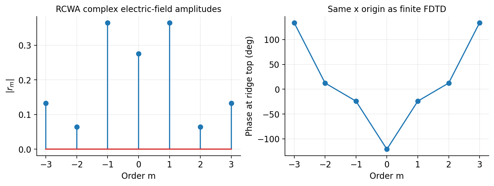

**图的结论：** 主导级与较弱的二级同时存在。复振幅必须包含相位和参考面，单独列效率不足以回答本实验的问题。

RCWA 的横向相位基准统一后，截断和采样收敛记录如下；原始未校正记录同时保留。

| 谐波上限变化 | 实际 dx / nm | 最大复系数变化 | 最大效率变化 |
| --- | --- | --- | --- |
| 20 → 40 | 5 → 5 | 0.0009737 | 0.00017505 |
| 40 → 80 | 5 → 3.125 | 0.0001192 | 0.00001379 |
| 80 → 80 | 3.125 → 2.5 | 0.0000103 | 0.00000530 |
| 80 → 80 | 2.5 → 1.25 | 0.0000137 | 0.00000706 |
| 80 → 160 | 1.25 → 1.25 | 0.0000146 | 0.00000194 |

# FDTD 连续角谱：长度变大后看到了什么

**图的目的：** 直接观察有限长度如何把离散衍射级变成连续分布。

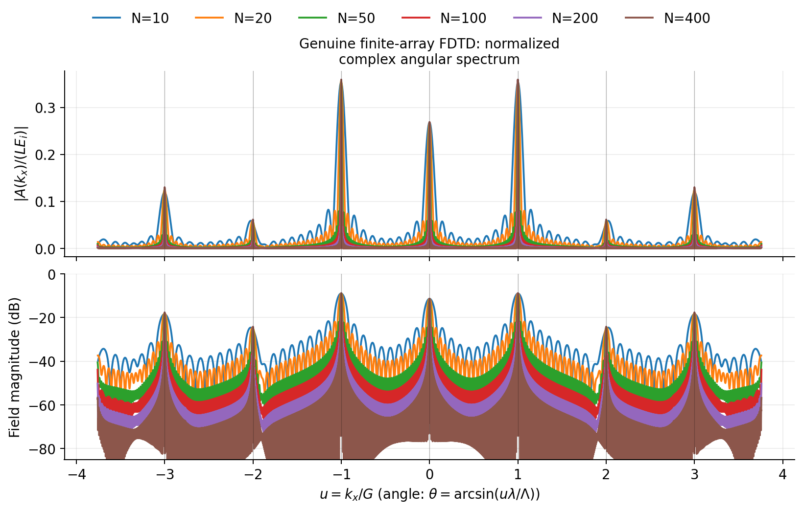

**图的结论：** 所有尺寸都在相同的衍射方向附近形成峰。增加 N 使峰变窄；归一化峰中心趋于固定复系数，而未经 L 归一化的峰高会随长度增加。下图的对数纵轴显示仍然存在的旁瓣和有限边缘背景。

**图的目的：** 把整个连续峰形与由 RCWA 同一组系数预测的有限窗形状比较。

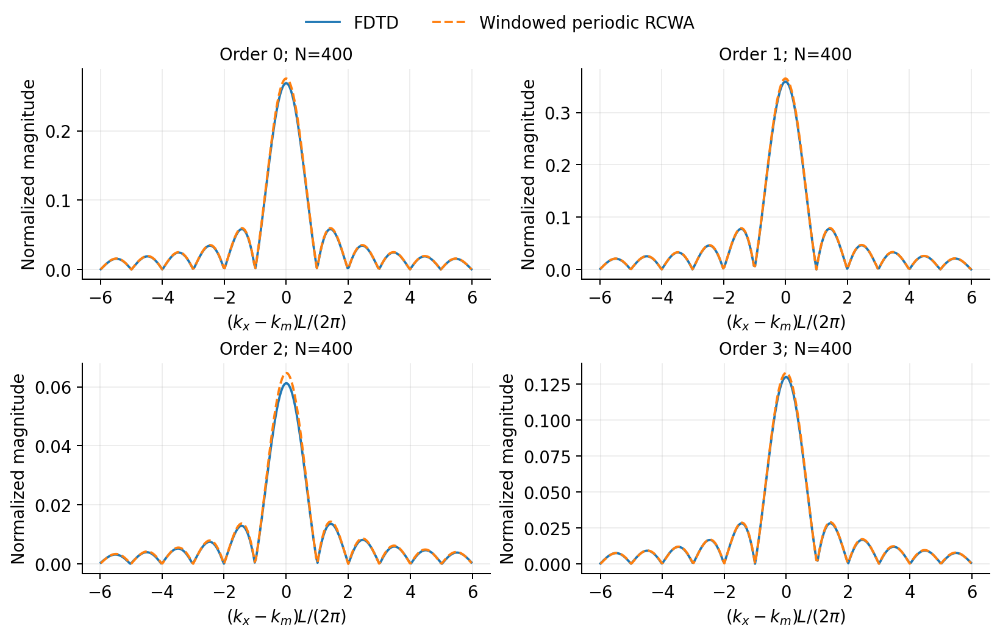

**图的结论：** 每个主峰及其附近结构由同一组离散系数和窗口核共同决定。实际曲线与理想有限窗的差别反映端部、入射不均匀及数值误差；并不说明每个旁瓣还需要分配一个新的 RCWA 系数。

## 为什么旁边的分布不矛盾

无限周期的某一级是严格单一方向的平面波；有限宽度的同一级是具有角宽的波包。RCWA 的一个 $r_m$ 规定该波包的整体复幅尺度，窗口规定它如何分布在附近的角度。

“中心点经过正确归一化后给出 $r_m$”不表示“所有能量都集中在这个点”。连续谱的单个点本身在积分中的测度为零。功率由一个有限宽度区域的谱密度积分得到；中心点只是在已知峰形与归一化后确定其系数。

可以类比：一个归一化高斯分布的中心值确定其高度参数，但总面积仍由整条曲线积分得到。这里使用的是复 sinc 核，还包含正负旁瓣及相干叠加，不能把场幅值直接当概率或功率。

还可以直接算一个孤立级的整体谱能量：

$$\int_{-\infty}^{\infty}|A_m(q)|^2dq=|E_{i,0}r_m|^2L^2\frac{2}{L}\int_{-\infty}^{\infty}\left(\frac{\sin v}{v}\right)^2dv=2\pi L|E_{i,0}r_m|^2.$$

这里用了 $\int_{-\infty}^{\infty}(\sin v/v)^2dv=\pi$。所以 L 加倍时，未经归一化的峰值场加倍、峰值模平方变为四倍、宽度约减半，而总谱能量只加倍，正好对应照明长度加倍。再除以同样正比于 L 的入射功率，窄瓣情况下得到 $\cos\theta_m|r_m|^2$。旁瓣已经包含在这次积分中，不是中心系数之外的另一份独立能量。

# 从真实 FDTD 提取的复振幅及长度收敛

主网格序列的整体误差和参考面检查如下。整体复 L2 差定义为 $\|\widehat{\boldsymbol r}-\boldsymbol r\|_2/\|\boldsymbol r\|_2$；它同时计入幅度与相位，但较强级的贡献较大，所以后面还逐级列出误差。

| N | 长度 / μm | 复向量相对 L2 差 | 最大逐级绝对复误差 | 最大 R/R2 复差 |
| --- | --- | --- | --- | --- |
| 10 | 20 | 5.4574% | 0.0153097 | 0.0025505 |
| 20 | 40 | 3.6769% | 0.0094963 | 0.0014911 |
| 50 | 100 | 2.7286% | 0.0071085 | 0.0005532 |
| 100 | 200 | 2.4433% | 0.0068157 | 0.0002800 |
| 200 | 400 | 2.3062% | 0.0067976 | 0.0002502 |
| 400 | 800 | 2.2404% | 0.0067936 | 0.0002668 |

将相邻尺寸直接相减，可以把“继续增加长度还改变多少”与“距离 RCWA 还差多少”分开。下面所有变化均来自同一粗网格；一级、二级的相对变化分母取对应 RCWA 系数模，弱级对有限端部更敏感。

| N 的变化 | 最大绝对复变化 | 复向量相对变化 | 一级相对变化 | 二级相对变化 |
| --- | --- | --- | --- | --- |
| 10 → 20 | 0.0060316 | 1.9684% | 0.8522% | 6.9242% |
| 20 → 50 | 0.0033295 | 1.1279% | 0.5252% | 4.1191% |
| 50 → 100 | 0.0010847 | 0.3728% | 0.1776% | 1.3801% |
| 100 → 200 | 0.0005673 | 0.1898% | 0.0875% | 0.6924% |
| 200 → 400 | 0.0002846 | 0.0950% | 0.0437% | 0.3459% |

**图的目的：** 判断增加周期数究竟是否改善与无限周期 RCWA 的一致性。

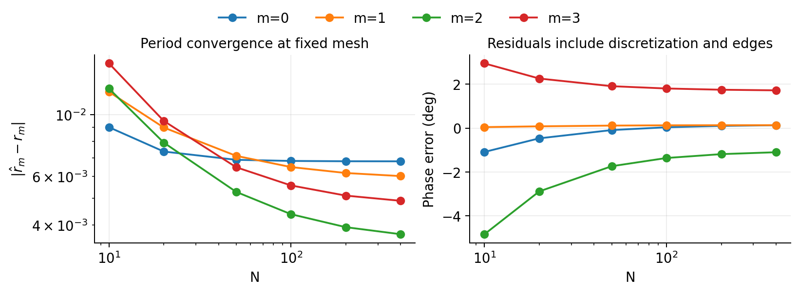

**图的结论：** 有限长度影响随 N 增大而减弱后，误差会遇到网格等数值误差底限。因此不能只增加到几百个周期，就把剩余误差解释成 sinc 尾部。较弱级应同时检查绝对复误差和相位。

**图的目的：** 避免只看强度吻合而漏掉复相位差。

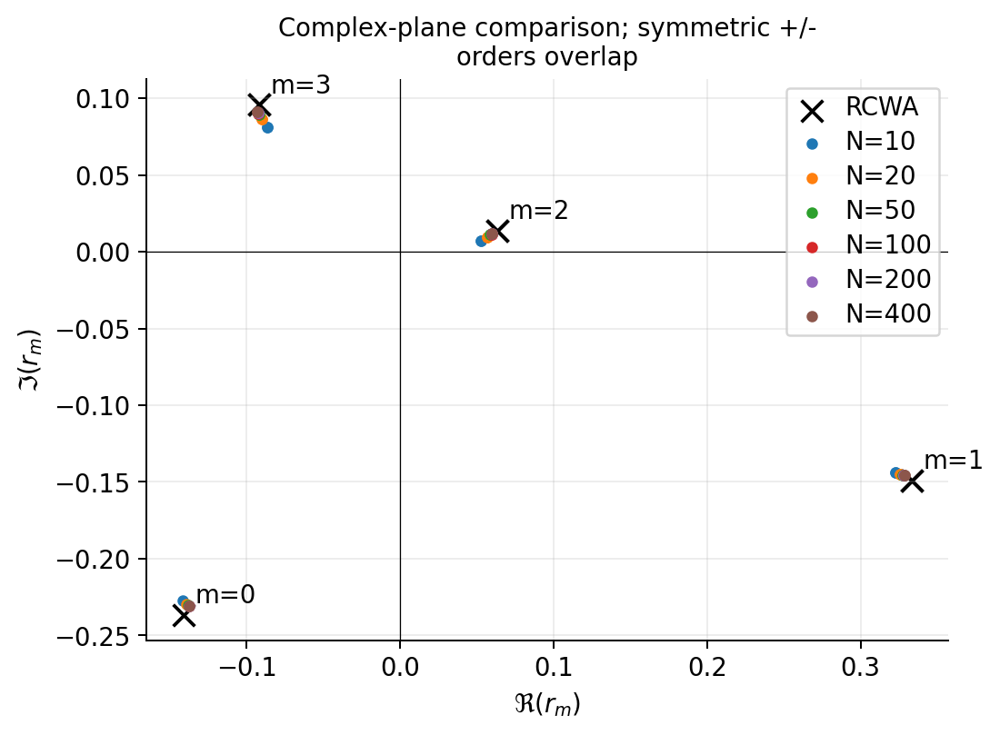

**图的结论：** FDTD 与 RCWA 在共同参考面和原点下可直接比较复数位置。正负级由镜像对称而重合；不同 N 的点接近固定目标，但固定网格仍有偏差。

## 最接近 RCWA 的实际求解工况

本次计算中整体复误差最小的是 **N050_dx10_dy5_t600**，不是外推到 $N=\infty$ 的估计。下表直接列其七个真实提取系数。

| m | FDTD 复系数 | 绝对复误差 | 相对复误差 | 相位误差 / ° |
| --- | --- | --- | --- | --- |
| -3 | -0.0912359 +0.0929379i | 0.0030416 | 2.2886% | +0.639777 |
| -2 | +0.0607558 +0.0126779i | 0.0027536 | 4.2538% | -0.615074 |
| -1 | +0.3310916 -0.1476661i | 0.0026464 | 0.7247% | +0.017114 |
| 0 | -0.1408498 -0.2347357i | 0.0018476 | 0.6707% | -0.142611 |
| 1 | +0.3310916 -0.1476661i | 0.0026465 | 0.7247% | +0.017125 |
| 2 | +0.0607559 +0.0126779i | 0.0027536 | 4.2538% | -0.615159 |
| 3 | -0.0912359 +0.0929379i | 0.0030416 | 2.2886% | +0.639769 |

这里的相对复误差是 $|\widehat r_m-r_m|/|r_m|$，并非仅比较模长。弱级的相对误差可能较大，不能以“总反射功率很接近”来替代逐级相位验证。所有工况的实部、虚部和各类误差都在 `analysis/all_extracted_orders.csv` 中。

**图的目的：** 把最终精度判断落到同一组真实 FDTD 系数的实部、虚部和相对复误差上。

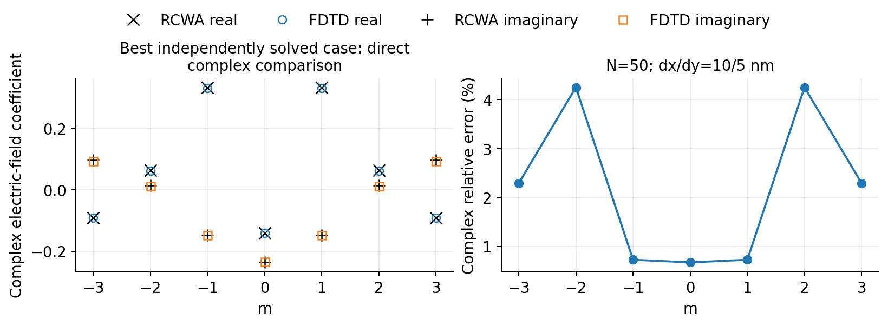

**图的结论：** 实部和虚部均可直接对照；弱二级的相对误差可比强一级更敏感。此图不使用额外拟合增益、Fresnel 缩放或相位调参。

# 到底何时积分：复振幅与功率的区别

## 不要直接积分某一级附近的复角谱来“收集振幅”

先考虑在参考面 $h=0$ 直接取矩形窗、只含一个衍射级的解析基准。设其有限窗角谱为 $A_m(q)=L E_{i,0}r_m\operatorname{sinc}[(q-q_m)L/2]$。在两个第一零点之间对复场无权积分：

其中正弦积分函数定义为 $\operatorname{Si}(s)=\int_0^s(\sin v/v)dv$。

$$\frac{1}{2\pi E_{i,0}}\int_{q_m-2\pi/L}^{q_m+2\pi/L}A_m(q)\,dq=\frac{2\operatorname{Si}(\pi)}{\pi}r_m.$$

数值为

$$\frac{2\operatorname{Si}(\pi)}{\pi}=1.178979744.$$

所以主瓣复场积分会比目标系数大约 17.90%，并不等于 $r_m$。这个因子与 N 无关。对整个孤立 sinc 进行有条件的有符号积分，正负旁瓣会相互抵消，但真实多级总场在有限角带内还包含邻级核、复相位和参考面传播。直接规定一个角带后积分，不会自动隔离出某一个无限周期系数。

需要用周围多个角谱点来抑制噪声时，可以拟合已知核。对一个孤立级，记 $A(q)=cW(q)$，则复数最小二乘估计为

$$\widehat c=\frac{\int W^*(q)A(q)dq}{\int |W(q)|^2dq}.$$

再除入射复场，并保持传播相位一致。多级重叠时需联合解 Gram 矩阵。这里积分之所以有效，是因为有匹配核和明确分母，而非因为“该级附近所有幅度相加就等于 RCWA”。本实验的最简提取不需要引入这一步。

## 要计算功率，就应积分带通量权重的模平方

完整均匀半空间中，向上传播的 TE 连续谱功率（每单位槽长）为

$$P_r=\frac{1}{4\pi Z_0}\int_{|q|<k_0}\frac{\beta(q)}{k_0}|A_L(q)|^2dq.$$

若以长度 L 上均匀入射的功率 $P_i=L|E_{i,0}|^2/(2Z_0)$ 归一化，则

$$\eta(B)=\frac{1}{2\pi L|E_{i,0}|^2}\int_B\frac{\beta(q)}{k_0}|A_L(q)|^2dq.$$

对完整出射谱，上式来自平面波展开和 Parseval 关系。实际先把监视线裁剪，再只由 E 场谱使用连续空间导纳时，它是**窗口化出射谱的功率估计**；不保证与同一段有限监视线直接计算的 Poynting 通量严格相等，因为空间裁剪与导纳算子不交换。本实验另外保存 E/H 直接通量进行核验。这里使用实测入射复平均进行归一化；若需要严格的总束效率，应以实际入射场的 Poynting 积分为分母，并说明与无限平面波效率的口径不同。

若横坐标改成角度，$q=k_0\sin\theta$，还须包含 Jacobian：

$$dq=k_0\cos\theta\,d\theta.$$

不能把等间隔角度数组上的 $|A|^2$ 直接求和，假装仍是等间隔 q 的积分。软件的远场强度、每单位立体角功率和本报告的平面角谱也需要先对齐定义。

## 主瓣只占多少功率

对孤立矩形窗 sinc，不含纵向通量权重的**标量谱能量**主瓣份额为

$$F_{\mathrm{main}}=\frac{\int_{-\pi}^{\pi}(\sin v/v)^2dv}{\int_{-\infty}^{\infty}(\sin v/v)^2dv}=0.902823333.$$

即约 90.2823%。剩余约 9.7177% 在旁瓣。电磁功率积分还包含 $\beta(q)/k_0$ 权重及传播锥截断；对远离掠射、足够窄的波瓣，该权重近似常数，才可把这个比例近似解释为功率份额。**当主瓣积分边界始终随 N 缩到第一零点时，N 再大也不会使标量谱能量比例变成 100%。** 增加 N 只把同一形状压窄。

与此不同，如果使用固定的邻级中点角带 $B_m=[q_m-G/2,q_m+G/2]$，该角带随着 N 增大包含越来越多旁瓣，孤立级的功率积分可趋于 RCWA 的 $\eta_m$。有限 N 下，总场的不同级窗谱还会相干重叠，角带功率是一个实用分区，并非对有限物理结构存在唯一严格的“无限周期级功率分解”。

**图的目的：** 用最简单的解析例子直接检验“需要对峰附近积分吗”。

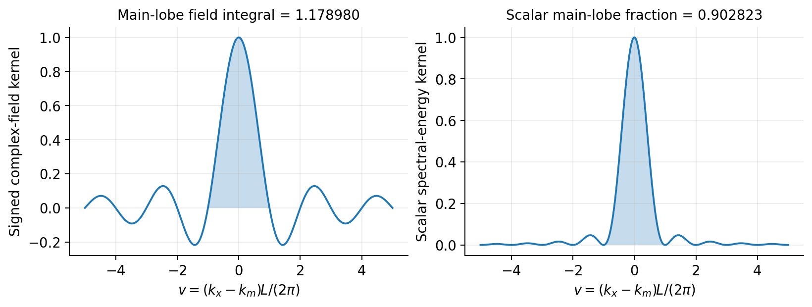

**图的结论：** 无权复场主瓣积分给 1.17898 倍系数；主瓣模平方积分给 0.902823 倍孤立 sinc 标量谱能量。窄瓣时后者近似对应电磁功率比例。两种积分都不是中心复系数提取公式。

**图的目的：** 在真实 Maxwell 结果中对比三种常被混用的量。

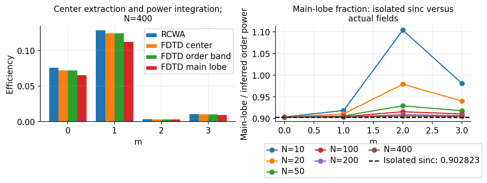

**图的结论：** 较宽的固定级间角带可包含更多旁瓣。N=10 时弱二级的主瓣角带功率甚至约为中心推得整级功率的 1.104 倍；这是总谱中强邻级尾部、端部和照明扰动参与叠加的结果，不能把每个角带当作唯一的孤立模式功率，再统一除以 90.28%。

# 参考场、参考面、网格和时间的核验

**图的目的：** 检验全 PML 平面波是否足够接近均匀照明，以及去传播相位是否正确。

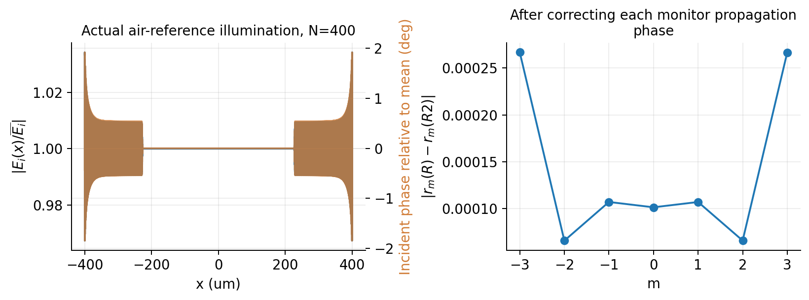

**图的结论：** 有限边界使入射场存在扰动；测量而非假设其复场是必要的。R 与 R2 在移到相同参考面后应接近，但有限窗口与数值色散仍可留下小差别。

如果直接用反射监视面处的入射复场 $E_i(d)=E_{i,0}e^{-ik_0d}$ 归一化，传播校正必须改为 $e^{-i(\beta_m+k_0)d}$。本实验是在 $h=0$ 测入射场，因此只乘 $e^{-i\beta_md}$。这两种写法都可以正确，但不能混用。

若以平坦 Si 反射作为背景相减，得到的是差分场 $\Delta r_m=r_m-r_F\delta_{m0}$，零级必须在共同参考面加回平坦反射。本实验的参考为空气，不存在这项加回；这里特别说明，是为了让复现者避免在参考仿真中悄悄更改所比较的量。

**图的目的：** 判断几百周期是否值得运行，并检验固定网格是否限制准确度。

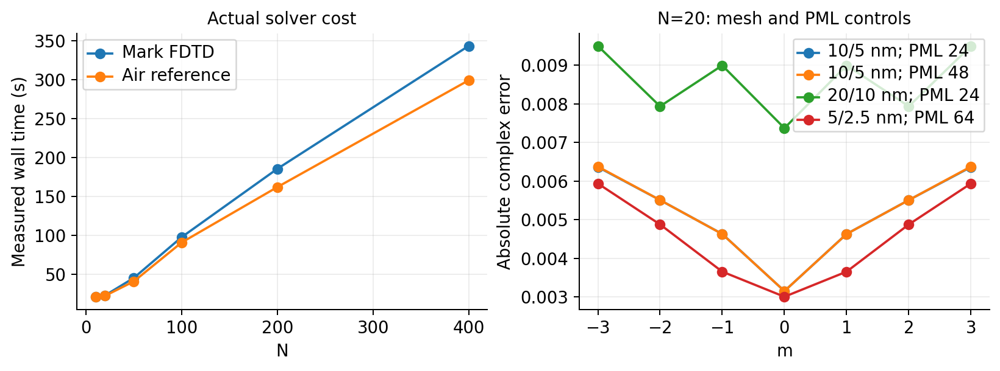

**图的结论：** 当前二维算例的周期数扩展可实际完成；粗细网格之间存在可见差别。长度收敛与网格收敛必须分开判断，不能把某一尺寸下的偶然符合宣称为普遍收敛。

表内工况名用空格分段，以便换行；原始文件名的分隔符为下划线。PML 栏为“实际层数 / 请求层数”。

| 工况（分段显示） | N | dx/dy nm | PML 实/设 | 上限 fs | Mark s | 空气 s | 复 L2 差 |
| --- | --- | --- | --- | --- | --- | --- | --- |
| N010 dx20 dy10 t600 | 10 | 20/10 | 24/24 | 600 | 21.07 | 21.09 | 5.4574% |
| N020 dx10 dy5 t600 | 20 | 10/5 | 24/24 | 600 | 52.56 | 45.21 | 2.2429% |
| N020 dx10 dy5 t600 pml48 | 20 | 10/5 | 48/48 | 600 | 64.76 | 55.35 | 2.2445% |
| N020 dx20 dy10 t600 | 20 | 20/10 | 24/24 | 600 | 22.82 | 22.28 | 3.6769% |
| N020 dx5 dy2.5 t600 | 20 | 5/2.5 | 64/96 | 600 | 312.90 | 254.85 | 1.9945% |
| N050 dx10 dy5 t600 | 50 | 10/5 | 48/48 | 600 | 224.01 | 197.75 | 1.1500% |
| N050 dx20 dy10 t600 | 50 | 20/10 | 24/24 | 600 | 45.26 | 40.78 | 2.7286% |
| N100 dx20 dy10 t600 | 100 | 20/10 | 24/24 | 600 | 97.63 | 90.77 | 2.4433% |
| N200 dx20 dy10 t1200 | 200 | 20/10 | 24/24 | 1200 | 190.54 | 306.41 | 2.3073% |
| N200 dx20 dy10 t1200 strictmark | 200 | 20/10 | 24/24 | 1200 | 435.46 | 0.00 | 2.3071% |
| N200 dx20 dy10 t600 | 200 | 20/10 | 24/24 | 600 | 185.40 | 161.93 | 2.3062% |
| N400 dx20 dy10 t600 | 400 | 20/10 | 24/24 | 600 | 343.26 | 299.12 | 2.2404% |

表中的求解时间是该次外部引擎调用的实际墙钟时间，包含引擎启动和许可初始化等开销；不是纯场更新内核时间。所列“最长时间”是最大允许仿真时间，达到自动关断条件时可能提前结束。实际停止时刻及关断记录在各工况求解记录中。达到某个自动关断阈值只是时间收敛证据之一，不能当作所有衍射级相位已达到同等相对精度的证明。

同一数值网格下的 E/H 和 R/R2 检查可以发现明显方向或相位错误，但不会消除共享的空间数值色散。增加周期数、加密网格、改变监视面和延长仿真时间分别检查不同的误差来源。

同一 N=20、10/5 nm 网格的 PML 厚度控制中，24 层增至 48 层的最大逐级复系数变化为 **0.00001203**。这是边界厚度的独立数值证据；它明显小于这里的主要网格变化，但不应自动外推成所有网格、所有 N 的严格 PML 误差界。

固定 N=20 时，20/10 nm → 10/5 nm 的最大复系数变化为 0.00514100，再到 5/2.5 nm 的变化为 0.00124584，约缩小 4.13 倍。这是网格加密趋势的直接证据；最细组边界厚度未完全匹配，且 N=20 的物理端部仍在，因此不据此宣称所有误差已达到严格二阶收敛。

## 主尺寸序列实际停止时间与关断值

以下是实际引擎记录，关断阈值为 $10^{-7}$。达到 600 fs 上限而最后关断值仍高于阈值的工况，明确保留为时间上限基准，不能称为已满足全域自动关断；后面的加时控制直接检查所需复系数是否已经稳定。

| N | 空气实际时间 / fs | Si 实际时间 / fs | 空气最后关断值 | Si 最后关断值 |
| --- | --- | --- | --- | --- |
| 10 | 108.19 | 179.79 | 3.81e-08 | 9.94e-08 |
| 20 | 176.81 | 185.76 | 3.5e-10 | 8.27e-08 |
| 50 | 376.68 | 373.70 | 1.05e-08 | 6.96e-08 |
| 100 | 600.01 | 558.65 | 2.81e-06 | 9.95e-08 |
| 200 | 600.01 | 600.01 | 1.43e-06 | 1.59e-07 |
| 400 | 600.01 | 600.01 | 7.23e-07 | 1.63e-07 |

## 大尺寸时间控制的实际结果

将 N=200、20/10 nm 网格的最长仿真时间从 600 fs 增至 1200 fs，保持源、PML 和其他设置一致，使用对应完整时长的空气参考和 Si 结构。七级复系数的最大绝对变化为 **0.00001375**，变化向量相对原系数的 L2 比为 **0.0032%**。对照原 600 fs 工况相对 RCWA 的最大绝对复差 **0.00679763**，这项检查定量说明时间截断影响与其余残差的关系。

N 较大时，全域自动关断可能受到长程近掠射边缘波限制。这里以实际提取系数的加时变化作为直接证据；它不等于已经证明所有更大尺寸、所有空间位置都达到相同时间精度。完整实际停止时间与最后关断值见 `fdtd/solver_manifest.csv`。

严格时间控制将 Si 结构的自动关断阈值收紧到 $10^{-12}$，使其真正延长计算，而不是仅增加一个很快提前关断的时间上限。空气参考复用先前已经实际跑满 1200 fs 的对应结果；收紧关断阈值不改变从未触发提前停止的那段 Maxwell 演化。没有重复运行或伪造第二组空气数据，引用关系写在 `AIR_REFERENCE.json` 中，耗时表中该项空气新增耗时记为 0。另保留原阈值 $10^{-7}$、结构在约 621 fs 提前停止的弱时间对照，避免把两者混称。

## 直接通量与角谱积分的额外核验

在相同裁剪窗口内直接使用 $\tfrac12\int\operatorname{Re}(E_zH_x^*)dx$，并保持相同入射归一化，得到以下独立对照。角谱列覆盖完整空气传播锥；七个级间中点角带只覆盖 $|q/G|\leq3.5$，两者另行保存，不能混称。

| N | E/H 直接反射通量 | 完整角谱通量估计 | 相对差 |
| --- | --- | --- | --- |
| 10 | 0.337668 | 0.335731 | -0.5738% |
| 20 | 0.342616 | 0.341837 | -0.2275% |
| 50 | 0.345570 | 0.345567 | -0.0011% |
| 100 | 0.346558 | 0.346819 | 0.0752% |
| 200 | 0.347051 | 0.347440 | 0.1121% |
| 400 | 0.347297 | 0.347751 | 0.1306% |

# 最后结论：直接回答原问题

**1. 如何由 FDTD 角谱得到 RCWA 的各级复振幅？** 保存复场，使用 $A_L(q)=\int E_r(x)e^{-iqx}dx$ 的约定；整数周期矩形窗 $L=N\Lambda$ 下，在精确 $q_m=m2\pi/\Lambda$ 取复数值，再按

$$\boxed{\widehat r_m=A_L(q_m;d)e^{-i\beta_md}/(L E_{i,0})}$$

归一化和移参考面。横向原点、偏振、电场分量和材料必须一致。

**2. 需要在该衍射级角谱范围内积分吗？** 恢复复系数时，最简方法不需要再作角谱无权积分。计算该角带承载的能量时，应积分带通量权重的 $|A|^2$。若希望利用多个复谱点估计系数，应使用已知窗口核的复数拟合或匹配投影，并显式处理核之间的重叠。

**3. 如果中心值吻合，旁边分布怎么办？** 保留它。那是有限窗口或有限阵列的角宽与旁瓣，属于同一个系数所控制的完整波包。峰中心用来标定系数，整条谱的模平方积分用来算功率，二者并不重复计算同一种量。仅积分第一主瓣会漏掉孤立 sinc 约 9.72% 的标量谱能量；窄瓣且远离掠射时对应同量级的功率份额。增加 N 并不会消除这个标量积分的固定比例。

**4. 多少周期够？** 没有对所有精度目标通用的最小数。对本例，若希望一级主瓣邻域中的零级尾部场约低于一级峰高 0.1%，解析保守判据要求 N 大于约 241.1，400 周期有余量。精确中心在理想整数周期条件下本来就无其他离散级的 sinc 串扰，10 个周期也满足数学正交。真实 FDTD 是否够长，最终看复系数随 N 的变化和独立数值控制，而非只看 sinc 峰宽。

**5. 本次实际结果支持到什么程度？** 已完成六组真实全 PML 有限尺寸序列与额外控制。最接近 RCWA 的实际工况 N050_dx10_dy5_t600，七级复向量相对差为 1.1500%，最大逐级绝对复差为 0.0030416。结果支持“正确归一化的级中心复角谱可以提取周期衍射复系数”的方法，同时明确保留有限长度与离散误差。没有把有限结构与无限周期结构说成在任意 N、任意边界和任意网格下严格相同。

# 文件、复现与来源

## 文件对应关系

| 文件 / 目录 | 用途 |
|---|---|
| `report/REPORT_zh.md` | 本报告全文，可在 GitHub 阅读数学公式与图片 |
| `report/REPORT_zh.pdf` | 教材排版 PDF，适合下载与打印 |
| `report/REPORT_zh.html` | 单文件离线阅读版，图片内嵌 |
| `fdtd/run_fdtd.py` | 全 PML、有限 N 周期 FDTD 构建、求解和导出 |
| `fdtd/cases/*/{air,mark}/model.fsp` | 实际模型；需要 Lumerical 许可打开 |
| `fdtd/cases/*/{air,mark}/model.lsf` | 可审阅的原生几何、源与边界脚本 |
| `fdtd/cases/*/{air,mark}/fields_*.npz` | 原始复 E/H、坐标与频率 |
| `fdtd/cases/*/{air,mark}/DONE.json` | 实际完成记录、参数与耗时 |
| `rcwa/run_rcwa.py` | 实际 RCWA 计算与原生输出导出 |
| `rcwa/reference_for_analysis.npz` | 统一参考面和横向原点后的复系数及原始系数 |
| `rcwa/*/native_datasets.mat` | 完整原生 RCWA 数据集 |
| `analyze.py` | 复角谱、直接级中心投影、功率积分、误差表与图 |
| `analysis/all_extracted_orders.csv` | 每个工况各传播级的复系数与误差 |
| `analysis/*_angular_spectrum.npz` | 连续复角谱及明确标记的有限窗 RCWA 对照 |
| `analysis/analytic_window_metrics.csv` | 解析 sinc 峰宽、尾部与积分比例 |
| `figures/` | 每张科学图的 PNG 和 SVG |

## 复现顺序

1. 在具备 Lumerical v252 许可的机器上运行 `rcwa/reproduce_reference.py`，依次完成材料提取、六组截断/采样、平坦界面、参考适配器与独立空间场投影核验。该目录 README 给出准确命令。
2. 按 `fdtd/` 的说明逐组运行平面波有限模型和空气参考。含非 ASCII 字符的路径在本环境通过指向同一目录的 ASCII junction 运行；换机器时应调整运行脚本中的安装位置与 ASCII 工作路径。
3. 运行 `python analyze.py`，从已完成的真实场重新生成数据表和图。
4. 运行 `python build_report.py`；PDF 需要 Pandoc 和 XeLaTeX。后处理所需常规 Python 依赖列在 `requirements.txt` 中。

这份交付不包含 Lumerical 软件或许可。复场数组和分析代码可在不打开商业求解器的情况下重新分析。

## 原始与官方来源

本报告的有限窗、正交、归一化和积分比例均由上述定义直接推导并通过解析计算核验。以下来源用于核查算法和软件接口的含义，不用它们替代本次真实仿真结果。

1. Moharam 等，*Formulation for stable and efficient implementation of the rigorous coupled-wave analysis of binary gratings*, JOSA A 12, 1068–1076 (1995)：[原始 RCWA 文献](https://opg.optica.org/josaa/abstract.cfm?uri=josaa-12-5-1068)。支持周期空间谐波展开与截断收敛背景。
2. Ansys，*Grating projections in FDTD overview*：[官方说明](https://optics.ansys.com/hc/en-us/articles/360034394354-Grating-projections-in-FDTD-overview)。区分衍射级功率和带偏振、相位的复场投影。
3. Ansys，*Understanding field truncation issues with finite sized plane wave sources*：[官方说明](https://optics.ansys.com/hc/en-us/articles/360034382874-Understanding-field-truncation-issues-with-finite-sized-plane-wave-sources)。说明有限平面波及横向 PML 会产生边缘衍射，中央场只能近似平面波。
4. Ansys，*Understanding the diffracting option of the plane wave source*：[官方说明](https://optics.ansys.com/hc/en-us/articles/360034382914-Understanding-the-diffracting-option-of-the-plane-wave-source)。解释源孔径与角谱展宽。本实验具体源类型以归档 LSF 为准，没有将软件的“diffracting”源选项与解析窗口等同。
5. Meep，*Diffraction Spectrum of a Finite Binary Grating*：[官方有限光栅教程](https://meep.readthedocs.io/en/latest/Python_Tutorials/Near_to_Far_Field_Spectra/#diffraction-spectrum-of-a-finite-binary-grating)。提供有限阵列与离散级比较的相关背景；本实验没有用 Meep 生成所报告的 Lumerical 数据。

报告中所有数据判断都应与原始复场和求解记录一起理解。解析窗的精确恒等式、有限物理光栅的近似、数值误差和本次实际结果已分别注明。
